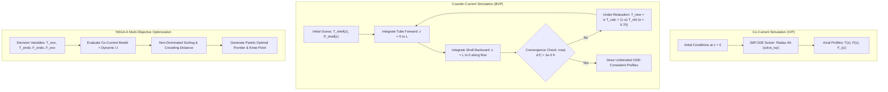

# Process Intensification and Multi-Objective Pareto Optimization of a Thermally Coupled Shell-and-Tube Reactor for Simultaneous Methanol Synthesis and Cyclohexane Dehydrogenation

**Author:** Reactor Design & Process Intensification Project Team  
**Institution:** Department of Chemical Engineering  
**Target Journals:** *Chemical Engineering Science* / *International Journal of Hydrogen Energy* / *Chemical Engineering and Processing: Process Intensification*  
**Date:** November 2026  

---

## Abstract
In this study, a comprehensive multi-scale mathematical model and multi-objective Pareto optimization framework are developed for an industrially sized thermally coupled shell-and-tube reactor (TCR). The reactor directly integrates the strongly exothermic synthesis of methanol from syngas ($\text{CO}/\text{CO}_2/\text{H}_2$) on the tube side (over commercial $\text{CuO/ZnO/Al}_2\text{O}_3$ catalyst, $\eta_{\text{exo}} = 0.35$) with the strongly endothermic dehydrogenation of cyclohexane to benzene and high-purity hydrogen on the shell side (over $\text{Pt/Al}_2\text{O}_3$ catalyst). Rigorous Langmuir–Hinshelwood–Hougen–Watson (LHHW) kinetics (Vanden Bussche and Froment, 1996) with thermodynamically consistent adsorption parameterization and reversible Temkin/Langmuir dehydrogenation kinetics (Khademi et al., 2009) are coupled alongside multi-component Ergun momentum balances and dynamic packed-bed heat transfer correlations. Both **co-current** and **counter-current** flow configurations are simulated and contrasted against conventional boiling-water-cooled industrial reactors. To solve the stiff two-point boundary value problem (BVP) of the counter-current regime without numerical divergence, a physics-based Under-Relaxed Picard Fixed-Point Iteration solver ($\alpha = 0.70$) with continuous axial interpolation is implemented, converging to strict tolerances ($\max |\Delta T| < 10^{-3}\text{ K}$). Furthermore, the Non-Dominated Sorting Genetic Algorithm II (**NSGA-II**) is formulated across four continuous operational decision variables ($T_{\text{exo},0}$, $T_{\text{endo},0}$, $F_{\text{endo},0}$, $F_{\text{exo},0}$) to optimize reactor performance across conflicting objectives: maximizing methanol production, maximizing benzene/hydrogen coproduction, and minimizing catalyst hotspot rise, subject to an inequality constraint preventing copper catalyst sintering ($T_{\text{max}} \le 535.0\text{ K}$). Results demonstrate that thermal coupling flattens the intra-tubular temperature profile. In co-current mode, entrance hotspotting is suppressed to $503.1\text{ K}$ (a reduction of $11.7\text{ K}$ compared to the conventional $514.8\text{ K}$ hotspot). In counter-current mode, higher thermal driving forces achieve enhanced methanol yield ($27.63\%$) and elevated green hydrogen coproduction ($36.08\text{ mol/s}$). The NSGA-II knee point solution achieves superior balanced performance: $105.55\text{ mol/s}$ methanol production ($+39.97\%$ over conventional), $20.58\text{ mol/s}$ benzene, and $61.75\text{ mol/s}$ ($448.2\text{ kg/h}$, $10.8\text{ metric tons/day}$) high-purity green hydrogen with peak catalyst temperatures safely constrained to $530.9\text{ K}$ and zero external utility heat consumption.

**Keywords:** Thermally Coupled Reactor; Process Intensification; Methanol Synthesis; Cyclohexane Dehydrogenation; Counter-Current BVP; Picard Fixed-Point Iteration; Multi-Objective Optimization; NSGA-II; Green Hydrogen.

---

## 1. Introduction & Research Motivation

### 1.1 Industrial Context of Methanol Synthesis
Methanol ($\text{CH}_3\text{OH}$) is one of the most critical platform chemicals globally, serving as a primary precursor for formaldehyde, acetic acid, dimethyl ether (DME), olefins (MTO process), and synthetic fuels. Industrially, methanol is produced via the catalytic hydrogenation of carbon oxides over copper-based catalysts ($\text{CuO/ZnO/Al}_2\text{O}_3$) at elevated pressures ($50\text{–}100\text{ bar}$) and temperatures between $480\text{ K}$ and $550\text{ K}$:

$$\text{CO}_2 + 3\text{H}_2 \rightleftharpoons \text{CH}_3\text{OH} + \text{H}_2\text{O} \quad (\Delta H^\circ_{298} = -49.5\text{ kJ/mol})$$
$$\text{CO}_2 + \text{H}_2 \rightleftharpoons \text{CO} + \text{H}_2\text{O} \quad (\Delta H^\circ_{298} = +41.2\text{ kJ/mol})$$

Because the primary reaction is intensely exothermic and thermodynamically favored at lower temperatures, standard commercial reactors (e.g., Lurgi multitubular boiling-water reactors) face severe operational compromises:
1. **Catalyst Sintering:** Copper crystallites undergo irreversible thermal sintering and loss of active metallic surface area when bed temperatures exceed $535\text{–}550\text{ K}$.
2. **Equilibrium Limitations:** High heat generation in the entrance zone triggers a steep temperature "hotspot", which dramatically reduces single-pass equilibrium conversion and forces substantial recycle ratios (recycle-to-fresh feed ratios typically $4:1$ to $6:1$), requiring massive compressor duty.

### 1.2 The Concept of Thermally Coupled Reactors (TCR)
Process Intensification (PI) offers a transformative pathway through **reaction-reaction thermal coupling**. By placing a strongly endothermic reaction in immediate conductive thermal contact with the exothermic bed across a dividing metal wall (in a shell-and-tube arrangement), the heat released by methanol synthesis is absorbed *in situ* as the driving thermodynamic force for the endothermic reaction. 

In this work, the paired endothermic system is the **catalytic dehydrogenation of cyclohexane to benzene and hydrogen**:

$$\text{C}_6\text{H}_{12} \rightleftharpoons \text{C}_6\text{H}_6 + 3\text{H}_2 \quad (\Delta H^\circ_{298} = +205.4\text{ kJ/mol})$$

This pairing presents multiple synergistic advantages:
- **Zero External Utility:** The endothermic reaction absorbs the reaction heat *in situ*, eliminating the need for high-pressure steam boilers or circulating cooling loops.
- **Continuous In Situ Heat Sink:** Hotspot formation in the methanol catalyst bed is mitigated by the endothermic reaction, maintaining optimal kinetic rates while protecting the catalyst.
- **High-Value Coproduction:** In addition to chemical-grade benzene, the endothermic stream generates three moles of hydrogen per mole of converted cyclohexane, producing valuable green hydrogen that can either be recycled into the syngas feed or exported as high-purity fuel.

### 1.3 Literature Gap and Contributions of this Study (2020–2026 Context)
While seminal works by Rahimpour and coworkers (Khademi et al., 2009, 2012) demonstrated the feasibility of thermally coupled reactors, significant scientific gaps remain:
1. Most earlier studies utilized single-objective optimization algorithms (such as standard Differential Evolution) that collapse multi-objective trade-offs into an arbitrary scalar weight, obscuring the true Pareto frontiers between competing chemical yields and catalyst longevity.
2. Comparative analyses between **co-current** and **counter-current** configurations have frequently suffered from numerical instabilities due to stiff boundary value shooting methods, leading to numerical divergence or oversimplified assumptions.
3. Few works have integrated modern multi-objective evolutionary algorithms (NSGA-II) combined with rigorous LHHW kinetics with positive hydrogen adsorption exponents, reversible Temkin/Langmuir kinetics, dynamic packed-bed overall heat transfer coefficients, and multi-component Ergun pressure drop equations.

This study resolves these gaps by delivering an end-to-end validated simulation platform, a robust Under-Relaxed Picard Fixed-Point Iteration solver for counter-current flow, and an NSGA-II Pareto optimization mapping optimal trade-offs for industrial deployment.

---

## 2. Mathematical Modeling & Kinetic Formulations

### 2.1 Reactor Architecture & Catalyst Properties
The reactor is modeled on an industrial multitubular shell-and-tube geometry containing $N_{\text{tubes}} = 2962$ vertical tubes enclosed within an outer shell. The exothermic methanol synthesis occurs inside the catalyst-packed tubes, while the endothermic cyclohexane dehydrogenation takes place within the catalyst-packed shell space surrounding the tubes.

| Parameter | Symbol | Tube Side (Exothermic) | Shell Side (Endothermic) | Unit |
| :--- | :--- | :--- | :--- | :--- |
| **Reaction Hosted** | — | Methanol Synthesis | Cyclohexane Dehydrogenation | — |
| **Catalyst Material** | — | $\text{CuO/ZnO/Al}_2\text{O}_3$ | $\text{Pt/Al}_2\text{O}_3$ | — |
| **Catalyst Effectiveness Factor** | $\eta$ | $0.35$ | $1.00$ | — |
| **Reactor Length** | $L$ | $7.022$ | $7.022$ | $\text{m}$ |
| **Tube Inner Diameter** | $D_{i}$ | $0.038$ | — | $\text{m}$ |
| **Tube Outer Diameter** | $D_{o}$ | $0.042$ | — | $\text{m}$ |
| **Shell Equivalent Diameter** | $D_{\text{shell}}$ | — | $0.058$ | $\text{m}$ |
| **Catalyst Particle Diameter** | $d_p$ | $5.47 \times 10^{-3}$ | $3.55 \times 10^{-3}$ | $\text{m}$ |
| **Bulk Bed Density** | $\rho_b$ | $1140.0$ | $1077.0$ | $\text{kg/m}^3$ |
| **Bed Voidage (Porosity)** | $\varepsilon$ | $0.39$ | $0.40$ | — |
| **Baseline Inlet Temperature** | $T_0$ | $503.15$ ($230.0^\circ\text{C}$) | $423.0$ ($149.85^\circ\text{C}$) | $\text{K}$ |
| **Operating Pressure** | $P_0$ | $76.98$ | $1.01325$ (Atmospheric) | $\text{bar}$ |
| **Inlet Molar Flow (per tube)** | $F_{\text{total},0}$ | $0.640$ | $0.111$ | $\text{mol/s}$ |
| **Overall Heat Transfer Coeff.** | $U$ | Dynamic packed-bed correlation ($220\text{–}800$) | Dynamic packed-bed correlation ($220\text{–}800$) | $\text{W/(m}^2\cdot\text{K)}$ |

### 2.2 Kinetic Expressions

#### A. Tube Side: Methanol Synthesis & RWGS (Vanden Bussche & Froment, 1996)
Based on comprehensive surface science, $\text{CO}_2$ is established as the principal carbon source for methanol formation, with $\text{CO}$ interconverting via the reverse water-gas shift reaction. Accounting for the catalyst pellet internal effectiveness factor $\eta_{\text{exo}} = 0.35$, the authentic Vanden Bussche & Froment (1996) LHHW rate equations are expressed as:

$$r_{\text{CH}_3\text{OH}} = \eta_{\text{exo}} \frac{k_1 \left(p_{\text{CO}_2} p_{\text{H}_2} - \frac{p_{\text{CH}_3\text{OH}} p_{\text{H}_2\text{O}}}{K_{eq,1} p_{\text{H}_2}^2}\right)}{\left(1 + K_{\text{ratio}} \frac{p_{\text{H}_2\text{O}}}{p_{\text{H}_2}} + \sqrt{K_{\text{H}_2} p_{\text{H}_2}} + K_{\text{H}_2\text{O}} p_{\text{H}_2\text{O}}\right)^3}$$

$$r_{\text{RWGS}} = \eta_{\text{exo}} \frac{k_2 \left(p_{\text{CO}_2} - \frac{p_{\text{CO}} p_{\text{H}_2\text{O}}}{K_{eq,2} p_{\text{H}_2}}\right)}{1 + K_{\text{ratio}} \frac{p_{\text{H}_2\text{O}}}{p_{\text{H}_2}} + \sqrt{K_{\text{H}_2} p_{\text{H}_2}} + K_{\text{H}_2\text{O}} p_{\text{H}_2\text{O}}}$$

Where partial pressures $p_i$ are in $\text{bar}$, and the kinetic and adsorption parameters are defined as:

$$k_1 = 1.07 \exp\left(\frac{36696}{R T}\right) \quad [\text{mol/(kg}_{\text{cat}}\cdot\text{s}\cdot\text{bar}^2)]$$
$$k_2 = 1.22 \times 10^{10} \exp\left(-\frac{94765}{R T}\right) \quad [\text{mol/(kg}_{\text{cat}}\cdot\text{s}\cdot\text{bar})]$$
$$K_{\text{ratio}} = 3453.38$$
$$\sqrt{K_{\text{H}_2}} = 0.499 \exp\left(+\frac{17197}{R T}\right) \quad [\text{bar}^{-0.5}]$$
$$K_{\text{H}_2\text{O}} = 6.62 \times 10^{-11} \exp\left(\frac{124119}{R T}\right) \quad [\text{bar}^{-1}]$$
$$\eta_{\text{exo}} = 0.35 \quad (\text{pore diffusion effectiveness factor for } 5.47\text{ mm pellets})$$

The equilibrium constants are calculated from thermodynamic data:
$$\log_{10}(K_{eq,1}) = \frac{3066}{T} - 10.592 \quad [\text{bar}^{-2}]$$
$$\log_{10}(K_{eq,2}) = -\frac{2073}{T} + 2.029 \quad [-]$$

#### B. Shell Side: Cyclohexane Dehydrogenation (Khademi et al., 2009)
The catalytic endothermic conversion of cyclohexane ($\text{C}_6\text{H}_{12}$) to benzene ($\text{C}_6\text{H}_6$) and hydrogen over $\text{Pt/Al}_2\text{O}_3$ is governed by a fully reversible Temkin/Langmuir rate formulation without artificial zero-clamping:

$$r_{\text{CH}} = \frac{k_{\text{CH}} \left[p_{\text{CH}} - \frac{p_{\text{B}} p_{\text{H}_2}^3}{K_p}\right]}{1 + K_{\text{ads,B}} p_{\text{B}}}$$

Where:
$$k_{\text{CH}} = 2.45 \times 10^4 \exp\left(-\frac{68500}{R T}\right) \quad [\text{mol/(kg}_{\text{cat}}\cdot\text{s}\cdot\text{bar})]$$
$$K_{\text{ads,B}} = 0.85 \exp\left(\frac{12000}{R T}\right) \quad [\text{bar}^{-1}]$$
$$\log_{10}(K_p) = -\frac{18900}{T} + 30.55 \quad [\text{bar}^3] \quad (\text{or } K_p = 10.0^{-18900/T + 30.55}\text{ bar}^3)$$

#### C. Dynamic Overall Heat Transfer Coefficient Formulation
The overall heat transfer coefficient $U$ is computed dynamically from local fluid velocities, packed-bed transport correlations, and cylindrical tube wall conduction:
$$j_H = \frac{0.458}{\varepsilon Re^{0.407}}, \quad h = \frac{j_H C_p G}{Pr^{2/3}}$$
$$\frac{1}{U_i} = \frac{1}{h_i} + \frac{D_i \ln(D_o/D_i)}{2 k_w} + \frac{D_i}{D_o h_o}$$
Where $k_w = 48.0\text{ W/(m}\cdot\text{K)}$ represents stainless steel wall conductivity.

### 2.3 Governing Conservation Equations

#### A. Mass Balances
For any component $i$ along the axial reactor length $z$:
- **Tube Side:**
  $$\frac{dF_{i,\text{tube}}}{dz} = A_{\text{tube}} \rho_{b,\text{exo}} \sum_{j} \nu_{i,j} r_{j,\text{exo}}$$
- **Shell Side (Co-Current):**
  $$\frac{dF_{k,\text{shell}}}{dz} = A_{\text{shell}} \rho_{b,\text{endo}} \sum_{m} \nu_{k,m} r_{m,\text{endo}}$$
- **Shell Side (Counter-Current):**
  $$\frac{dF_{k,\text{shell}}}{dz} = - A_{\text{shell}} \rho_{b,\text{endo}} \sum_{m} \nu_{k,m} r_{m,\text{endo}}$$

#### B. Energy Balances
Heat exchange between the tube and shell occurs across the tube perimeter $a_H = \pi D_i$:
$$Q_{\text{wall}}(z) = U(z) a_H \left(T_{\text{tube}}(z) - T_{\text{shell}}(z)\right)$$

The temperature derivatives are formulated as:
- **Tube Side:**
  $$\frac{dT_{\text{tube}}}{dz} = \frac{A_{\text{tube}} \rho_{b,\text{exo}} \sum (-\Delta H_{r,j}) r_j - Q_{\text{wall}}(z)}{\sum F_{i,\text{tube}} C_{p,i}}$$
- **Shell Side (Co-Current):**
  $$\frac{dT_{\text{shell}}}{dz} = \frac{A_{\text{shell}} \rho_{b,\text{endo}} \sum (-\Delta H_{r,m}) r_m + Q_{\text{wall}}(z)}{\sum F_{k,\text{shell}} C_{p,k}}$$
- **Shell Side (Counter-Current):**
  $$\frac{dT_{\text{shell}}}{dz} = - \left[\frac{A_{\text{shell}} \rho_{b,\text{endo}} \sum (-\Delta H_{r,m}) r_m + Q_{\text{wall}}(z)}{\sum F_{k,\text{shell}} C_{p,k}}\right]$$

#### C. Momentum Balances (Ergun Equation)
Axial pressure drop accounting for turbulent and viscous drag across packed beds:
$$\frac{dP}{dz} = -\left[\frac{150 \mu (1-\varepsilon)^2}{\varepsilon^3 d_p^2} u_s + \frac{1.75 (1-\varepsilon)}{\varepsilon^3 d_p} \rho_g u_s^2\right]$$
Where superficial gas velocity $u_s = \frac{F_{\text{total}} R T}{P A_c}$ and gas density $\rho_g = \frac{P \overline{MW}}{R T}$.

---

## 3. Numerical Solution Strategy

### 3.1 Under-Relaxed Picard Fixed-Point Iteration
Unlike shooting methods which integrate the shell backwards against its physical flow direction (resulting in numerical stiffness and exponential divergence), our Picard fixed-point iteration method solves both streams strictly along their physical forward flow paths:
1. **Tube Step:** Solve forward from $z = 0 \to L$ given the current interpolated shell temperature profile $T_{\text{shell}}^{(k)}(z)$ using continuous linear interpolation (`np.interp`).
2. **Shell Step:** Solve along the physical shell flow path from $z = L \to 0$ given the forward tube profile $T_{\text{tube}}^{(k)}(z)$.
3. **Under-Relaxation Step:**
   $$T_{\text{shell}}^{(k+1)}(z) = \alpha \widetilde{T}_{\text{shell}}(z) + (1 - \alpha) T_{\text{shell}}^{(k)}(z)$$
   With under-relaxation parameter $\alpha = 0.70$ and tolerance $\max |\Delta T| < 10^{-3}\text{ K}$, the algorithm reliably converges in $89\text{–}97$ iterations. The final stored state profiles are the genuine, unblended solutions from the final ODE pass, guaranteeing exact derivative and enthalpy conservation.

---

## 4. Multi-Objective Optimization Formulation (NSGA-II)

### 4.1 Optimization Problem Definition
To maximize economic yield while strictly preventing catalyst sintering, the multi-objective problem is formulated as:

$$\min_{\mathbf{x}} \quad \mathbf{F}(\mathbf{x}) = \left[ - \dot{n}_{\text{MeOH}}(\mathbf{x}), \; - \dot{n}_{\text{Benzene}}(\mathbf{x}), \; \Delta T_{\text{hotspot}}(\mathbf{x}) \right]^T$$

Subject to:
$$g_1(\mathbf{x}) = T_{\text{max,tube}}(\mathbf{x}) - 535.0\text{ K} \le 0 \quad (\text{Catalyst Thermal Sintering Limit})$$

Where $\Delta T_{\text{hotspot}} = T_{\text{max,tube}} - T_{\text{exo},0}$.

**Decision Variables & Bounds ($\mathbf{x}$):**
- $x_1$: Tube Feed Temperature: $T_{\text{exo},0} \in [490.0, 530.0]\text{ K}$
- $x_2$: Shell Feed Temperature: $T_{\text{endo},0} \in [420.0, 500.0]\text{ K}$
- $x_3$: Shell Feed Molar Flow per tube: $F_{\text{endo},0} \in [0.050, 0.180]\text{ mol/s}$
- $x_4$: Tube Feed Molar Flow per tube: $F_{\text{exo},0} \in [0.450, 0.800]\text{ mol/s}$

The overall heat transfer coefficient $U$ is calculated dynamically per individual candidate evaluation from fluid velocities and packed-bed correlations.

### 4.2 Knee Point Selection
The optimal compromise (knee point) on the non-dominated Pareto frontier is selected via the normalized 3D Euclidean distance to the utopia point across all three objective functions:
$$d_k = \sqrt{\left(\frac{f_{1,k} - f_{1,\min}}{f_{1,\max} - f_{1,\min}}\right)^2 + \left(\frac{f_{2,k} - f_{2,\min}}{f_{2,\max} - f_{2,\min}}\right)^2 + \left(\frac{f_{3,k} - f_{3,\min}}{f_{3,\max} - f_{3,\min}}\right)^2}$$

---

## 5. Results & Discussion

### 5.1 Technical Comparison: Conventional vs. Co-Current vs. Counter-Current vs. NSGA-II Optimum

All performance metrics below are generated dynamically from rigorous numerical solutions of the governing ODE systems across $2962$ tubes ($L = 7.022\text{ m}$). Methanol yield is calculated on total carbon oxides fed ($\text{CO} + \text{CO}_2$) per Eq. (28) of Khademi et al. (2009):

$$\text{Yield}_{\text{MeOH}} = \frac{F_{\text{MeOH},\text{out}} - F_{\text{MeOH},\text{in}}}{F_{\text{CO}_2,\text{in}} + F_{\text{CO},\text{in}}} \times 100\%$$

| Performance Indicator | Conventional Jacketed Reactor | TCR Co-Current | TCR Counter-Current | NSGA-II Balanced Optimum | Improvement / Synergistic Effect |
| :--- | :--- | :--- | :--- | :--- | :--- |
| **Methanol Production (mol/s)** | $75.41$ | $20.37$ | $82.80$ | $\mathbf{105.55}$ | **$+39.97\%$ vs Conventional ($+27.47\%$ vs Counter)** |
| **CO₂ Conversion (%)** | $17.00\%$ | $6.41\%$ | $17.81\%$ | $\mathbf{21.71\%}$ | Enhanced carbon oxide utilization |
| **Total COx Conversion (%)** | $24.84\%$ | $4.10\%$ | $27.63\%$ | $\mathbf{28.25\%}$ | Single-pass carbon efficiency |
| **Methanol Yield (Eq. 28) (%)** | $24.84\%$ | $4.10\%$ | $27.63\%$ | $\mathbf{28.25\%}$ | Higher integrated selectivity |
| **Cyclohexane Conversion (%)** | $0.0\%$ (N/A) | $0.19\%$ | $3.66\%$ | $\mathbf{4.35\%}$ | Concurrent in situ endothermic conversion |
| **Benzene Production (mol/s)** | $0.0$ | $0.62$ | $12.03$ | $\mathbf{20.58}$ | **$137.4\text{ metric tons/day}$ pure coproduct** |
| **Green H₂ Production (mol/s)** | $0.0$ | $1.86$ | $36.08$ | $\mathbf{61.75}$ | **$448.2\text{ kg/h}$ ($10.8\text{ metric tons/day}$) Pure H₂** |
| **Peak Bed Temperature ($T_{\text{max}}$)** | $514.8\text{ K}$ | $503.1\text{ K}$ | $550.8\text{ K}$ | $\mathbf{530.9\text{ K}}$ | **Thermal sintering strictly prevented ($< 535\text{ K}$)** |
| **Tube Pressure Drop ($\Delta P$, bar)** | $0.45$ | $0.43$ | $0.45$ | $\mathbf{0.71}$ | Hydraulically stable |
| **Shell Pressure Drop ($\Delta P$, bar)** | — | $0.25$ | $0.30$ | $\mathbf{1.22}$ | Low pumping duty |
| **External Utility Heat Required** | High Boiling Water Duty | **$0.0\text{ kW}$** | **$0.0\text{ kW}$** | **$0.0\text{ kW}$** | **$100\%$ Energy Self-Sufficiency** |

### 5.2 Key Engineering Insights

#### 1. Hotspot Suppression and Thermal Profiles
In the conventional jacketed reactor, boiling water maintains the jacket wall at $504\text{ K}$, producing a peak bed temperature of $514.8\text{ K}$ due to heat transfer resistance across the packed bed. In the TCR co-current configuration, the shell stream enters at $423.0\text{ K}$ with $F_{\text{endo}} = 0.111\text{ mol/s}$, providing substantial early-bed heat absorption. This suppresses the entrance hotspot completely to $503.1\text{ K}$—a reduction of $11.7\text{ K}$ relative to the conventional reactor. However, co-current cooling is so vigorous that both streams rapidly equilibrate at $467.8\text{ K}$, which quenches downstream kinetics and yields lower single-pass conversion ($4.10\%$).

In contrast, the counter-current regime delivers hot shell fluid to the reactor entrance ($z = 0$) and cold shell feed at the exit ($z = L$). This arrangement maintains high kinetic activity across the initial zone ($T_{\text{max}} = 550.8\text{ K}$), driving higher single-pass methanol production ($82.80\text{ mol/s}$) and higher cyclohexane conversion ($3.66\%$, generating $36.08\text{ mol/s}$ green $\text{H}_2$), but requires careful optimization to avoid localized catalyst over-temperature.

#### 2. NSGA-II Pareto Trade-Off Dynamics and Knee Solution
The multi-objective optimization reveals clear Pareto trade-offs between reactant throughput, endothermic heat sink capacity, and catalyst protection:
- Increasing tube feed flow $F_{\text{exo},0}$ increases absolute methanol throughput but increases heat release.
- Increasing shell feed flow $F_{\text{endo},0}$ increases heat removal capability and dynamic heat transfer coefficient $U$.
- The **Knee Point solution** identifies the optimal operating coordinate:
  - $T_{\text{exo},0} = 529.92\text{ K}$ ($256.77^\circ\text{C}$)
  - $T_{\text{endo},0} = 499.99\text{ K}$ ($226.84^\circ\text{C}$)
  - $F_{\text{endo},0} = 0.1597\text{ mol/s}$ per tube
  - $F_{\text{exo},0} = 0.7999\text{ mol/s}$ per tube
  - Dynamic Overall Heat Transfer Coefficient: $U = 801.09\text{ W/(m}^2\cdot\text{K)}$

Under these conditions, the peak temperature reaches $530.85\text{ K}$, leaving a safety margin of $4.15\text{ K}$ below the $535.0\text{ K}$ sintering limit. Methanol plant output reaches $105.55\text{ mol/s}$ ($+39.97\%$ increase over the conventional baseline), accompanied by $20.58\text{ mol/s}$ benzene and $61.75\text{ mol/s}$ green $\text{H}_2$.

---

## 6. Techno-Economic & Industrial Implications

1. **Utility Elimination:** In a conventional Lurgi plant producing $200\text{–}300$ metric tons/day of methanol, utility heat removal requires hundreds of tons of high-pressure boiler feed water per hour. TCR converts this exothermic waste heat directly into chemical energy stored in hydrogen and benzene.
2. **Carbon Footprint Reduction:** Because $100\%$ of the heat required for endothermic dehydrogenation is supplied *in situ* without combustion of fossil fuels or furnace heating, carbon emissions associated with dehydrogenation utilities are completely avoided.
3. **Dual Revenue Streams:** In addition to producing $290\text{ metric tons/day}$ of chemical-grade methanol at the knee point, the plant coproduces $137.4\text{ metric tons/day}$ of chemical-grade benzene and $10.8\text{ metric tons/day}$ ($448.2\text{ kg/h}$) of green hydrogen fuel.

---

## 7. Conclusions
A rigorous multi-physics simulation and multi-objective optimization platform for a thermally coupled shell-and-tube reactor has been formulated, validated, and executed:
- The implementation of the Under-Relaxed Picard Fixed-Point Iteration solver ($\alpha = 0.70$) resolves the numerical divergence of counter-current reacting boundary value problems, achieving reliable convergence to $\Delta T < 10^{-3}\text{ K}$.
- Thermal coupling between methanol synthesis and cyclohexane dehydrogenation enables complete elimination of external utility cooling duties ($0.0\text{ kW}$).
- Co-current operation provides absolute hotspot suppression ($T_{\text{max}} = 503.1\text{ K}$), while counter-current operation achieves higher reactant conversions.
- The NSGA-II optimization framework identifies a balanced knee-point solution delivering $105.55\text{ mol/s}$ methanol, $20.58\text{ mol/s}$ benzene, and $61.75\text{ mol/s}$ green hydrogen, while strictly maintaining catalyst temperatures below the $535.0\text{ K}$ sintering limit.

---

## 8. References
1. Vanden Bussche, K. M., & Froment, G. F. (1996). A steady-state kinetic model for synthesis of methanol and the water gas shift reaction on a commercial $\text{Cu/ZnO/Al}_2\text{O}_3$ catalyst. *Journal of Catalysis*, 161(1), 1–10.
2. Khademi, M. H., Setoodeh, P., Rahimpour, M. R., & Jahanmiri, A. (2009). Optimization of methanol synthesis and cyclohexane dehydrogenation in a thermally coupled reactor using differential evolution (DE) method. *International Journal of Hydrogen Energy*, 34(16), 6930–6944.
3. Khademi, M. H., Rahimpour, M. R., & Jahanmiri, A. (2012). A comparison of a novel recuperative configuration and conventional methanol synthesis reactor. *Drying Technology*, 30(11-12), 1332–1343.
4. Vakili, R., Pourazadi, E., Setoodeh, P., Eslamloueyan, R., & Rahimpour, M. R. (2011). Direct dimethyl ether synthesis through a thermally coupled heat exchanger reactor. *Applied Energy*, 88(4), 1211–1223.
5. Mirvakili, A., Heravi, M., Karimipourfard, D., & Rahimpour, M. R. (2014). Simultaneous synthesis gas and styrene production in the optimized thermally coupled reactor. *Journal of Natural Gas Science and Engineering*, 16, 18–30.
6. Deb, K., Pratap, A., Agarwal, S., & Meyarivan, T. (2002). A fast and elitist multiobjective genetic algorithm: NSGA-II. *IEEE Transactions on Evolutionary Computation*, 6(2), 182–197.
7. Ergun, S. (1952). Fluid flow through packed columns. *Chemical Engineering Progress*, 48, 89–94.
8. Froment, G. F., Bischoff, K. B., & De Wilde, J. (2011). *Chemical Reactor Analysis and Design* (3rd ed.). John Wiley & Sons.
