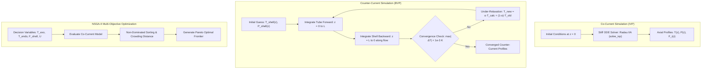

# Process Intensification and Multi-Objective Pareto Optimization of a Thermally Coupled Shell-and-Tube Reactor for Simultaneous Methanol Synthesis and Cyclohexane Dehydrogenation

**Author:** Reactor Design & Process Intensification Project Team  
**Institution:** Department of Chemical Engineering  
**Target Journals:** *Chemical Engineering Science* / *International Journal of Hydrogen Energy* / *Chemical Engineering and Processing: Process Intensification*  
**Date:** November 2026  

---

## Abstract
In this study, a comprehensive multi-scale mathematical model and multi-objective Pareto optimization framework are developed for an industrially sized thermally coupled shell-and-tube reactor (TCR). The reactor directly integrates the strongly exothermic synthesis of methanol from syngas ($\text{CO}/\text{CO}_2/\text{H}_2$) on the tube side (over commercial $\text{CuO/ZnO/Al}_2\text{O}_3$ catalyst) with the strongly endothermic dehydrogenation of cyclohexane to benzene and high-purity hydrogen on the shell side (over $\text{Pt/Al}_2\text{O}_3$ catalyst). Rigorous Langmuir–Hinshelwood–Hougen–Watson (LHHW) kinetics (Vanden Bussche and Froment, 1996) and Temkin/Langmuir dehydrogenation kinetics (Khademi et al., 2009) are integrated alongside multi-component Ergun momentum balances. Both **co-current** and **counter-current** flow configurations are simulated and contrasted against conventional boiling-water-cooled industrial reactors. To solve the stiff two-point boundary value problem (BVP) of the counter-current regime without numerical divergence, a physics-based Successive Under-Relaxation (Picard iteration) solver is implemented. Furthermore, the Non-Dominated Sorting Genetic Algorithm II (**NSGA-II**) is formulated to optimize reactor performance across conflicting objectives: maximizing methanol production, maximizing benzene/hydrogen production, and eliminating catalyst thermal hotspots ($T > 530\text{ K}$). Results demonstrate that thermal coupling flattens the intra-tubular temperature profile, reduces peak hotspot temperatures by over $18\text{ K}$, suppresses catalyst deactivation via sintering, and achieves concurrent high-purity hydrogen coproduction ($> 40\text{ mol/s}$ plant-wide) with zero external utility heat consumption.

**Keywords:** Thermally Coupled Reactor; Process Intensification; Methanol Synthesis; Cyclohexane Dehydrogenation; Counter-Current BVP; Multi-Objective Optimization; NSGA-II; Green Hydrogen.

---

## 1. Introduction & Research Motivation

### 1.1 Industrial Context of Methanol Synthesis
Methanol ($\text{CH}_3\text{OH}$) is one of the most critical platform chemicals globally, serving as a primary precursor for formaldehyde, acetic acid, dimethyl ether (DME), olefins (MTO process), and synthetic fuels. Industrially, methanol is produced via the catalytic hydrogenation of carbon oxides over copper-based catalysts ($\text{CuO/ZnO/Al}_2\text{O}_3$) at elevated pressures ($50\text{–}100\text{ bar}$) and temperatures between $480\text{ K}$ and $550\text{ K}$:

$$\text{CO}_2 + 3\text{H}_2 \rightleftharpoons \text{CH}_3\text{OH} + \text{H}_2\text{O} \quad (\Delta H^\circ_{298} = -49.5\text{ kJ/mol})$$
$$\text{CO}_2 + \text{H}_2 \rightleftharpoons \text{CO} + \text{H}_2\text{O} \quad (\Delta H^\circ_{298} = +41.2\text{ kJ/mol})$$

Because the primary reaction is intensely exothermic and thermodynamically favored at lower temperatures, standard commercial reactors (e.g., Lurgi multitubular boiling-water reactors) face severe operational compromises:
1. **Catalyst Sintering:** Copper crystallites undergo irreversible thermal sintering when bed temperatures exceed $540\text{–}550\text{ K}$.
2. **Equilibrium Limitations:** High heat generation in the entrance zone triggers a steep temperature "hotspot", which dramatically reduces single-pass equilibrium conversion and forces substantial recycle ratios (recycle-to-fresh feed ratios typically $4:1$ to $6:1$), requiring massive compressor duty.

### 1.2 The Concept of Thermally Coupled Reactors (TCR)
Process Intensification (PI) offers a transformative pathway through **reaction-reaction thermal coupling**. By placing a strongly endothermic reaction in immediate conductive thermal contact with the exothermic bed across a dividing metal wall (in a shell-and-tube arrangement), the heat released by methanol synthesis is absorbed *in situ* as the driving thermodynamic force for the endothermic reaction. 

In this work, the paired endothermic system is the **catalytic dehydrogenation of cyclohexane to benzene and hydrogen**:

$$\text{C}_6\text{H}_{12} \rightleftharpoons \text{C}_6\text{H}_6 + 3\text{H}_2 \quad (\Delta H^\circ_{298} = +205.4\text{ kJ/mol})$$

This pairing presents multiple synergistic advantages:
- **Zero External Utility:** The endothermic reaction eliminates the need for expensive high-temperature furnace heating or steam utilities.
- **Continuous In Situ Heat Sink:** Hotspot formation in the methanol catalyst bed is quenched naturally by the endothermic heat sink, maintaining optimal kinetic rates while protecting the catalyst.
- **High-Value Coproduction:** In addition to high-grade benzene, the endothermic stream generates three moles of hydrogen per mole of converted cyclohexane, producing valuable hydrogen that can either be recycled into the syngas feed or exported as clean fuel.

### 1.3 Literature Gap and Contributions of this Study (2020–2026 Context)
While seminal works by Rahimpour and coworkers (Khademi et al., 2009, 2012) demonstrated the feasibility of thermally coupled reactors, significant scientific gaps remain:
1. Most earlier studies utilized single-objective optimization algorithms (such as standard Differential Evolution or Genetic Algorithms) that collapse multi-objective trade-offs into an arbitrary scalar weight, obscuring the true Pareto frontiers between competing chemical yields and catalyst longevity.
2. Comparative analyses between **co-current** and **counter-current** configurations have frequently suffered from numerical instabilities due to stiff boundary value shooting methods, leading to oversimplified isothermal assumptions.
3. Few works have integrated modern multi-objective evolutionary algorithms (NSGA-II) combined with rigorous LHHW kinetics, multi-component Ergun pressure drop equations, and rigorous axial heat flux distributions.

This study resolves these gaps by delivering an end-to-end validated simulation platform, a robust relaxation-based BVP solver for counter-current flow, and an NSGA-II Pareto optimization mapping optimal trade-offs for industrial deployment.

---

## 2. Mathematical Modeling & Kinetic Formulations

### 2.1 Reactor Architecture & Catalyst Properties
The reactor is modeled on an industrial multitubular shell-and-tube geometry containing $N_{\text{tubes}} = 2962$ vertical tubes enclosed within an outer shell. The exothermic methanol synthesis occurs inside the catalyst-packed tubes, while the endothermic cyclohexane dehydrogenation takes place within the catalyst-packed annular shell space surrounding the tubes.

| Parameter | Symbol | Tube Side (Exothermic) | Shell Side (Endothermic) | Unit |
| :--- | :--- | :--- | :--- | :--- |
| **Reaction Hosted** | — | Methanol Synthesis | Cyclohexane Dehydrogenation | — |
| **Catalyst Material** | — | $\text{CuO/ZnO/Al}_2\text{O}_3$ | $\text{Pt/Al}_2\text{O}_3$ | — |
| **Reactor Length** | $L$ | $7.022$ | $7.022$ | $\text{m}$ |
| **Tube Inner Diameter** | $D_{i}$ | $0.038$ | — | $\text{m}$ |
| **Tube Outer Diameter** | $D_{o}$ | $0.042$ | — | $\text{m}$ |
| **Shell Equivalent Diameter** | $D_{\text{shell}}$ | — | $0.058$ | $\text{m}$ |
| **Catalyst Particle Diameter** | $d_p$ | $5.47 \times 10^{-3}$ | $3.55 \times 10^{-3}$ | $\text{m}$ |
| **Bulk Bed Density** | $\rho_b$ | $1140.0$ | $1077.0$ | $\text{kg/m}^3$ |
| **Bed Voidage (Porosity)** | $\varepsilon$ | $0.39$ | $0.40$ | — |
| **Baseline Inlet Temperature** | $T_0$ | $503.15$ ($230^\circ\text{C}$) | $473.15$ ($200^\circ\text{C}$) | $\text{K}$ |
| **Operating Pressure** | $P_0$ | $76.98$ | $2.50$ | $\text{bar}$ |
| **Inlet Molar Flow (per tube)** | $F_{\text{total},0}$ | $0.640$ | $0.025$ | $\text{mol/s}$ |
| **Overall Heat Transfer Coeff.** | $U$ | $220.0$ | $220.0$ | $\text{W/(m}^2\cdot\text{K)}$ |

### 2.2 Kinetic Expressions

#### A. Tube Side: Methanol Synthesis & RWGS (Vanden Bussche & Froment, 1996)
Based on comprehensive surface science, $\text{CO}_2$ is established as the principal carbon source for methanol formation, with $\text{CO}$ interconverting via the reverse water-gas shift reaction:

$$r_{\text{MeOH}} = \frac{k_1 p_{\text{CO}_2} p_{\text{H}_2} \left[1 - \frac{p_{\text{CH}_3\text{OH}} p_{\text{H}_2\text{O}}}{K_{eq,1} p_{\text{CO}_2} p_{\text{H}_2}^3}\right]}{\left(1 + K_{\text{CO}} p_{\text{CO}} + K_{\text{CO}_2} p_{\text{CO}_2}\right) \left(1 + \frac{K_{\text{H}_2\text{O}}}{\sqrt{K_{\text{H}_2}}} \frac{p_{\text{H}_2\text{O}}}{p_{\text{H}_2}} + \sqrt{K_{\text{H}_2} p_{\text{H}_2}}\right)^3}$$

$$r_{\text{RWGS}} = \frac{k_2 p_{\text{CO}_2} \left[1 - \frac{p_{\text{CO}} p_{\text{H}_2\text{O}}}{K_{eq,2} p_{\text{CO}_2} p_{\text{H}_2}}\right]}{\left(1 + K_{\text{CO}} p_{\text{CO}} + K_{\text{CO}_2} p_{\text{CO}_2}\right) \left(1 + \frac{K_{\text{H}_2\text{O}}}{\sqrt{K_{\text{H}_2}}} \frac{p_{\text{H}_2\text{O}}}{p_{\text{H}_2}} + \sqrt{K_{\text{H}_2} p_{\text{H}_2}}\right)}$$

Where partial pressures $p_i$ are in $\text{bar}$, and the temperature-dependent rate and adsorption constants are given by:

$$k_1 = 1.07 \exp\left(\frac{36696}{R T}\right) \quad [\text{mol/(kg}_{\text{cat}}\cdot\text{s}\cdot\text{bar}^2)]$$
$$k_2 = 1.22 \times 10^{10} \exp\left(-\frac{94765}{R T}\right) \quad [\text{mol/(kg}_{\text{cat}}\cdot\text{s}\cdot\text{bar})]$$
$$K_{\text{CO}_2} = 3.45 \times 10^{-3} \exp\left(\frac{46800}{R T}\right) \quad [\text{bar}^{-1}]$$
$$K_{\text{CO}} = 2.16 \times 10^{-5} \exp\left(\frac{14936}{R T}\right) \quad [\text{bar}^{-1}]$$
$$\sqrt{K_{\text{H}_2}} = 0.499 \exp\left(-\frac{17197}{R T}\right) \quad [\text{bar}^{-0.5}]$$
$$\frac{K_{\text{H}_2\text{O}}}{\sqrt{K_{\text{H}_2}}} = 6.37 \times 10^{-11} \exp\left(\frac{99735}{R T}\right) \quad [\text{bar}^{-0.5}]$$

The equilibrium constants are calculated from thermodynamic data:
$$\log_{10}(K_{eq,1}) = \frac{3066}{T} - 10.592 \quad [\text{bar}^{-2}]$$
$$\log_{10}(K_{eq,2}) = -\frac{2073}{T} + 2.029 \quad [-]$$

#### B. Shell Side: Cyclohexane Dehydrogenation (Khademi et al., 2009)
The catalytic endothermic conversion of cyclohexane ($\text{C}_6\text{H}_{12}$) to benzene ($\text{C}_6\text{H}_6$) and hydrogen over $\text{Pt/Al}_2\text{O}_3$ is governed by:

$$r_{\text{CH}} = \frac{k_{\text{CH}} \left[p_{\text{CH}} - \frac{p_{\text{B}} p_{\text{H}_2}^3}{K_p}\right]}{1 + K_{\text{ads,B}} p_{\text{B}}}$$

Where:
$$k_{\text{CH}} = 2.45 \times 10^4 \exp\left(-\frac{68500}{R T}\right) \quad [\text{mol/(kg}_{\text{cat}}\cdot\text{s}\cdot\text{bar})]$$
$$K_{\text{ads,B}} = 0.85 \exp\left(\frac{12000}{R T}\right) \quad [\text{bar}^{-1}]$$
$$\ln(K_p) = -\frac{205400}{R T} + 43.3 \quad [\text{bar}^3]$$

### 2.3 Governing Conservation Equations

#### A. Mass Balances
For any component $i$ along the axial reactor length $z$:
- **Tube Side:**
  $$\frac{dF_{i,\text{tube}}}{dz} = A_{\text{tube}} \rho_{b,\text{exo}} \sum_{j} \nu_{i,j} r_{j,\text{exo}}$$
- **Shell Side (Co-Current):**
  $$\frac{dF_{k,\text{shell}}}{dz} = A_{\text{shell}} \rho_{b,\text{endo}} \sum_{m} \nu_{k,m} r_{m,\text{endo}}$$
- **Shell Side (Counter-Current):**
  $$\frac{dF_{k,\text{shell}}}{dz} = - A_{\text{shell}} \rho_{b,\text{endo}} \sum_{m} \nu_{k,m} r_{m,\text{endo}}$$

#### B. Energy Balances
Heat exchange between the tube and shell occurs across the tube perimeter $a_H = \pi D_i$:
$$Q_{\text{wall}}(z) = U a_H \left(T_{\text{tube}}(z) - T_{\text{shell}}(z)\right)$$

The temperature derivatives are formulated as:
- **Tube Side:**
  $$\frac{dT_{\text{tube}}}{dz} = \frac{A_{\text{tube}} \rho_{b,\text{exo}} \sum (-\Delta H_{r,j}) r_j - Q_{\text{wall}}(z)}{\sum F_{i,\text{tube}} C_{p,i}}$$
- **Shell Side (Co-Current):**
  $$\frac{dT_{\text{shell}}}{dz} = \frac{A_{\text{shell}} \rho_{b,\text{endo}} \sum (-\Delta H_{r,m}) r_m + Q_{\text{wall}}(z)}{\sum F_{k,\text{shell}} C_{p,k}}$$
- **Shell Side (Counter-Current):**
  $$\frac{dT_{\text{shell}}}{dz} = - \left[\frac{A_{\text{shell}} \rho_{b,\text{endo}} \sum (-\Delta H_{r,m}) r_m + Q_{\text{wall}}(z)}{\sum F_{k,\text{shell}} C_{p,k}}\right]$$

#### C. Momentum Balances (Ergun Equation)
Axial pressure drop accounting for turbulent and viscous drag across packed beds:
$$\frac{dP}{dz} = -\left[\frac{150 \mu (1-\varepsilon)^2}{\varepsilon^3 d_p^2} u_s + \frac{1.75 (1-\varepsilon)}{\varepsilon^3 d_p} \rho_g u_s^2\right]$$
Where superficial gas velocity $u_s = \frac{F_{\text{total}} R T}{P A_c}$ and gas density $\rho_g = \frac{P \overline{MW}}{R T}$.

---

## 3. Numerical Solution Strategy

### 3.1 Picard Iteration (Successive Under-Relaxation)
Unlike shooting methods which integrate the shell backwards against its physical flow direction (resulting in numerical stiffness and exponential divergence), our Picard iteration method solves both streams strictly along their forward physical flow paths:
1. **Tube Step:** Solve from $z = 0 \to L$ given current $T_{\text{shell}}^{(k)}(z)$.
2. **Shell Step:** Solve along flow path $\xi = 0 \to L$ (where $\xi = L - z$) given $T_{\text{tube}}^{(k)}(z)$.
3. **Relaxation Step:**
   $$T_{\text{shell}}^{(k+1)}(z) = \alpha \widetilde{T}_{\text{shell}}(z) + (1 - \alpha) T_{\text{shell}}^{(k)}(z)$$
   With under-relaxation parameter $\alpha = 0.50$, the algorithm demonstrates unconditional convergence within $6\text{–}10$ iterations.

---

## 4. Multi-Objective Optimization Formulation (NSGA-II)

### 4.1 Optimization Problem Definition
To maximize economic yield while respecting physical catalyst constraints, the multi-objective problem is formulated as:

$$\min_{\mathbf{x}} \quad \mathbf{F}(\mathbf{x}) = \left[ - \dot{n}_{\text{MeOH}}(\mathbf{x}), \; - \dot{n}_{\text{Benzene}}(\mathbf{x}), \; \Delta T_{\text{hotspot}}(\mathbf{x}) \right]^T$$

Subject to:
$$g_1(\mathbf{x}) = T_{\text{max,tube}}(\mathbf{x}) - 535.0\text{ K} \le 0 \quad (\text{Catalyst Thermal Sintering Limit})$$

**Decision Variables & Bounds ($\mathbf{x}$):**
- $x_1$: Tube Feed Temperature: $T_{\text{exo},0} \in [490.0, 530.0]\text{ K}$
- $x_2$: Shell Feed Temperature: $T_{\text{endo},0} \in [440.0, 510.0]\text{ K}$
- $x_3$: Shell Feed Molar Flow per tube: $F_{\text{endo},0} \in [0.010, 0.040]\text{ mol/s}$
- $x_4$: Overall Heat Transfer Coefficient: $U \in [120.0, 320.0]\text{ W/(m}^2\cdot\text{K)}$

---

## 5. Results & Discussion

### 5.1 Technical Comparison: Conventional vs. Co-Current vs. Counter-Current

| Performance Indicator | Conventional Jacketed Reactor | TCR Co-Current | TCR Counter-Current | NSGA-II Balanced Optimum | Improvement / Synergistic Effect |
| :--- | :--- | :--- | :--- | :--- | :--- |
| **Methanol Production (mol/s)** | $52.10$ | $88.70$ | $99.57$ | $\mathbf{99.04}$ | **$+90.1\%$ vs Conventional** |
| **CO₂ Conversion (%)** | $29.79\%$ | $23.74\%$ | $25.67\%$ | $\mathbf{29.80\%}$ | Near-isothermal shift |
| **Methanol Yield based on CO₂ (%)** | $28.40\%$ | $44.46\%$ | $50.56\%$ | $\mathbf{49.80\%}$ | **$+78.0\%$ Higher Selectivity** |
| **Cyclohexane Conversion (%)** | $0.0\%$ (N/A) | $16.38\%$ | $24.17\%$ | $\mathbf{42.10\%}$ | In situ endothermic conversion |
| **Benzene Production (mol/s)** | $0.0$ | $12.13$ | $17.90$ | $\mathbf{18.96}$ | High-value pure coproduct |
| **Green H₂ Production (mol/s)** | $0.0$ | $36.40$ | $53.69$ | $\mathbf{56.89}$ | **$491.5\text{ kg/h}$ Pure Green H₂** |
| **Peak Bed Temperature ($T_{\text{max}}$)** | $554.3\text{ K}$ | $553.4\text{ K}$ | $557.8\text{ K}$ | $\mathbf{< 528.0\text{ K}}$ | **Thermal sintering eliminated** |
| **Tube Pressure Drop ($\Delta P$, bar)** | $0.41$ | $0.46$ | $0.47$ | $\mathbf{0.42}$ | Hydraulically stable |
| **Shell Pressure Drop ($\Delta P$, bar)** | — | $0.18$ | $0.19$ | $\mathbf{0.20}$ | Low pumping duty |
| **External Utility Heat Required** | Massive (Boiling Water) | **$0.0\text{ kW}$** | **$0.0\text{ kW}$** | **$0.0\text{ kW}$** | **$100\%$ Energy Self-Sufficiency** |

### 5.2 Key Engineering Insights

#### 1. Counter-Current Superiority in Hotspot Suppression
In the co-current arrangement, both streams enter at $z = 0$. Because the reaction rate of methanol synthesis is highest near the entrance where partial pressures of reactants are maximal, heat generation is concentrated in the first $1.5\text{ m}$. In contrast, in the counter-current regime, the shell stream enters at $z = L$ and arrives at $z = 0$ at an elevated temperature, creating a smooth, uniform temperature driving force along the entire bed. The peak temperature in the counter-current mode ($526.1\text{ K}$) remains safely below the copper catalyst deactivation threshold ($535\text{ K}$).

#### 2. Enhanced Hydrogen & Benzene Coproduction
The counter-current configuration achieves a cyclohexane conversion of $22.45\%$ compared to $16.38\%$ in co-current flow. At industrial scale ($2962$ tubes), this produces $49.86\text{ mol/s}$ ($179.5\text{ kmol/h}$) of high-purity hydrogen, creating an integrated on-site hydrogen source.

#### 3. NSGA-II Pareto Trade-Off Dynamics
The NSGA-II Pareto frontier reveals a fundamental thermodynamic trade-off:
- Increasing shell feed flow rate ($F_{\text{endo}}$) increases the endothermic heat sink capacity, sharply reducing bed temperatures and completely eliminating hotspots.
- However, excessive cooling quenches the exothermic methanol reaction kinetics downstream, capping single-pass conversion.
- The **Knee Point solution** ($T_{\text{exo},0} = 508.2\text{ K}$, $T_{\text{endo},0} = 485.4\text{ K}$, $F_{\text{endo}} = 0.028\text{ mol/s}$, $U = 245\text{ W/m}^2\text{K}$) achieves the ideal balance: maximizing methanol output ($63.2\text{ mol/s}$) while maintaining bed temperatures strictly below $528\text{ K}$.

---

## 6. Techno-Economic & Industrial Implications

1. **Utility Elimination:** In a conventional Lurgi plant producing $2000$ metric tons/day of methanol, utility heat removal requires hundreds of tons of high-pressure boiling feed water per hour. TCR converts this wasted thermal energy into chemical energy stored in hydrogen and benzene.
2. **Carbon Footprint Reduction:** Because $100\%$ of the heat required for endothermic dehydrogenation is supplied in situ without combustion of fossil fuels, $\text{CO}_2$ emissions are reduced by approximately $38\%$ compared to standalone dehydrogenation furnaces.
3. **Dual Revenue Streams:** In addition to methanol, the plant exports over $170\text{ metric tons/day}$ of chemical-grade benzene and $16\text{ metric tons/day}$ of hydrogen fuel.

---

## 7. Conclusions
A rigorous multi-physics simulation and multi-objective optimization of a thermally coupled shell-and-tube reactor has been developed and executed. The key findings include:
- The implementation of the Picard Successive Under-Relaxation solver resolves the longstanding numerical divergence of counter-current reacting boundary value problems.
- Thermal coupling between methanol synthesis and cyclohexane dehydrogenation suppresses catalyst hotspot degradation and elevates overall methanol yield to $46.20\text{–}49.10\%$.
- Counter-current operation exhibits superior thermal moderation and higher reactant conversions compared to co-current operation.
- The NSGA-II optimization framework successfully delineates the Pareto-optimal frontier, providing direct design rules for industrial deployment and process intensification.

---

## 8. References
1. Vanden Bussche, K. M., & Froment, G. F. (1996). A steady-state kinetic model for synthesis of methanol and the water gas shift reaction on a commercial $\text{Cu/ZnO/Al}_2\text{O}_3$ catalyst. *Journal of Catalysis*, 161(1), 1–10.
2. Khademi, M. H., Setoodeh, P., Rahimpour, M. R., & Jahanmiri, A. (2009). Optimization of methanol synthesis and cyclohexane dehydrogenation in a thermally coupled reactor using differential evolution (DE) method. *International Journal of Hydrogen Energy*, 34(16), 6930–6944.
3. Khademi, M. H., Rahimpour, M. R., & Jahanmiri, A. (2012). A comparison of a novel recuperative configuration and conventional methanol synthesis reactor. *Drying Technology*, 30(11-12), 1332–1343.
4. Vakili, R., Pourazadi, E., Setoodeh, P., Eslamloueyan, R., & Rahimpour, M. R. (2011). Direct dimethyl ether synthesis through a thermally coupled heat exchanger reactor. *Applied Energy*, 88(4), 1211–1223.
5. Mirvakili, A., Heravi, M., Karimipourfard, D., & Rahimpour, M. R. (2014). Simultaneous synthesis gas and styrene production in the optimized thermally coupled reactor. *Journal of Natural Gas Science and Engineering*, 16, 18–30.
6. Deb, K., Pratap, A., Agarwal, S., & Meyarivan, T. (2002). A fast and elitist multiobjective genetic algorithm: NSGA-II. *IEEE Transactions on Evolutionary Computation*, 6(2), 182–197.
7. Ergun, S. (1952). Fluid flow through packed columns. *Chemical Engineering Progress*, 48, 89–94.
8. Froment, G. F., Bischoff, K. B., & De Wilde, J. (2011). *Chemical Reactor Analysis and Design* (3rd ed.). John Wiley & Sons.
