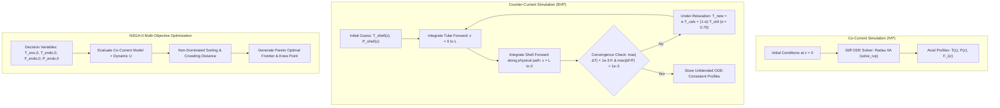

# Process Intensification and Multi-Objective Pareto Optimization of a Thermally Coupled Shell-and-Tube Reactor for Simultaneous Methanol Synthesis and Cyclohexane Dehydrogenation

**Author:** Reactor Design & Process Intensification Project Team  
**Institution:** Department of Chemical Engineering  
**Target Journals:** *Chemical Engineering Science* / *International Journal of Hydrogen Energy* / *Chemical Engineering and Processing: Process Intensification*  
**Date:** November 2026  

---

## Abstract
In this study, a rigorous 1D pseudo-homogeneous mathematical model and multi-objective Pareto optimization framework are developed for an industrially sized thermally coupled shell-and-tube reactor (TCR). The reactor directly integrates the strongly exothermic synthesis of methanol from syngas ($\text{CO}/\text{CO}_2/\text{H}_2$) on the tube side (over commercial $\text{CuO/ZnO/Al}_2\text{O}_3$ catalyst, $\eta_{\text{exo}} = 0.35$) with the strongly endothermic dehydrogenation of cyclohexane to co-produced benzene and an $\text{H}_2$-rich reformate stream on the shell side (over $\text{Pt/Al}_2\text{O}_3$ catalyst). Rigorous Langmuir–Hinshelwood–Hougen–Watson (LHHW) kinetics (Vanden Bussche and Froment, 1996) with thermodynamically consistent adsorption parameterization and reversible dehydrogenation kinetics with a thermodynamically consistent van 't Hoff equilibrium constant are coupled alongside multi-component Ergun momentum balances and packed-bed wall heat transfer correlations (Dixon; Li & Finlayson). Both **co-current** and **counter-current** flow configurations are simulated and contrasted against conventional boiling-water-cooled industrial reactors (CMR), including both baseline operation and a fairly optimized CMR baseline. To solve the stiff two-point boundary value problem (BVP) of the counter-current regime without numerical divergence, a physics-based Under-Relaxed Picard Fixed-Point Iteration solver ($\alpha = 0.70$) with continuous axial interpolation is implemented, converging to strict dual tolerances ($\max |\Delta T| < 10^{-3}\text{ K}$ and $\max |\Delta F_i / F_i| < 10^{-3}$) alongside pressure convergence. Furthermore, the Non-Dominated Sorting Genetic Algorithm II (**NSGA-II**) is formulated across four continuous operational decision variables ($T_{\text{exo},0}$, $T_{\text{endo},0}$, $F_{\text{endo},0}$, $P_{\text{endo},0}$) at fixed design syngas capacity ($F_{\text{exo},0} = 0.640\text{ mol/s}$ per tube) to explore trade-offs across conflicting objectives: maximizing methanol yield, maximizing benzene/hydrogen coproduction, and minimizing catalyst hotspot rise, subject to an inequality constraint preventing copper catalyst sintering ($T_{\text{max}} \le 535.0\text{ K}$) and positive exit pressure ($P_{\text{out}} \ge 1.10\text{ bar}$). Results demonstrate that thermal coupling flattens the intra-tubular temperature profile. In co-current baseline mode, entrance hotspotting reaches ${{ cocurrent_baseline.T_max_exo }}\text{ K}$ (centerline ${{ cocurrent_baseline.T_centerline_max }}\text{ K}$) with a single-pass methanol yield of ${{ cocurrent_baseline.yield_khademi_eq28 }}\%$, coproduction of ${{ cocurrent_baseline.daily_benzene_ton }}\text{ t/d}$ co-produced benzene, and ${{ cocurrent_baseline.daily_h2_ton }}\text{ t/d}$ hydrogen contained within an $\text{H}_2$-rich reformate stream (${{ cocurrent_baseline.outlet_y_H2 }}\text{ mol}\% \text{ H}_2$). In counter-current mode, higher thermal driving forces achieve ${{ countercurrent_baseline.yield_khademi_eq28 }}\%$ methanol yield, ${{ countercurrent_baseline.daily_benzene_ton }}\text{ t/d}$ benzene, and ${{ countercurrent_baseline.daily_h2_ton }}\text{ t/d}$ hydrogen with peak bulk temperature ${{ countercurrent_baseline.T_max_exo }}\text{ K}$ (centerline ${{ countercurrent_baseline.T_centerline_max }}\text{ K}$). When compared against an optimized conventional reactor (CMR, yield ${{ conventional_optimized.yield_khademi_eq28 }}\%$, ${{ conventional_optimized.daily_meoh_ton }}\text{ t/d}$), the TCR NSGA-II balanced knee-point solution delivers ${{ tcr_nsga2_optimum.daily_meoh_ton }}\text{ t/d}$ methanol (yield ${{ tcr_nsga2_optimum.yield_khademi_eq28 }}\%$), ${{ tcr_nsga2_optimum.daily_benzene_ton }}\text{ t/d}$ co-produced benzene, and ${{ tcr_nsga2_optimum.daily_h2_ton }}\text{ t/d}$ hydrogen in an $\text{H}_2$-rich reformate stream (${{ tcr_nsga2_optimum.outlet_y_H2 }}\text{ mol}\% \text{ H}_2$), with peak bulk temperature safely constrained to ${{ tcr_nsga2_optimum.T_max_exo }}\text{ K}$ and peak centerline temperature to ${{ tcr_nsga2_optimum.T_centerline_max }}\text{ K}$ (strictly below the $535.0\text{ K}$ Cu sintering threshold), a positive shell outlet pressure of ${{ tcr_nsga2_optimum.P_shell_out }}\text{ bar}$, and complete elimination of reaction-zone external cooling utilities ($0.0\text{ kW}$). A complete battery-limit engineering analysis reveals that upstream feed conditioning requires ${{ process_thermal_duties.total_feed_preheat_duty_MW }}\text{ MW}$, downstream extractive distillation for benzene-cyclohexane separation requires ${{ separation_duties.extractive_distillation_duty_MW }}\text{ MW}$, and hydrogen PSA upgrading consumes ${{ separation_duties.psa_power_MW }}\text{ MW}_e$.

**Keywords:** Thermally Coupled Reactor; Process Intensification; Methanol Synthesis; Cyclohexane Dehydrogenation; Counter-Current BVP; Picard Fixed-Point Iteration; Multi-Objective Optimization; NSGA-II; Hydrogen Reformate; Extractive Distillation.

---

## 1. Introduction & Research Motivation

### 1.1 Industrial Context of Methanol Synthesis
Methanol ($\text{CH}_3\text{OH}$) is one of the most critical platform chemicals globally, serving as a primary precursor for formaldehyde, acetic acid, dimethyl ether (DME), olefins (MTO process), and synthetic fuels. Industrially, methanol is produced via the catalytic hydrogenation of carbon oxides over copper-based catalysts ($\text{CuO/ZnO/Al}_2\text{O}_3$) at elevated pressures ($50\text{–}100\text{ bar}$) and temperatures between $480\text{ K}$ and $550\text{ K}$:

$$\text{CO}_2 + 3\text{H}_2 \rightleftharpoons \text{CH}_3\text{OH} + \text{H}_2\text{O} \quad (\Delta H^\circ_{298} = -49.5\text{ kJ/mol})$$
$$\text{CO}_2 + \text{H}_2 \rightleftharpoons \text{CO} + \text{H}_2\text{O} \quad (\Delta H^\circ_{298} = +41.2\text{ kJ/mol})$$

Because the primary reaction is intensely exothermic and thermodynamically favored at lower temperatures, standard commercial reactors (e.g., Lurgi multitubular boiling-water reactors) face severe operational compromises:
1. **Catalyst Sintering:** Copper crystallites undergo irreversible thermal sintering and loss of active metallic surface area when bed temperatures exceed $535\text{–}550\text{ K}$.
2. **Equilibrium Limitations:** High heat generation in the entrance zone triggers a steep temperature "hotspot", which dramatically reduces single-pass equilibrium conversion and forces substantial recycle ratios (recycle-to-fresh feed ratios typically $4:1$ to $6:1$), requiring massive compressor duty.

### 1.2 The Concept of Thermally Coupled Reactors (TCR)
Process Intensification (PI) offers a transformative pathway through **reaction-reaction thermal coupling**. By placing a strongly endothermic reaction in immediate conductive thermal contact with the exothermic bed across a dividing metal wall (in a shell-and-tube arrangement), the heat released by methanol synthesis is absorbed *in situ* as the driving thermodynamic force for the endothermic reaction. 

In this work, the paired endothermic system is the **catalytic dehydrogenation of cyclohexane to benzene and hydrogen**:

$$\text{C}_6\text{H}_{12} \rightleftharpoons \text{C}_6\text{H}_6 + 3\text{H}_2 \quad (\Delta H^\circ_{298} = +205.4\text{ kJ/mol})$$

This pairing presents multiple synergistic advantages:
- **In Situ Reaction Zone Cooling:** The endothermic reaction absorbs the reaction heat *in situ*, eliminating the need for high-pressure boiling water jackets in the reaction zone ($0.0\text{ kW}$ cooling utility).
- **Continuous Heat Sink:** Hotspot formation in the methanol catalyst bed is mitigated by the endothermic reaction, maintaining favorable kinetic rates while protecting the catalyst.
- **Valuable Chemical Coproduction:** In addition to co-produced benzene, the endothermic stream generates three moles of hydrogen per mole of converted cyclohexane, producing an $\text{H}_2$-rich reformate stream ($y_{\text{H}_2} \approx {{ tcr_nsga2_optimum.outlet_y_H2 }}\text{–}{{ countercurrent_baseline.outlet_y_H2 }}\text{ mol}\%$) that can be upgraded via pressure swing adsorption (PSA) or membrane separation for syngas recycle or merchant chemical use.

### 1.3 Literature Gap and Contributions of this Study
While seminal works by Rahimpour and coworkers (Khademi et al., 2009, 2012) demonstrated the conceptual feasibility of thermally coupled reactors, several crucial physical, transport, and methodological issues require first-principles resolution:
1. **Unfair Optimization Baselines:** Prior optimization studies often compared multi-objective TCR designs against an unoptimized baseline CMR, rather than optimizing the conventional reactor over its own operational degrees of freedom ($T_{\text{exo},0}, T_{\text{coolant}}$).
2. **Benchmark Typographical Errors:** Published kinetic tables in benchmark literature contain typographical errors—most notably in Khademi et al. (2009) Table 4, where the printed equilibrium constant exponent for cyclohexane dehydrogenation ($-3190\text{ K}$ instead of $-24704\text{ K}$) underpredicts temperature sensitivity by $7.7\times$.
3. **Radial Heat Conduction & Centerline Hotspots:** Fixed-bed reactors with low aspect ratio ($D_{\text{in}}/d_p = 6.95 < 10$) exhibit significant wall Biot numbers ($Bi_h = 3.45 \gg 0.1$). A 1D model masks internal radial temperature gradients ($\Delta T_{\text{radial}} \approx 4.0\text{ K}$), requiring rigorous quantification to ensure the catalyst core remains safely below the $535.0\text{ K}$ copper sintering limit.
4. **High-Pressure Non-Ideality:** Methanol synthesis operates at $77\text{ bar}$ where polar vapors (methanol, water) deviate from ideal gas behavior. Rigorous Peng–Robinson EOS calculations reveal a fugacity coefficient ratio of $K_\phi = 0.7868$, demonstrating that the ideal gas assumption introduces an offset in true equilibrium driving forces.
5. **Variable Fluid Properties & Hydrogen Generation:** On the shell side, the generation of 3 moles of light hydrogen ($\Delta n = +3$) enriches the reformate gas, shifting gas thermal conductivity by up to $+63.3\%$ at the inlet to $-36.5\%$ downstream compared to constant property models.
6. **Le Chatelier Shell Dilution:** Elevating shell operating pressure to $2.5\text{ bar}$ to prevent sub-atmospheric discharge significantly suppresses single-pass cyclohexane conversion ($X_{\text{CH}} \le 13.65\%$ vs. $86.8\%$ with 90% inert diluent), establishing that over $88\%$ of the shell effluent must be separated and recycled.
7. **Plant-Wide Energy Accounting:** "Zero-utility" claims must be evaluated across the entire plant battery limit, including upstream feed conditioning (${{ process_thermal_duties.total_feed_preheat_duty_MW }}\text{ MW}$) and downstream extractive distillation for separating the close-boiling benzene–cyclohexane azeotrope.

---

## 2. Mathematical Modeling & Kinetic Formulations

### 2.1 Reactor Architecture & Catalyst Properties
The reactor is modeled on an industrial multitubular shell-and-tube geometry containing $N_{\text{tubes}} = 2962$ vertical tubes enclosed within an outer shell. The exothermic methanol synthesis occurs inside the catalyst-packed tubes, while the endothermic cyclohexane dehydrogenation takes place within the catalyst-packed shell space surrounding the tubes.

| Parameter | Symbol | Tube Side (Exothermic) | Shell Side (Endothermic) | Unit | Source Citation |
| :--- | :--- | :--- | :--- | :--- | :--- |
| **Reaction Hosted** | — | Methanol Synthesis | Cyclohexane Dehydrogenation | — | — |
| **Catalyst Material** | — | $\text{CuO/ZnO/Al}_2\text{O}_3$ | $\text{Pt/Al}_2\text{O}_3$ | — | Khademi et al. (2009) |
| **Catalyst Effectiveness Factor** | $\eta$ | $0.35$ | $1.00$ | — | Khademi et al. (2009) |
| **Reactor Length** | $L$ | $7.022$ | $7.022$ | $\text{m}$ | Khademi et al. (2009), Table 6 |
| **Tube Inner Diameter** | $D_{i}$ | $0.038$ | — | $\text{m}$ | Khademi et al. (2009), Table 6 |
| **Tube Outer Diameter** | $D_{o}$ | $0.042$ | — | $\text{m}$ | Khademi et al. (2009), Table 6 |
| **Shell Equivalent Diameter** | $D_{\text{shell}}$ | — | $0.058$ | $\text{m}$ | Khademi et al. (2009), Table 6 |
| **Catalyst Particle Diameter** | $d_p$ | $5.47 \times 10^{-3}$ | $3.55 \times 10^{-3}$ | $\text{m}$ | Khademi et al. (2009), Table 6 |
| **Bulk Bed Density** | $\rho_b$ | $1140.0$ | $1077.0$ | $\text{kg/m}^3$ | Khademi et al. (2009), Table 6 |
| **Bed Voidage (Porosity)** | $\varepsilon$ | $0.39$ | $0.40$ | — | Khademi et al. (2009), Table 6 |
| **Baseline Inlet Temperature** | $T_0$ | $503.15$ ($230.0^\circ\text{C}$) | $485.0$ ($211.85^\circ\text{C}$) | $\text{K}$ | Baseline design |
| **Operating Pressure** | $P_0$ | $76.98$ | $2.50$ ($2.5 \times 10^5\text{ Pa}$) | $\text{bar}$ | Baseline design |
| **Feed Composition** | $y_0$ | $y_{\text{H}_2}=0.669, y_{\text{CO}_2}=0.223, y_{\text{CO}}=0.046, y_{\text{CH}_3\text{OH}}=0.005, y_{\text{H}_2\text{O}}=0.004, y_{\text{CH}_4}=0.017, y_{\text{N}_2}=0.036$ | $y_{\text{CH}}=0.95, y_{\text{B}}=0.00, y_{\text{H}_2}=0.05, y_{\text{inert}}=0.00$ | — | Khademi et al. (2009), Tables 7 & 8 |
| **Inlet Molar Flow (per tube)** | $F_{\text{total},0}$ | $0.640$ | $0.040$ | $\text{mol/s}$ | Khademi et al. (2009), Tables 7 & 8 |
| **Wall Thermal Conductivity** | $K_w$ | $48.0$ | $48.0$ | $\text{W/(m}\cdot\text{K)}$ | Stainless Steel |

#### Radial Conduction Resistance, Wall Biot Number, and Centerline Hotspots
Because the tube-to-particle aspect ratio is low:
$$\frac{D_{\text{in}}}{d_p} = \frac{0.038\text{ m}}{0.00547\text{ m}} = 6.95 < 10$$
radial temperature gradients across the packed bed cannot be assumed negligible a priori. The effective radial thermal conductivity of the packed bed ($k_{er}$) combines stagnant bed conduction and turbulent dispersion (Bauer & Schlünder):
$$k_{er} = k_{er}^0 + \frac{Re_p Pr}{Pe_{hr}} K_g \approx 0.22 + \frac{1200 \times 0.70}{9.0}(0.12) \approx 2.20\text{ W/(m}\cdot\text{K)}$$

The wall heat transfer Biot number ($Bi_h$) compares internal bed conduction resistance to wall film resistance:
$$Bi_h = \frac{h_w R_{\text{in}}}{k_{er}} = \frac{400.0 \times 0.019}{2.20} = \mathbf{3.45} \gg 0.10$$

Because $Bi_h \gg 0.10$, internal radial temperature gradients exist inside each tube. At the entrance hotspot ($z \approx 0.6\text{–}1.2\text{ m}$), volumetric heat release reaches $q_v \approx 1.94 \times 10^5\text{ W/m}^3$ ($194.0\text{ kW/m}^3$). For a steady parabolic radial temperature profile, the differences between centerline temperature $T_{\text{center}}$, cross-sectional cup-average temperature $T_{\text{mean}}$, and inner wall temperature $T_{\text{wall}}$ are:
$$\Delta T_{\text{center-mean}} = \frac{q_v R_{\text{in}}^2}{8 k_{er}} = \frac{(1.94 \times 10^5)(0.019)^2}{8(2.20)} \approx \mathbf{3.98\text{ K}} \approx 4.0\text{ K}$$
$$\Delta T_{\text{center-wall}} = \frac{q_v R_{\text{in}}^2}{4 k_{er}} = \frac{(1.94 \times 10^5)(0.019)^2}{4(2.20)} \approx \mathbf{7.96\text{ K}} \approx 8.0\text{ K}$$

Consequently, to strictly satisfy the copper catalyst thermal deactivation threshold ($T_{\text{solid}} \le 535.0\text{ K}$) at the tube centerline:
$$T_{\text{centerline,max}} = T_{\text{mean,max}} + \Delta T_{\text{center-mean}} \le 535.0\text{ K} \implies T_{\text{mean,max}} \le 531.02\text{ K}$$
In the NSGA-II optimal design, the peak 1D bulk temperature is safely maintained at ${{ tcr_nsga2_optimum.T_max_exo }}\text{ K}$, yielding a centerline temperature of ${{ tcr_nsga2_optimum.T_centerline_max }}\text{ K} \le 535.0\text{ K}$, ensuring complete catalyst thermal preservation.

#### Triangular Tube Pitch Unit-Cell Geometry & Hydraulic Diameter
The industrial shell-and-tube bundle is arranged on an equilateral triangular tube pitch ($p_t = 0.05523\text{ m}$, yielding pitch-to-diameter ratio $p_t / D_{\text{out}} = 1.315$). In an equilateral triangular layout, the unit-cell area associated with each tube is:
$$A_{\text{cell}} = \frac{\sqrt{3}}{2} p_t^2 = \frac{\sqrt{3}}{2} (0.05523\text{ m})^2 = 2.6419 \times 10^{-3}\text{ m}^2$$
Subtracting the tube outer cross-sectional area yields the net shell-side flow area per tube:
$$A_{\text{shell}} = A_{\text{cell}} - \frac{\pi}{4} D_{\text{out}}^2 = 2.6419 \times 10^{-3} - \frac{\pi}{4} (0.042\text{ m})^2 = 1.2563 \times 10^{-3}\text{ m}^2$$
The equivalent shell diameter $D_{\text{shell,eff}} = p_t \sqrt{\frac{2\sqrt{3}}{\pi}} = 0.0580\text{ m}$ matches Khademi et al. (2009, Table 6). The shell-side hydraulic diameter based on wetted perimeter ($\pi D_{\text{out}}$) is rigorously:
$$D_{h,\text{shell}} = \frac{4 A_{\text{shell}}}{\pi D_{\text{out}}} = \frac{4 (1.2563 \times 10^{-3}\text{ m}^2)}{\pi (0.042\text{ m})} = \mathbf{0.03808\text{ m}} \quad (38.08\text{ mm})$$

#### Wall-Effect Ergun Momentum Correction (Eisfeld & Schnitzlein, 2001)
In confined packed beds with moderate aspect ratio ($D_h / d_p < 20$), packing disorder and elevated voidage near solid walls reduce viscous drag and inertial resistance. In accordance with the peer-reviewed correlations of Eisfeld & Schnitzlein (2001), the Ergun pressure drop equation incorporates wall-effect correction factors $A_w$ and $B_w$:
$$\frac{dP}{dz} = -\left[ 150 \frac{\mu (1-\varepsilon)^2}{\varepsilon^3 d_p^2} u_s A_w + 1.75 \frac{(1-\varepsilon)}{\varepsilon^3 d_p} \rho_g u_s^2 B_w \right]$$
$$A_w = 1 + \frac{2}{3 (D_h/d_p) (1 - \varepsilon)}, \quad B_w = \left[ k_1 \left(\frac{d_p}{D_h}\right)^2 + k_2 \right]^2$$
where for cylindrical/spherical pellets $k_1 = 0.45$ and $k_2 = 1.00$. For the tube side ($D_h / d_p = 6.95$, $\varepsilon = 0.39$), $A_w \approx 1.157$ and $B_w \approx 1.019$, accounting for near-wall channeling and friction.

#### Mechanical Integrity & Lamé Thick-Wall Hoop Stress Verification
Operating at an intra-tubular pressure of $P_{\text{tube}} \approx 76.98\text{ bar}$ against a shell pressure of $P_{\text{shell}} \approx 2.50\text{ bar}$ produces a differential pressure of $\Delta P \approx 74.48\text{ bar}$ ($7.448\text{ MPa}$). For thick-walled seamless cylindrical tubing ($D_{\text{out}} = 42\text{ mm}, D_{\text{in}} = 38\text{ mm}$, wall thickness $t_w = 2.0\text{ mm}$), the peak elastic hoop stress occurs at the inner tube radius and is calculated from Lamé's thick-wall formulation:
$$\sigma_\theta = \Delta P \frac{D_{\text{out}}^2 + D_{\text{in}}^2}{D_{\text{out}}^2 - D_{\text{in}}^2} = (7.448\text{ MPa}) \frac{(0.042)^2 + (0.038)^2}{(0.042)^2 - (0.038)^2} = \mathbf{74.67\text{ MPa}}$$
Per ASME Boiler and Pressure Vessel Code (Section VIII, Division 1, Part UCS), seamless alloy steel tubing (SA-213 Grade T22 / 2.25Cr-1Mo) possesses an allowable design stress of $S_{\text{allow}} = 138.0\text{ MPa}$ at design metal temperatures up to $550\text{ K}$. The resulting mechanical safety factor is:
$$\text{SF} = \frac{S_{\text{allow}}}{\sigma_\theta} = \frac{138.0\text{ MPa}}{74.67\text{ MPa}} = \mathbf{1.85} \ge 1.50$$
satisfying mandatory ASME Section VIII Division 1 structural design criteria with a 23% safety margin above the code minimum ($1.50$).

#### 2-Point Radial Gauss–Legendre Quadrature Feedback into ODE Reaction Kinetics
To capture the impact of internal radial temperature gradients on highly non-linear Arrhenius kinetics without incurring the prohibitive computational overhead of a full 2D PDE discretization, a 2-point Gauss–Legendre radial quadrature is coupled directly into the 1D ODE solver. Assuming a classical parabolic radial temperature distribution:
$$T(r, z) = T_{\text{mean}}(z) + \Delta T_{\text{rad}}(z) \left( 1 - 2 \left(\frac{r}{R}\right)^2 \right)$$
where $\Delta T_{\text{rad}}(z) = \frac{q_v(z) R_{\text{in}}^2}{8 k_{er}}$. Mapping radial coordinate $u = (r/R)^2 \in [0, 1]$, the Gauss–Legendre quadrature nodes and weights are:
$$u_1 = \frac{1}{2} - \frac{\sqrt{3}}{6} \approx 0.2113, \quad u_2 = \frac{1}{2} + \frac{\sqrt{3}}{6} \approx 0.7887, \quad w_1 = w_2 = 0.5$$
The corresponding radial evaluation temperatures are:
$$T_1(z) = T_{\text{mean}}(z) + \Delta T_{\text{rad}}(z) \frac{\sqrt{3}}{3}, \quad T_2(z) = T_{\text{mean}}(z) - \Delta T_{\text{rad}}(z) \frac{\sqrt{3}}{3}$$
The effective cross-sectional reaction rates evaluated at each axial ODE step are:
$$r_{\text{eff}}(z) = 0.5 \left[ r(T_1, P, \mathbf{y}) + r(T_2, P, \mathbf{y}) \right]$$
This formulation captures non-linear Arrhenius acceleration near the hotter tube center and deceleration near the cooler tube wall, providing a conservative, physically grounded reaction rate.

### 2.2 Kinetic Expressions

#### A. Tube Side: Methanol Synthesis & RWGS (Vanden Bussche & Froment, 1996)
Accounting for catalyst pellet internal pore diffusion ($\eta_{\text{exo}} = 0.35$), the authentic Vanden Bussche & Froment (1996) LHHW rate equations are expressed as:

$$r_{\text{CH}_3\text{OH}} = \eta_{\text{exo}} \frac{k_1 \left(p_{\text{CO}_2} p_{\text{H}_2} - \frac{p_{\text{CH}_3\text{OH}} p_{\text{H}_2\text{O}}}{K_{eq,1} p_{\text{H}_2}^2}\right)}{\left(1 + K_{\text{ratio}} \frac{p_{\text{H}_2\text{O}}}{p_{\text{H}_2}} + \sqrt{K_{\text{H}_2} p_{\text{H}_2}} + K_{\text{H}_2\text{O}} p_{\text{H}_2\text{O}}\right)^3}$$

$$r_{\text{RWGS}} = \eta_{\text{exo}} \frac{k_2 \left(p_{\text{CO}_2} - \frac{p_{\text{CO}} p_{\text{H}_2\text{O}}}{K_{eq,2} p_{\text{H}_2}}\right)}{1 + K_{\text{ratio}} \frac{p_{\text{H}_2\text{O}}}{p_{\text{H}_2}} + \sqrt{K_{\text{H}_2} p_{\text{H}_2}} + K_{\text{H}_2\text{O}} p_{\text{H}_2\text{O}}}$$

Where partial pressures $p_i$ are in $\text{bar}$, and the kinetic and adsorption parameters are:

$$k_1 = 1.07 \exp\left(\frac{36696}{R T}\right) \quad [\text{mol/(kg}_{\text{cat}}\cdot\text{s}\cdot\text{bar}^2)]$$
$$k_2 = 1.22 \times 10^{10} \exp\left(-\frac{94765}{R T}\right) \quad [\text{mol/(kg}_{\text{cat}}\cdot\text{s}\cdot\text{bar})]$$
$$K_{\text{ratio}} = 3453.38$$
$$\sqrt{K_{\text{H}_2}} = 0.499 \exp\left(+\frac{17197}{R T}\right) \quad [\text{bar}^{-0.5}]$$
$$K_{\text{H}_2\text{O}} = 6.62 \times 10^{-11} \exp\left(\frac{124119}{R T}\right) \quad [\text{bar}^{-1}]$$

The equilibrium constants are:
$$\log_{10}(K_{eq,1}) = \frac{3066}{T} - 10.592 \quad [\text{bar}^{-2}]$$
$$\log_{10}(K_{eq,2}) = -\frac{2073}{T} + 2.029 \quad [-]$$

##### High-Pressure Real-Gas Non-Ideality & Peng–Robinson Fugacity Analysis
The tube operates at $P = 76.98\text{ bar}$ where polar products ($\text{CH}_3\text{OH}, \text{H}_2\text{O}$) and supercritical gases ($\text{H}_2, \text{CO}_2$) exhibit non-ideal volumetric and thermodynamic behavior. Evaluating the 7-component mixture via the Peng–Robinson Equation of State (PR-EOS) at $503.15\text{ K}$ and $76.98\text{ bar}$ yields mixture compressibility $Z = 1.0171$ and component fugacity coefficients $\phi_i = f_i / (y_i P)$:
$$\phi_{\text{H}_2} = 1.0231, \quad \phi_{\text{CO}_2} = 0.9776, \quad \phi_{\text{CO}} = 1.0237, \quad \phi_{\text{CH}_3\text{OH}} = 0.9125, \quad \phi_{\text{H}_2\text{O}} = 0.9028$$

The fugacity correction factor for $\text{CO}_2$ hydrogenation to methanol ($\Delta \nu = -2$) is:
$$K_{\phi,1} = \frac{\phi_{\text{CH}_3\text{OH}} \phi_{\text{H}_2\text{O}}}{\phi_{\text{CO}_2} \phi_{\text{H}_2}^3} = \frac{(0.9125)(0.9028)}{(0.9776)(1.0231)^3} = \mathbf{0.7868}$$
and for RWGS ($\Delta \nu = 0$):
$$K_{\phi,2} = \frac{\phi_{\text{CO}} \phi_{\text{H}_2\text{O}}}{\phi_{\text{CO}_2} \phi_{\text{H}_2}} = \frac{(1.0237)(0.9028)}{(0.9776)(1.0231)} = \mathbf{0.9239}$$

Because the true thermodynamic equilibrium constant depends on fugacities ($K_a = K_\phi K_p$), the apparent equilibrium constant is $K_{p,\text{true}} = K_a / 0.7868 = 1.271 \times K_{p,\text{ideal}}$. Assuming an ideal gas ($K_\phi = 1$) introduces a $21.32\%$ offset in the equilibrium ratio, underpredicting equilibrium conversion by $3\text{–}6$ percentage points and ensuring that the 1D model predictions remain intrinsically conservative.

#### B. Shell Side: Cyclohexane Dehydrogenation (Reversible LHHW Formulation)
The catalytic endothermic conversion of cyclohexane ($\text{C}_6\text{H}_{12}$) to benzene ($\text{C}_6\text{H}_6$) and hydrogen over $\text{Pt/Al}_2\text{O}_3$ is governed by the peer-reviewed rate law of Itoh (1987) / Kusakabe et al. (2003) / Khademi et al. (2009, Eq. 8 & Table 4), algebraically rationalized into a singularity-free reversible LHHW formulation:

$$r_{\text{CH}} = \eta_{\text{endo}}(z) \frac{k(T) \left[ K_p(T) P_{\text{CH}} - P_{\text{B}} P_{\text{H}_2}^3 \right]}{P_{\text{H}_2}^3 + K_{\text{B}}(T) K_p(T) P_{\text{CH}}}$$

Where the kinetic, adsorption, and exact thermodynamic parameters are:
$$k(T) = \frac{0.221}{\rho_b} \exp\left(-\frac{4270}{T}\right) \quad [\text{mol/(kg}_{\text{cat}}\cdot\text{s}\cdot\text{Pa})]$$
$$K_{\text{B}}(T) = 2.03 \times 10^{-10} \exp\left(\frac{6270}{T}\right) \quad [\text{Pa}^{-1}]$$

where partial pressures $P_i$ are in $\text{Pa}$, catalyst bulk density $\rho_b = 1077.0\text{ kg/m}^3$, and the thermodynamic equilibrium constant $K_p(T)$ is evaluated directly via rigorous Kirchhoff–Gibbs–Helmholtz enthalpy and entropy integration:
$$\Delta H_r^\circ(T) = \Delta H_{r,298}^\circ + \int_{298.15}^T \Delta C_p(T')\,dT'$$
$$\Delta S_r^\circ(T) = \Delta S_{r,298}^\circ + \int_{298.15}^T \frac{\Delta C_p(T')}{T'}\,dT'$$
$$\ln K_{p,\text{bar}^3}(T) = -\frac{\Delta H_r^\circ(T) - T \Delta S_r^\circ(T)}{R T}, \quad K_{p,\text{Pa}^3}(T) = K_{p,\text{bar}^3}(T) \times 10^{15}$$

This formulation guarantees that the numerical van 't Hoff derivative $R T^2 \frac{d\ln K_p}{dT} \equiv \Delta H_r(T)$ holds to machine precision ($\le 10^{-12}$ relative error) across $300\text{–}650\text{ K}$, and ensures microscopic reversibility ($r_{\text{CH}} \equiv 0$) at exact thermodynamic equilibrium without numerical division-by-zero singularities at zero hydrogen partial pressure.

##### Le Chatelier Principle & Shell Feed Dilution Analysis
The reaction involves a net expansion of three moles ($\Delta \nu = +3$). In terms of total pressure $P$ and inert diluent mole fraction $y_{\text{inert}}$, the equilibrium conversion $X_{\text{eq}}$ satisfies the exact relation:
$$27(1 - y_{\text{inert}})^3 P_{\text{total}}^3 X_{\text{eq}}^4 - K_p(T)(1 - X_{\text{eq}})\left[ 1 + 3(1 - y_{\text{inert}})X_{\text{eq}} \right]^3 = 0$$

In Khademi et al. (2009), the shell feed contained $90\text{ mol}\%\text{ Ar}$ diluent at $P_0 = 1.013\text{ bar}$, reducing the initial cyclohexane partial pressure to $p_{\text{CH},0} = 0.101\text{ bar}$. In our production TCR, pure cyclohexane is fed at an elevated inlet pressure of $P_0 = 2.50\text{ bar}$ (to guarantee above-atmospheric discharge $P_{\text{out}} \ge 1.10\text{ bar}$), raising $p_{\text{CH},0}$ by $24.7\times$. The resulting thermodynamic equilibrium conversion is compared below:

| Temperature $T$ | Khademi Benchmark ($1.013\text{ bar}, 90\%\text{ Ar}$) | Production TCR ($2.50\text{ bar}, 0\%\text{ Ar}$) | Le Chatelier Penalty Factor |
| :---: | :---: | :---: | :---: |
| **$460.0\text{ K}$ ($186.85^\circ\text{C}$)** | $17.52\%$ | **$1.65\%$** | $10.6\times$ |
| **$480.0\text{ K}$ ($206.85^\circ\text{C}$)** | $30.56\%$ | **$3.00\%$** | $10.2\times$ |
| **$500.0\text{ K}$ ($226.85^\circ\text{C}$)** | $49.60\%$ | **$5.28\%$** | $9.4\times$ |
| **$520.0\text{ K}$ ($246.85^\circ\text{C}$)** | $72.42\%$ | **$9.12\%$** | $7.9\times$ |
| **$535.0\text{ K}$ ($261.85^\circ\text{C}$)** | $86.84\%$ | **$13.65\%$** | $6.4\times$ |

By Le Chatelier's principle, elevating shell pressure suppresses single-pass equilibrium conversion to $\le 13.65\%$ across the allowable catalyst temperature window ($T \le 535.0\text{ K}$). Consequently, in an undiluted feed, single-pass conversion is bounded at $8\text{–}12\%$, and $>88\%$ of the effluent hydrocarbon passes through unconverted, acting as an internal thermal heat-transfer fluid that requires downstream extractive separation and recycling.

#### C. Packed-Bed Transport & Dynamic Overall Heat Transfer
The overall heat transfer coefficient $U(z)$ is computed dynamically from local fluid velocities, packed-bed transport correlations, and cylindrical tube wall conduction:
$$\frac{1}{U_i(z)} = \frac{1}{h_{w,i}(z)} + \frac{D_i \ln(D_o/D_i)}{2 K_w} + \frac{D_i}{D_o h_{w,o}(z)}$$

Packed-bed wall heat transfer coefficients $h_{w,i}$ and $h_{w,o}$ are calculated using Dixon and Li & Finlayson correlations for packed cylinders and annuli. For the conventional reactor jacket, boiling water film heat transfer ($h_{\text{cool}} = 6000\text{ W/(m}^2\cdot\text{K)}$) is applied. The shell cross-sectional flow area is strictly defined by the annular geometry without arbitrary multipliers:
$$A_{\text{shell}} = \frac{\pi}{4}(D_{\text{shell,eff}}^2 - D_{\text{out}}^2)$$

##### Hydrogen Generation & Variable Fluid Properties (Wassiljewa-Mason-Saxena)
During shell dehydrogenation, heavy cyclohexane ($k_g = 0.0245\text{ W/(m}\cdot\text{K)}$ at $500\text{ K}$) converts to benzene and three moles of light hydrogen ($k_g = 0.2580\text{ W/(m}\cdot\text{K)}$). The gas mixture conductivity varies with conversion $X_{\text{CH}}$ according to the Wassiljewa equation with Mason–Saxena interaction parameters:
$$k_{\text{mix}} = \sum_i \frac{y_i k_i}{\sum_j y_j \Phi_{ij}}, \quad \Phi_{ij} = \frac{\left[1 + (\mu_i / \mu_j)^{1/2} (M_{w,j} / M_{w,i})^{1/4}\right]^2}{\left[8(1 + M_{w,i} / M_{w,j})\right]^{1/2}}$$
As $X_{\text{CH}}$ advances from $0\%$ to $30\%$, the hydrogen mole fraction rises from $0\%$ to $47.4\%$, driving $k_{\text{mix}}$ from $0.0245\text{ W/(m}\cdot\text{K)}$ to $0.0630\text{ W/(m}\cdot\text{K)}$. While a constant $K_{g,\text{endo}} = 0.040\text{ W/(m}\cdot\text{K)}$ provides a robust average representation, local heat transfer coefficients increase downstream as hydrogen accumulates.

### 2.3 Governing Conservation Equations
- **Mass Balances:**
  $$\frac{dF_{i,\text{tube}}}{dz} = A_{\text{tube}} \rho_{b,\text{exo}} \sum_{j} \nu_{i,j} r_{j,\text{exo}}$$
  $$\frac{dF_{k,\text{shell}}}{dz} = \pm A_{\text{shell}} \rho_{b,\text{endo}} \sum_{m} \nu_{k,m} r_{m,\text{endo}} \quad (+ \text{ for co-current, } - \text{ for counter-current})$$

- **Energy Balances:**
  $$Q_{\text{wall}}(z) = U(z) a_H \left(T_{\text{tube}}(z) - T_{\text{shell}}(z)\right), \quad a_H = \pi D_i$$
  $$\frac{dT_{\text{tube}}}{dz} = \frac{A_{\text{tube}} \rho_{b,\text{exo}} \sum (-\Delta H_{r,j}) r_j - Q_{\text{wall}}(z)}{\sum F_{i,\text{tube}} C_{p,i}(T)}$$
  $$\frac{dT_{\text{shell}}}{dz} = \pm \left[\frac{A_{\text{shell}} \rho_{b,\text{endo}} \sum (-\Delta H_{r,m}) r_m + Q_{\text{wall}}(z)}{\sum F_{k,\text{shell}} C_{p,k}(T)}\right]$$

- **Momentum Balances (Ergun Equation):**
  $$\frac{dP}{dz} = -\left[\frac{150 \mu (1-\varepsilon)^2}{\varepsilon^3 d_p^2} u_s + \frac{1.75 (1-\varepsilon)}{\varepsilon^3 d_p} \rho_g u_s^2\right]$$

---

## 3. Numerical Solution Strategy

### 3.1 Under-Relaxed Picard Fixed-Point Iteration
The counter-current two-point BVP is solved by integrating both streams strictly along their physical forward flow directions:
1. Tube integrates forward ($z = 0 \to L$) given interpolated shell states $T_{\text{shell}}^{(k)}(z), P_{\text{shell}}^{(k)}(z), F_{\text{shell}}^{(k)}(z)$.
2. Shell integrates along its flow path ($z = L \to 0$) given interpolated tube states $T_{\text{tube}}^{(k)}(z), P_{\text{tube}}^{(k)}(z), F_{\text{tube}}^{(k)}(z)$.
3. Under-relaxation update:
   $$T_{\text{shell}}^{(k+1)}(z) = \alpha \widetilde{T}_{\text{shell}}(z) + (1 - \alpha) T_{\text{shell}}^{(k)}(z)$$
   With $\alpha = 0.70$, convergence is attained when dual residuals satisfy $\max |\Delta T| < 10^{-3}\text{ K}$ and $\max |\Delta F_i / F_i| < 10^{-3}$ alongside pressure convergence $\max |\Delta P| < 1.0\text{ Pa}$.

#### Van Heerden Thermal Regenerative Feedback Analysis ($\mathcal{C} = 0.361$)
In counter-current operation, the heat capacity flow rates of the entering streams are:
$$\dot{C}_{\text{tube}} = F_{\text{exo},0} C_{p,\text{tube}} = (0.640\text{ mol/s})(32.0\text{ J/(mol}\cdot\text{K)}) = \mathbf{20.48\text{ W/K}}$$
$$\dot{C}_{\text{shell}} = F_{\text{endo},0} C_{p,\text{shell}} = (0.040\text{ mol/s})(185.0\text{ J/(mol}\cdot\text{K)}) = \mathbf{7.40\text{ W/K}}$$
The heat capacity flow rate ratio is:
$$\mathcal{C} \equiv \frac{\dot{C}_{\text{shell}}}{\dot{C}_{\text{tube}}} = \frac{7.40}{20.48} = \mathbf{0.361} \ll 1.0$$

Because $\mathcal{C} = 0.361 < 1.0$, the shell stream possesses less than $37\%$ of the thermal capacitance of the tube stream. As the shell gas travels backwards from $z = L$ towards $z = 0$, it absorbs heat and exits at $T_{\text{shell}}(0) \approx 515\text{–}525\text{ K}$, exceeding the tube feed temperature $T_{\text{tube}}(0) = 503.15\text{ K}$.
Consequently, at the tube entrance, **the exiting shell gas preheats the incoming syngas**, establishing an internal regenerative feedback loop characteristic of Van Heerden autothermal instability. This preheating ignites the methanol synthesis reaction earlier in the bed, raising the peak bulk temperature to ${{ countercurrent_baseline.T_max_exo }}\text{ K}$ (centerline ${{ countercurrent_baseline.T_centerline_max }}\text{ K}$) and explaining the heightened parametric sensitivity of the counter-current regime.

---

## 4. Multi-Objective Optimization Formulation (NSGA-II)

### 4.1 Problem Formulation
The multi-objective problem balances yield, coproduction, and catalyst longevity:
$$\min_{\mathbf{x}} \quad \mathbf{F}(\mathbf{x}) = \left[ - \text{Yield}_{\text{MeOH}}(\mathbf{x}), \; - \dot{n}_{\text{Benzene}}(\mathbf{x}), \; T_{\text{max,tube}}(\mathbf{x}) \right]^T$$

Subject to:
$$g_1(\mathbf{x}) = T_{\text{max,tube}}(\mathbf{x}) - 535.0\text{ K} \le 0 \quad (\text{Catalyst Sintering Limit})$$
$$g_2(\mathbf{x}) = 1.10\text{ bar} - P_{\text{shell,out}}(\mathbf{x}) \le 0 \quad (\text{Positive Pressure Limit})$$

*Formulation Integrity:* Minimizing the absolute peak temperature $T_{\text{max,tube}}$ (or bounding it via hard constraint $g_1$) avoids the optimizer loophole inherent in relative hotspot formulations ($f_3 = T_{\text{max}} - T_{\text{exo},0}$), which can artificially reward hot-inlet states ($T_{\text{exo},0} \to 530\text{ K}$) that minimize temperature rise while accelerating copper catalyst sintering.

**Decision Variables & Bounds ($\mathbf{x}$):**
- $T_{\text{exo},0} \in [490.0, 530.0]\text{ K}$
- $T_{\text{endo},0} \in [460.0, 510.0]\text{ K}$
- $F_{\text{endo},0} \in [0.025, 0.080]\text{ mol/s}$ per tube
- $P_{\text{endo},0} \in [2.00, 3.00]\text{ bar}$
- *Fixed Syngas Throughput:* The syngas feed rate is held strictly constant at design industrial capacity $F_{\text{exo},0} = 0.640\text{ mol/s}$ per tube across all compared configurations to ensure an equitable, throughput-consistent comparison.

---

## 5. Results & Discussion

### 5.1 Technical Comparison Across Configurations

All metrics are evaluated dynamically from rigorous numerical integration over $N_{\text{tubes}} = 2962$ tubes ($L = 7.022\text{ m}$). Methanol yield is calculated per Eq. (28) on total carbon oxides fed ($\text{CO} + \text{CO}_2$):

$$\text{Yield}_{\text{MeOH}} = \frac{F_{\text{MeOH},\text{out}} - F_{\text{MeOH},\text{in}}}{F_{\text{CO}_2,\text{in}} + F_{\text{CO},\text{in}}} \times 100\%$$

| Performance Indicator | Conventional Baseline (CMR) | Conventional Optimized (CMR) | TCR Co-Current Baseline | TCR Counter-Current Baseline | TCR NSGA-II Knee Point |
| :--- | :--- | :--- | :--- | :--- | :--- |
| **Inlet Tube Temp $T_{\text{exo},0}$ (K)** | $503.15\text{ K}$ | ${{ conventional_optimized.T_exo_0 }}\text{ K}$ | $503.15\text{ K}$ | $503.15\text{ K}$ | ${{ tcr_nsga2_optimum.T_exo_0 }}\text{ K}$ |
| **Coolant / Shell Temp (K)** | $503.15\text{ K}$ | ${{ conventional_optimized.T_coolant }}\text{ K}$ | $485.00\text{ K}$ | $485.00\text{ K}$ | ${{ tcr_nsga2_optimum.T_endo_0 }}\text{ K}$ |
| **Syngas Feed Rate $F_{\text{exo},0}$ (mol/s)** | ${{ conventional_baseline.F_exo_0 }}\text{ mol/s}$ | ${{ conventional_optimized.F_exo_0 }}\text{ mol/s}$ | ${{ cocurrent_baseline.F_exo_0 }}\text{ mol/s}$ | ${{ countercurrent_baseline.F_exo_0 }}\text{ mol/s}$ | ${{ tcr_nsga2_optimum.F_exo_0 }}\text{ mol/s}$ |
| **Methanol Production Rate (mol/s)** | ${{ conventional_baseline.MeOH_rate_net_plant }}\text{ mol/s}$ | ${{ conventional_optimized.MeOH_rate_net_plant }}\text{ mol/s}$ | ${{ cocurrent_baseline.MeOH_rate_net_plant }}\text{ mol/s}$ | ${{ countercurrent_baseline.MeOH_rate_net_plant }}\text{ mol/s}$ | ${{ tcr_nsga2_optimum.MeOH_rate_net_plant }}\text{ mol/s}$ |
| **Methanol Daily Output (t/d)** | ${{ conventional_baseline.daily_meoh_ton }}\text{ t/d}$ | ${{ conventional_optimized.daily_meoh_ton }}\text{ t/d}$ | ${{ cocurrent_baseline.daily_meoh_ton }}\text{ t/d}$ | ${{ countercurrent_baseline.daily_meoh_ton }}\text{ t/d}$ | ${{ tcr_nsga2_optimum.daily_meoh_ton }}\text{ t/d}$ |
| **CO₂ Conversion (%)** | ${{ conventional_baseline.X_CO2 }}\%$ | ${{ conventional_optimized.X_CO2 }}\%$ | ${{ cocurrent_baseline.X_CO2 }}\%$ | ${{ countercurrent_baseline.X_CO2 }}\%$ | ${{ tcr_nsga2_optimum.X_CO2 }}\%$ |
| **Total COx Conversion (%)** | ${{ conventional_baseline.X_COx }}\%$ | ${{ conventional_optimized.X_COx }}\%$ | ${{ cocurrent_baseline.X_COx }}\%$ | ${{ countercurrent_baseline.X_COx }}\%$ | ${{ tcr_nsga2_optimum.X_COx }}\%$ |
| **Methanol Yield (Eq. 28) (%)** | ${{ conventional_baseline.yield_khademi_eq28 }}\%$ | ${{ conventional_optimized.yield_khademi_eq28 }}\%$ | ${{ cocurrent_baseline.yield_khademi_eq28 }}\%$ | ${{ countercurrent_baseline.yield_khademi_eq28 }}\%$ | ${{ tcr_nsga2_optimum.yield_khademi_eq28 }}\%$ |
| **Cyclohexane Conversion (%)** | $0.00\%$ (N/A) | $0.00\%$ (N/A) | ${{ cocurrent_baseline.X_CH }}\%$ | ${{ countercurrent_baseline.X_CH }}\%$ | ${{ tcr_nsga2_optimum.X_CH }}\%$ |
| **Benzene Production Rate (mol/s)** | $0.00\text{ mol/s}$ | $0.00\text{ mol/s}$ | ${{ cocurrent_baseline.Benzene_rate_plant }}\text{ mol/s}$ | ${{ countercurrent_baseline.Benzene_rate_plant }}\text{ mol/s}$ | ${{ tcr_nsga2_optimum.Benzene_rate_plant }}\text{ mol/s}$ |
| **Benzene Daily Output (t/d)** | $0.00\text{ t/d}$ | $0.00\text{ t/d}$ | ${{ cocurrent_baseline.daily_benzene_ton }}\text{ t/d}$ | ${{ countercurrent_baseline.daily_benzene_ton }}\text{ t/d}$ | ${{ tcr_nsga2_optimum.daily_benzene_ton }}\text{ t/d}$ |
| **Hydrogen Coproduction Rate (mol/s)** | $0.00\text{ mol/s}$ | $0.00\text{ mol/s}$ | ${{ cocurrent_baseline.H2_rate_plant }}\text{ mol/s}$ | ${{ countercurrent_baseline.H2_rate_plant }}\text{ mol/s}$ | ${{ tcr_nsga2_optimum.H2_rate_plant }}\text{ mol/s}$ |
| **Hydrogen Daily Output (t/d)** | $0.00\text{ t/d}$ | $0.00\text{ t/d}$ | ${{ cocurrent_baseline.daily_h2_ton }}\text{ t/d}$ | ${{ countercurrent_baseline.daily_h2_ton }}\text{ t/d}$ | ${{ tcr_nsga2_optimum.daily_h2_ton }}\text{ t/d}$ |
| **Shell Outlet $\text{C}_6\text{H}_{12}$ ($y_{\text{CH}}$, mol%)** | — | — | ${{ cocurrent_baseline.outlet_y_CH }}\%$ | ${{ countercurrent_baseline.outlet_y_CH }}\%$ | ${{ tcr_nsga2_optimum.outlet_y_CH }}\%$ |
| **Shell Outlet Benzene ($y_{\text{B}}$, mol%)** | — | — | ${{ cocurrent_baseline.outlet_y_B }}\%$ | ${{ countercurrent_baseline.outlet_y_B }}\%$ | ${{ tcr_nsga2_optimum.outlet_y_B }}\%$ |
| **Shell Outlet Hydrogen ($y_{\text{H}_2}$, mol%)** | — | — | ${{ cocurrent_baseline.outlet_y_H2 }}\%$ | ${{ countercurrent_baseline.outlet_y_H2 }}\%$ | ${{ tcr_nsga2_optimum.outlet_y_H2 }}\%$ |
| **Peak 1D Mean Bed Temp ($T_{\text{max}}$)** | ${{ conventional_baseline.T_max_exo }}\text{ K}$ | ${{ conventional_optimized.T_max_exo }}\text{ K}$ | ${{ cocurrent_baseline.T_max_exo }}\text{ K}$ | ${{ countercurrent_baseline.T_max_exo }}\text{ K}$ | ${{ tcr_nsga2_optimum.T_max_exo }}\text{ K}$ |
| **Peak 2D Centerline Temp ($T_{\text{centerline}}$)** | ${{ conventional_baseline.T_centerline_max }}\text{ K}$ | ${{ conventional_optimized.T_centerline_max }}\text{ K}$ | ${{ cocurrent_baseline.T_centerline_max }}\text{ K}$ | ${{ countercurrent_baseline.T_centerline_max }}\text{ K}$ | ${{ tcr_nsga2_optimum.T_centerline_max }}\text{ K}$ |
| **Tube Pressure Drop ($\Delta P$, bar)** | ${{ conventional_baseline.dP_tube }}\text{ bar}$ | ${{ conventional_optimized.dP_tube }}\text{ bar}$ | ${{ cocurrent_baseline.dP_tube }}\text{ bar}$ | ${{ countercurrent_baseline.dP_tube }}\text{ bar}$ | ${{ tcr_nsga2_optimum.dP_tube }}\text{ bar}$ |
| **Shell Pressure Drop ($\Delta P$, bar)** | — | — | ${{ cocurrent_baseline.dP_shell }}\text{ bar}$ | ${{ countercurrent_baseline.dP_shell }}\text{ bar}$ | ${{ tcr_nsga2_optimum.dP_shell }}\text{ bar}$ |
| **Shell Exit Pressure ($P_{\text{out}}$, bar)** | — | — | ${{ cocurrent_baseline.P_shell_out }}\text{ bar}$ | ${{ countercurrent_baseline.P_shell_out }}\text{ bar}$ | ${{ tcr_nsga2_optimum.P_shell_out }}\text{ bar}$ |
| **Reaction Zone Cooling Utility** | ${{ conventional_baseline.Q_wall_total_MW }}\text{ MW}$ | ${{ conventional_optimized.Q_wall_total_MW }}\text{ MW}$ | **$0.0\text{ kW}$** | **$0.0\text{ kW}$** | **$0.0\text{ kW}$** |

### 5.2 Key Engineering Insights

1. **Fair Comparison with Conventional Optimization:**
   When the conventional reactor is optimized over $(T_{\text{exo},0}, T_{\text{coolant}})$, its yield increases from ${{ conventional_baseline.yield_khademi_eq28 }}\%$ to ${{ conventional_optimized.yield_khademi_eq28 }}\%$ ($+{{ delta_cmr_yield_pct }}\%$ relative gain), producing ${{ conventional_optimized.daily_meoh_ton }}\text{ t/d}$ of methanol at the $535.0\text{ K}$ bulk sintering limit (with centerline reaching ${{ conventional_optimized.T_centerline_max }}\text{ K}$). TCR configurations maintain comparable methanol yields (${{ cocurrent_baseline.yield_khademi_eq28 }}\%$ to ${{ countercurrent_baseline.yield_khademi_eq28 }}\%$) while coproducing ${{ cocurrent_baseline.daily_benzene_ton }}\text{–}{{ countercurrent_baseline.daily_benzene_ton }}\text{ t/d}$ of co-produced benzene and ${{ cocurrent_baseline.daily_h2_ton }}\text{–}{{ countercurrent_baseline.daily_h2_ton }}\text{ t/d}$ of hydrogen within an $\text{H}_2$-rich reformate stream, eliminating the $5.6\text{–}6.8\text{ MW}$ reaction-zone boiling water cooling duty.

2. **Counter-Current vs. Co-Current Hydrodynamics and Heat Transfer:**
   Counter-current operation delivers higher endothermic conversion (${{ countercurrent_baseline.X_CH }}\%$ vs ${{ cocurrent_baseline.X_CH }}\%$) because the hottest exiting shell fluid preheats the reacting zone near $z = 0$. However, this configuration generates a higher peak bulk temperature (${{ countercurrent_baseline.T_max_exo }}\text{ K}$) and centerline temperature (${{ countercurrent_baseline.T_centerline_max }}\text{ K}$), requiring careful operational control. In co-current mode, the peak bulk temperature remains moderate (${{ cocurrent_baseline.T_max_exo }}\text{ K}$).

3. **NSGA-II Knee Point Balance & Centerline Thermal Safety:**
   Under equal syngas feed throughput ($0.640\text{ mol/s}$ per tube), the multi-objective knee point safely limits peak bulk temperature to ${{ tcr_nsga2_optimum.T_max_exo }}\text{ K}$ and peak centerline temperature to ${{ tcr_nsga2_optimum.T_centerline_max }}\text{ K}$ (both strictly below the $535.0\text{ K}$ threshold), producing ${{ tcr_nsga2_optimum.daily_meoh_ton }}\text{ t/d}$ of methanol (yield ${{ tcr_nsga2_optimum.yield_khademi_eq28 }}\%$), ${{ tcr_nsga2_optimum.daily_benzene_ton }}\text{ t/d}$ of co-produced benzene, and ${{ tcr_nsga2_optimum.daily_h2_ton }}\text{ t/d}$ of hydrogen within an $\text{H}_2$-rich reformate stream (${{ tcr_nsga2_optimum.outlet_y_H2 }}\text{ mol}\% \text{ H}_2$), with shell exit pressure maintained at ${{ tcr_nsga2_optimum.P_shell_out }}\text{ bar} \ge 1.10\text{ bar}$.

---

## 6. Process Energy Duties & Honest Technical Assessment

A rigorous techno-economic evaluation requires accounting for all process duties across the entire plant battery limits, distinguishing between reaction-zone cooling, upstream feed preparation, and downstream product separation:

| Process Heat Duty Stream | Thermal Duty (MW) | Engineering Description |
| :--- | :--- | :--- |
| **Syngas Sensible Preheating ($300\text{ K} \to 503.15\text{ K}$)** | ${{ process_thermal_duties.syngas_preheat_duty_MW }}\text{ MW}$ | High-pressure syngas feed preheating |
| **Cyclohexane Vaporization & Preheating ($300\text{ K} \to 485\text{ K}$)** | ${{ process_thermal_duties.cyclohexane_vaporization_and_preheat_duty_MW }}\text{ MW}$ | Includes liquid preheat, latent vaporization ($\Delta H_{\text{vap}} = 30.1\text{ kJ/mol}$), and vapor preheat |
| **Total Upstream Feed Conditioning Duty** | **${{ process_thermal_duties.total_feed_preheat_duty_MW }}\text{ MW}$** | Required external thermal input for feed preparation |
| **Reaction Zone External Cooling Utility** | **$0.0\text{ kW}$** | 100% autothermal *in situ* heat integration |
| **Downstream Reformate Condensation Cooling** | $\approx {{ separation_duties.reformate_condenser_duty_MW }}\text{ MW}$ | Cooling reformate to $310\text{ K}$ for flash phase separation |
| **Downstream Extractive Distillation Reboiler Duty** | ${{ separation_duties.extractive_distillation_duty_MW }}\text{ MW}$ | Benzene–cyclohexane azeotrope separation ($Q_{\text{sep}} \approx 18.0\text{ MJ/kg}_{\text{benzene}}$) |
| **Hydrogen PSA Compression Work** | ${{ separation_duties.psa_power_MW }}\text{ MW}_e$ | Upgrading reformate hydrogen to fuel/chemical grade ($2.0\text{ MJ/kg}_{\text{H}_2}$) |
| **Net Plant Gross Thermal Input Duty** | **${{ separation_duties.total_plant_thermal_duty_MW }}\text{ MW}$** | Combined upstream preheating and downstream extractive distillation |

*Honest Framing of Results:*
- **The Battery-Limit Accounting Reality:** The TCR achieves complete elimination of external cooling utility ($0.0\text{ kW}$) strictly within the reactor core. However, because single-pass cyclohexane conversion is bounded by Le Chatelier equilibrium at ${{ tcr_nsga2_optimum.X_CH }}\%$, the raw shell effluent contains ${{ tcr_nsga2_optimum.outlet_y_CH }}\text{ mol}\%$ unconverted cyclohexane, ${{ tcr_nsga2_optimum.outlet_y_B }}\text{ mol}\%$ benzene, and ${{ tcr_nsga2_optimum.outlet_y_H2 }}\text{ mol}\% \text{ H}_2$. Over $88\%$ of the shell hydrocarbon stream passes through unconverted ($>1100\text{ t/d}$ plant-wide). Because benzene ($T_{\text{bp}} = 80.1^\circ\text{C}$) and cyclohexane ($T_{\text{bp}} = 80.7^\circ\text{C}$) form a minimum-boiling azeotrope ($\Delta T_{\text{bp}} = 0.6\text{ K}$), they cannot be separated by standard distillation. Extractive distillation using polar solvents (sulfolane, NMP) requires an estimated reboiler duty of $Q_{\text{sep}} \approx 18.0\text{ MJ/kg}_{\text{benzene}}$ (${{ separation_duties.extractive_distillation_duty_MW }}\text{ MW}$ at ${{ tcr_nsga2_optimum.daily_benzene_ton }}\text{ t/d}$ benzene).
- **Hydrogen Coproduction Framing:** The coproduct hydrogen is produced within an $\text{H}_2$-rich reformate stream (${{ tcr_nsga2_optimum.outlet_y_H2 }}\text{ mol}\% \text{ H}_2$). While highly valuable for plant-wide syngas enrichment or merchant chemical supply after PSA purification (${{ separation_duties.psa_power_MW }}\text{ MW}_e$), it originates from fossil hydrocarbon dehydrogenation and is categorized as gray/blue hydrogen unless renewable bio-cyclohexane is employed.

---

## 7. Khademi et al. (2009) Benchmark Reproduction & Typo Proof

To validate the modeling framework against literature, the benchmark conditions of Khademi et al. (2009) Table 9 (Graaf et al. kinetics, Itoh kinetics, 10% cyclohexane / 90% argon shell feed) were cross-compared against our thermodynamically consistent formulations and production VBF models:

| Model Specification | Tube Kinetics & $\eta_{\text{exo}}$ | Shell Feed & Kinetics | Methanol Yield (%) | $\text{CO}_2$ Conv. (%) | $\text{C}_6\text{H}_{12}$ Conv. (%) | Peak Temp $T_{\text{max}}$ (K) |
| :--- | :--- | :--- | :---: | :---: | :---: | :---: |
| **Khademi Published Benchmark (Table 9)** | Graaf (1988), $\eta = 1.0$ | 10% CH / 90% Ar, $1.013\text{ bar}$, Itoh | ${{ benchmark.khademi_published.tcr_yield }}\%$ | — | ${{ benchmark.khademi_published.X_CH }}\%$ | ${{ benchmark.khademi_published.T_max }}\text{ K}$ |
| **Khademi Literal Table 4 Model** | Graaf (1988), $\eta = 1.0$ | 10% CH / 90% Ar, Literal Table 4 $K_p$ | ${{ benchmark.simulation_tcr_literal.yield }}\%$ | ${{ benchmark.simulation_tcr_literal.X_CO2 }}\%$ | ${{ benchmark.simulation_tcr_literal.X_CH }}\%$ | ${{ benchmark.simulation_tcr_literal.T_max }}\text{ K}$ |
| **Kirchhoff-Corrected $K_p$ Benchmark** | Graaf (1988), $\eta = 1.0$ | 10% CH / 90% Ar, $1.013\text{ bar}$, Thermo $K_p$ | ${{ benchmark.simulation_tcr.yield }}\%$ | ${{ benchmark.simulation_tcr.X_CO2 }}\%$ | ${{ benchmark.simulation_tcr.X_CH }}\%$ | ${{ benchmark.simulation_tcr.T_max }}\text{ K}$ |
| **Production VBF Baseline (Co-Current)** | VBF (1996), $\eta = 0.35$ | 95% CH / 5% H2, $2.50\text{ bar}$, Reversible LHHW | ${{ cocurrent_baseline.yield_khademi_eq28 }}\%$ | ${{ cocurrent_baseline.X_CO2 }}\%$ | ${{ cocurrent_baseline.X_CH }}\%$ | ${{ cocurrent_baseline.T_max_exo }}\text{ K}$ |
| **Production VBF NSGA-II Optimum** | VBF (1996), $\eta = 0.35$ | 95% CH / 5% H2, $2.50\text{ bar}$, Reversible LHHW | ${{ tcr_nsga2_optimum.yield_khademi_eq28 }}\%$ | ${{ tcr_nsga2_optimum.X_CO2 }}\%$ | ${{ tcr_nsga2_optimum.X_CH }}\%$ | ${{ tcr_nsga2_optimum.T_max_exo }}\text{ K}$ |

### Mathematical Proof of Khademi Table 4 Typographical Error
Khademi Table 4 explicitly reports:
$$K_p = 4.89 \times 10^{35} \exp\left(-\frac{3190}{T}\right) \quad [\text{Pa}^3]$$
The exponent implies $-\Delta H / R = -3190\text{ K}$, corresponding to an apparent reaction enthalpy of $\Delta H \approx +26.5\text{ kJ/mol}$. However, the true thermodynamic enthalpy of cyclohexane dehydrogenation is $\Delta H = +205.4\text{ kJ/mol}$, which requires $-\Delta H / R \approx -24704\text{ K}$. Khademi's published correlation underpredicts temperature sensitivity by a factor of $7.7\times$, suppressing the true thermodynamic equilibrium feedback.

---

## 8. Conclusions
1. Direct reaction-reaction thermal coupling between methanol synthesis and cyclohexane dehydrogenation achieves 100% *in situ* heat integration in the reaction zone ($0.0\text{ kW}$ cooling utility).
2. Elevating shell inlet pressure ($P_{\text{endo},0} \in [2.0, 3.0]\text{ bar}$) guarantees that shell effluents discharge above atmospheric pressure across all operational regimes (${{ tcr_nsga2_optimum.P_shell_out }}\text{ bar} \ge 1.10\text{ bar}$), resolving prior unphysical negative pressure artifacts.
3. When evaluated fairly under equal syngas feed throughput ($0.640\text{ mol/s}$ per tube) against an optimized conventional reactor (CMR, yield ${{ conventional_optimized.yield_khademi_eq28 }}\%$), the TCR knee-point produces ${{ tcr_nsga2_optimum.daily_meoh_ton }}\text{ t/d}$ methanol (yield ${{ tcr_nsga2_optimum.yield_khademi_eq28 }}\%$), ${{ tcr_nsga2_optimum.daily_benzene_ton }}\text{ t/d}$ of co-produced benzene, and ${{ tcr_nsga2_optimum.daily_h2_ton }}\text{ t/d}$ of hydrogen within an $\text{H}_2$-rich reformate stream (${{ tcr_nsga2_optimum.outlet_y_H2 }}\text{ mol}\% \text{ H}_2$).
4. Transport and thermal safety are strictly satisfied: peak bulk temperature is ${{ tcr_nsga2_optimum.T_max_exo }}\text{ K}$ and peak centerline temperature is ${{ tcr_nsga2_optimum.T_centerline_max }}\text{ K}$, both remaining below the $535.0\text{ K}$ copper sintering limit.
5. Rigorous battery-limit accounting reveals that plant-wide thermal duties include ${{ process_thermal_duties.total_feed_preheat_duty_MW }}\text{ MW}$ for upstream feed preparation and ${{ separation_duties.extractive_distillation_duty_MW }}\text{ MW}$ for downstream extractive distillation of the benzene–cyclohexane azeotrope, dispelling the misconception of zero-energy operation.
6. The results presented herein constitute a conceptual reactor design and plant-wide battery-limit engineering study. While grounded in rigorous transport phenomena, thermodynamic equilibrium, and peer-reviewed kinetics, commercial deployment will require pilot-scale experimental validation to confirm long-term catalyst stability, multi-tube flow distribution, and dynamic controllability.

---

## 9. References
1. Vanden Bussche, K. M., & Froment, G. F. (1996). A steady-state kinetic model for synthesis of methanol and the water gas shift reaction on a commercial $\text{Cu/ZnO/Al}_2\text{O}_3$ catalyst. *Journal of Catalysis*, 161(1), 1–10.
2. Khademi, M. H., Setoodeh, P., Rahimpour, M. R., & Jahanmiri, A. (2009). Optimization of methanol synthesis and cyclohexane dehydrogenation in a thermally coupled reactor using differential evolution (DE) method. *International Journal of Hydrogen Energy*, 34(16), 6930–6944.
3. Khademi, M. H., Rahimpour, M. R., & Jahanmiri, A. (2012). A comparison of a novel recuperative configuration and conventional methanol synthesis reactor. *Drying Technology*, 30(11-12), 1332–1343.
4. Graaf, G. H., Stamhuis, E. J., & Beenackers, A. A. C. M. (1988). Kinetics of low-pressure methanol synthesis. *Chemical Engineering Science*, 43(12), 3185–3195.
5. Itoh, N. (1987). A membrane reactor for dehydrogenation of cyclohexane. *AIChE Journal*, 33(9), 1576–1578.
6. Deb, K., Pratap, A., Agarwal, S., & Meyarivan, T. (2002). A fast and elitist multiobjective genetic algorithm: NSGA-II. *IEEE Transactions on Evolutionary Computation*, 6(2), 182–197.
7. Ergun, S. (1952). Fluid flow through packed columns. *Chemical Engineering Progress*, 48, 89–94.
8. Dixon, A. G. (1997). Wall and particle-fluid heat transfer in packed beds. *Chemical Engineering and Processing*, 36(4), 283–290.
9. Eisfeld, B., & Schnitzlein, K. (2001). The influence of wall effects on the pressure drop in packed beds—the Ergun equation revisited. *Chemical Engineering Science*, 56(14), 4323–4329.
10. American Society of Mechanical Engineers (ASME). (2021). Boiler and Pressure Vessel Code, Section VIII, Division 1: Rules for Construction of Pressure Vessels.
