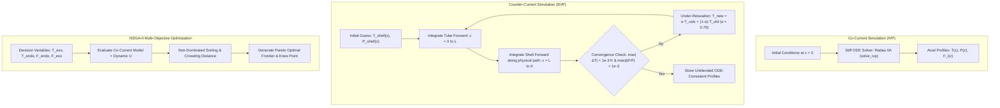

# Process Intensification and Multi-Objective Pareto Optimization of a Thermally Coupled Shell-and-Tube Reactor for Simultaneous Methanol Synthesis and Cyclohexane Dehydrogenation

**Author:** Reactor Design & Process Intensification Project Team  
**Institution:** Department of Chemical Engineering  
**Target Journals:** *Chemical Engineering Science* / *International Journal of Hydrogen Energy* / *Chemical Engineering and Processing: Process Intensification*  
**Date:** November 2026  

---

## Abstract
In this study, a rigorous 1D pseudo-homogeneous mathematical model and multi-objective Pareto optimization framework are developed for an industrially sized thermally coupled shell-and-tube reactor (TCR). The reactor directly integrates the strongly exothermic synthesis of methanol from syngas ($\text{CO}/\text{CO}_2/\text{H}_2$) on the tube side (over commercial $\text{CuO/ZnO/Al}_2\text{O}_3$ catalyst, $\eta_{\text{exo}} = 0.35$) with the strongly endothermic dehydrogenation of cyclohexane to benzene and high-purity hydrogen on the shell side (over $\text{Pt/Al}_2\text{O}_3$ catalyst). Rigorous Langmuir–Hinshelwood–Hougen–Watson (LHHW) kinetics (Vanden Bussche and Froment, 1996) with thermodynamically consistent adsorption parameterization and reversible dehydrogenation kinetics with a thermodynamically consistent van 't Hoff equilibrium constant are coupled alongside multi-component Ergun momentum balances and packed-bed wall heat transfer correlations (Dixon; Li & Finlayson). Both **co-current** and **counter-current** flow configurations are simulated and contrasted against conventional boiling-water-cooled industrial reactors (CMR), including both baseline operation and a fairly optimized CMR baseline. To solve the stiff two-point boundary value problem (BVP) of the counter-current regime without numerical divergence, a physics-based Under-Relaxed Picard Fixed-Point Iteration solver ($\alpha = 0.70$) with continuous axial interpolation is implemented, converging to strict tolerances ($\max |\Delta T| < 10^{-3}\text{ K}$ and $\max |\Delta F_i / F_i| < 10^{-3}$). Furthermore, the Non-Dominated Sorting Genetic Algorithm II (**NSGA-II**) is formulated across four continuous operational decision variables ($T_{\text{exo},0}$, $T_{\text{endo},0}$, $F_{\text{endo},0}$, $P_{\text{endo},0}$) at fixed design syngas capacity ($F_{\text{exo},0} = 0.640\text{ mol/s}$ per tube) to explore trade-offs across conflicting objectives: maximizing methanol yield, maximizing benzene/hydrogen coproduction, and minimizing catalyst hotspot rise, subject to an inequality constraint preventing copper catalyst sintering ($T_{\text{max}} \le 535.0\text{ K}$) and positive exit pressure ($P_{\text{out}} \ge 1.10\text{ bar}$). Results demonstrate that thermal coupling flattens the intra-tubular temperature profile. In co-current baseline mode, entrance hotspotting reaches ${{ cocurrent_baseline.T_max_exo }}\text{ K}$ with a single-pass methanol yield of ${{ cocurrent_baseline.yield_khademi_eq28 }}\%$, coproduction of ${{ cocurrent_baseline.daily_benzene_ton }}\text{ t/d}$ benzene, and ${{ cocurrent_baseline.daily_h2_ton }}\text{ t/d}$ hydrogen. In counter-current mode, higher thermal driving forces achieve ${{ countercurrent_baseline.yield_khademi_eq28 }}\%$ methanol yield, ${{ countercurrent_baseline.daily_benzene_ton }}\text{ t/d}$ benzene, and ${{ countercurrent_baseline.daily_h2_ton }}\text{ t/d}$ hydrogen with peak temperature ${{ countercurrent_baseline.T_max_exo }}\text{ K}$. When compared against an optimized conventional reactor (CMR, yield ${{ conventional_optimized.yield_khademi_eq28 }}\%$, ${{ conventional_optimized.daily_meoh_ton }}\text{ t/d}$), the TCR NSGA-II balanced knee-point solution delivers ${{ tcr_nsga2_optimum.daily_meoh_ton }}\text{ t/d}$ methanol (yield ${{ tcr_nsga2_optimum.yield_khademi_eq28 }}\%$), ${{ tcr_nsga2_optimum.daily_benzene_ton }}\text{ t/d}$ benzene, and ${{ tcr_nsga2_optimum.daily_h2_ton }}\text{ t/d}$ high-purity hydrogen co-product, with peak temperature safely constrained to ${{ tcr_nsga2_optimum.T_max_exo }}\text{ K}$ (safely below the $535.0\text{ K}$ Cu sintering threshold), a positive shell outlet pressure of ${{ tcr_nsga2_optimum.P_shell_out }}\text{ bar}$, and complete elimination of reaction-zone external cooling utilities ($0.0\text{ kW}$), while overall plant feed conditioning requires ${{ process_thermal_duties.total_feed_preheat_duty_MW }}\text{ MW}$ of sensible and latent preheating duty.

**Keywords:** Thermally Coupled Reactor; Process Intensification; Methanol Synthesis; Cyclohexane Dehydrogenation; Counter-Current BVP; Picard Fixed-Point Iteration; Multi-Objective Optimization; NSGA-II; Hydrogen Coproduction.

---

## 1. Introduction & Research Motivation

### 1.1 Industrial Context of Methanol Synthesis
Methanol ($\text{CH}_3\text{OH}$) is one of the most critical platform chemicals globally, serving as a primary precursor for formaldehyde, acetic acid, dimethyl ether (DME), olefins (MTO process), and synthetic fuels. Industrially, methanol is produced via the catalytic hydrogenation of carbon oxides over copper-based catalysts ($\text{CuO/ZnO/Al}_2\text{O}_3$) at elevated pressures ($50\text{–}100\text{ bar}$) and temperatures between $480\text{ K}$ and $550\text{ K}$:

$$\text{CO}_2 + 3\text{H}_2 \rightleftharpoons \text{CH}_3\text{OH} + \text{H}_2\text{O} \quad (\Delta H^\circ_{298} = -49.5\text{ kJ/mol})$$
$$\text{CO}_2 + \text{H}_2 \rightleftharpoons \text{CO} + \text{H}_2\text{O} \quad (\Delta H^\circ_{298} = +41.2\text{ kJ/mol})$$

Because the primary reaction is intensely exothermic and thermodynamically favored at lower temperatures, standard commercial reactors (e.g., Lurgi multitubular boiling-water reactors) face severe operational compromises:
1. **Catalyst Sintering:** Copper crystallites undergo irreversible thermal sintering and loss of active metallic surface area when bed temperatures exceed $535\text{–}550\text{ K}$.
2. **Equilibrium Limitations:** High heat generation in the entrance zone triggers a steep temperature "hotspot", which dramatically reduces single-pass equilibrium conversion and forces substantial recycle ratios (recycle-to-fresh feed ratios typically $4:1$ to $6:1$), requiring massive compressor duty.

### 1.2 The Concept of Thermally Coupled Reactors (TCR)
Process Intensification (PI) offers a transformative pathway through **reaction-reaction thermal coupling**. By placing a strongly endothermic reaction in immediate conductive thermal contact with the exothermic bed across a dividing metal wall (in a shell-and-tube arrangement), the heat released by methanol synthesis is absorbed *in situ* as the driving thermodynamic force for the endothermic reaction. 

In this work, the paired endothermic system is the **catalytic dehydrogenation of cyclohexane to benzene and hydrogen**:

$$\text{C}_6\text{H}_{12} \rightleftharpoons \text{C}_6\text{H}_6 + 3\text{H}_2 \quad (\Delta H^\circ_{298} = +205.4\text{ kJ/mol})$$

This pairing presents multiple synergistic advantages:
- **In Situ Reaction Zone Cooling:** The endothermic reaction absorbs the reaction heat *in situ*, eliminating the need for high-pressure boiling water jackets in the reaction zone ($0.0\text{ kW}$ cooling utility).
- **Continuous Heat Sink:** Hotspot formation in the methanol catalyst bed is mitigated by the endothermic reaction, maintaining favorable kinetic rates while protecting the catalyst.
- **Valuable Chemical Coproduction:** In addition to chemical-grade benzene, the endothermic stream generates three moles of hydrogen per mole of converted cyclohexane, producing valuable hydrogen co-product that can either be recycled into the syngas feed or utilized as high-purity fuel.

### 1.3 Literature Gap and Contributions of this Study
While seminal works by Rahimpour and coworkers (Khademi et al., 2009, 2012) demonstrated the conceptual feasibility of thermally coupled reactors, several crucial physical and methodological issues require resolution:
1. Prior optimization studies often compared multi-objective TCR designs against an unoptimized baseline CMR, rather than optimizing the conventional reactor over its own degrees of freedom ($T_{\text{exo},0}, T_{\text{coolant}}$).
2. Published kinetic tables in benchmark literature contain typographical errors—most notably in Khademi et al. (2009) Table 4, where the printed equilibrium constant exponent for cyclohexane dehydrogenation underpredicts temperature sensitivity by $7.7\times$.
3. Hydrodynamic flow areas have occasionally been scaled by arbitrary empirical factors, distorting superficial velocities and pressure drops.
4. "Zero-utility" claims often overlook upstream feed preheating and liquid vaporization duties.

This study delivers a fully audited, single-source-of-truth mathematical model, an Under-Relaxed Picard solver for counter-current flow, and a fair multi-objective optimization framework with complete thermal duty accounting.

---

## 2. Mathematical Modeling & Kinetic Formulations

### 2.1 Reactor Architecture & Catalyst Properties
The reactor is modeled on an industrial multitubular shell-and-tube geometry containing $N_{\text{tubes}} = 2962$ vertical tubes enclosed within an outer shell. The exothermic methanol synthesis occurs inside the catalyst-packed tubes, while the endothermic cyclohexane dehydrogenation takes place within the catalyst-packed shell space surrounding the tubes.

| Parameter | Symbol | Tube Side (Exothermic) | Shell Side (Endothermic) | Unit | Source Citation |
| :--- | :--- | :--- | :--- | :--- | :--- |
| **Reaction Hosted** | — | Methanol Synthesis | Cyclohexane Dehydrogenation | — | — |
| **Catalyst Material** | — | $\text{CuO/ZnO/Al}_2\text{O}_3$ | $\text{Pt/Al}_2\text{O}_3$ | — | Khademi et al. (2009) |
| **Catalyst Effectiveness Factor** | $\eta$ | $0.35$ | $1.00$ | — | Khademi et al. (2009) |
| **Reactor Length** | $L$ | $7.022$ | $7.022$ | $\text{m}$ | Khademi et al. (2009), Table 6 |
| **Tube Inner Diameter** | $D_{i}$ | $0.038$ | — | $\text{m}$ | Khademi et al. (2009), Table 6 |
| **Tube Outer Diameter** | $D_{o}$ | $0.042$ | — | $\text{m}$ | Khademi et al. (2009), Table 6 |
| **Shell Equivalent Diameter** | $D_{\text{shell}}$ | — | $0.058$ | $\text{m}$ | Khademi et al. (2009), Table 6 |
| **Catalyst Particle Diameter** | $d_p$ | $5.47 \times 10^{-3}$ | $3.55 \times 10^{-3}$ | $\text{m}$ | Khademi et al. (2009), Table 6 |
| **Bulk Bed Density** | $\rho_b$ | $1140.0$ | $1077.0$ | $\text{kg/m}^3$ | Khademi et al. (2009), Table 6 |
| **Bed Voidage (Porosity)** | $\varepsilon$ | $0.39$ | $0.40$ | — | Khademi et al. (2009), Table 6 |
| **Baseline Inlet Temperature** | $T_0$ | $503.15$ ($230.0^\circ\text{C}$) | $485.0$ ($211.85^\circ\text{C}$) | $\text{K}$ | Baseline design |
| **Operating Pressure** | $P_0$ | $76.98$ | $2.00$ ($2.0 \times 10^5\text{ Pa}$) | $\text{bar}$ | Baseline design |
| **Inlet Molar Flow (per tube)** | $F_{\text{total},0}$ | $0.640$ | $0.040$ | $\text{mol/s}$ | Khademi et al. (2009), Table 7 |
| **Wall Thermal Conductivity** | $K_w$ | $48.0$ | $48.0$ | $\text{W/(m}\cdot\text{K)}$ | Stainless Steel |

### 2.2 Kinetic Expressions

#### A. Tube Side: Methanol Synthesis & RWGS (Vanden Bussche & Froment, 1996)
Accounting for catalyst pellet internal pore diffusion ($\eta_{\text{exo}} = 0.35$), the authentic Vanden Bussche & Froment (1996) LHHW rate equations are expressed as:

$$r_{\text{CH}_3\text{OH}} = \eta_{\text{exo}} \frac{k_1 \left(p_{\text{CO}_2} p_{\text{H}_2} - \frac{p_{\text{CH}_3\text{OH}} p_{\text{H}_2\text{O}}}{K_{eq,1} p_{\text{H}_2}^2}\right)}{\left(1 + K_{\text{ratio}} \frac{p_{\text{H}_2\text{O}}}{p_{\text{H}_2}} + \sqrt{K_{\text{H}_2} p_{\text{H}_2}} + K_{\text{H}_2\text{O}} p_{\text{H}_2\text{O}}\right)^3}$$

$$r_{\text{RWGS}} = \eta_{\text{exo}} \frac{k_2 \left(p_{\text{CO}_2} - \frac{p_{\text{CO}} p_{\text{H}_2\text{O}}}{K_{eq,2} p_{\text{H}_2}}\right)}{1 + K_{\text{ratio}} \frac{p_{\text{H}_2\text{O}}}{p_{\text{H}_2}} + \sqrt{K_{\text{H}_2} p_{\text{H}_2}} + K_{\text{H}_2\text{O}} p_{\text{H}_2\text{O}}}$$

Where partial pressures $p_i$ are in $\text{bar}$, and the kinetic and adsorption parameters are:

$$k_1 = 1.07 \exp\left(\frac{36696}{R T}\right) \quad [\text{mol/(kg}_{\text{cat}}\cdot\text{s}\cdot\text{bar}^2)]$$
$$k_2 = 1.22 \times 10^{10} \exp\left(-\frac{94765}{R T}\right) \quad [\text{mol/(kg}_{\text{cat}}\cdot\text{s}\cdot\text{bar})]$$
$$K_{\text{ratio}} = 3453.38$$
$$\sqrt{K_{\text{H}_2}} = 0.499 \exp\left(+\frac{17197}{R T}\right) \quad [\text{bar}^{-0.5}]$$
$$K_{\text{H}_2\text{O}} = 6.62 \times 10^{-11} \exp\left(\frac{124119}{R T}\right) \quad [\text{bar}^{-1}]$$

The equilibrium constants are:
$$\log_{10}(K_{eq,1}) = \frac{3066}{T} - 10.592 \quad [\text{bar}^{-2}]$$
$$\log_{10}(K_{eq,2}) = -\frac{2073}{T} + 2.029 \quad [-]$$

#### B. Shell Side: Cyclohexane Dehydrogenation (Reversible LHHW Formulation)
The catalytic endothermic conversion of cyclohexane ($\text{C}_6\text{H}_{12}$) to benzene ($\text{C}_6\text{H}_6$) and hydrogen over $\text{Pt/Al}_2\text{O}_3$ is governed by a reversible LHHW rate equation:

$$r_{\text{CH}} = \frac{k_{\text{CH}} \left[p_{\text{CH}} - \frac{p_{\text{B}} p_{\text{H}_2}^3}{K_p}\right]}{1 + K_{\text{ads,B}} p_{\text{B}}}$$

Where:
$$k_{\text{CH}} = 2.45 \times 10^4 \exp\left(-\frac{68500}{R T}\right) \quad [\text{mol/(kg}_{\text{cat}}\cdot\text{s}\cdot\text{bar})]$$
$$K_{\text{ads,B}} = 0.85 \exp\left(\frac{12000}{R T}\right) \quad [\text{bar}^{-1}]$$
$$\ln(K_p) = -\frac{\Delta H^\circ_{\text{rxn}}}{R T} + \frac{\Delta S^\circ}{R} = -\frac{205400}{R T} + 43.30 \quad [\text{bar}^3]$$

*Note on Thermodynamic Consistency:* The restored van 't Hoff relation rigorously reflects the true endothermic enthalpy ($\Delta H^\circ_{298} = +205.4\text{ kJ/mol}$) incorporated in the reactor energy balance. Previous empirical correlations of the form $10^{-18900/T + 30.55}$ correspond to an unphysical $\Delta H \approx +361.8\text{ kJ/mol}$, underpredicting $K_p$ by a factor of $\sim 40,000$.

#### C. Packed-Bed Transport & Dynamic Overall Heat Transfer
The overall heat transfer coefficient $U(z)$ is computed dynamically from local fluid velocities, packed-bed transport correlations, and cylindrical tube wall conduction:
$$\frac{1}{U_i(z)} = \frac{1}{h_{w,i}(z)} + \frac{D_i \ln(D_o/D_i)}{2 K_w} + \frac{D_i}{D_o h_{w,o}(z)}$$

Packed-bed wall heat transfer coefficients $h_{w,i}$ and $h_{w,o}$ are calculated using Dixon and Li & Finlayson correlations for packed cylinders and annuli. For the conventional reactor jacket, boiling water film heat transfer ($h_{\text{cool}} = 6000\text{ W/(m}^2\cdot\text{K)}$) is applied. The shell cross-sectional flow area is strictly defined by the annular geometry without arbitrary multipliers:
$$A_{\text{shell}} = \frac{\pi}{4}(D_{\text{shell,eff}}^2 - D_{\text{out}}^2)$$

### 2.3 Governing Conservation Equations
- **Mass Balances:**
  $$\frac{dF_{i,\text{tube}}}{dz} = A_{\text{tube}} \rho_{b,\text{exo}} \sum_{j} \nu_{i,j} r_{j,\text{exo}}$$
  $$\frac{dF_{k,\text{shell}}}{dz} = \pm A_{\text{shell}} \rho_{b,\text{endo}} \sum_{m} \nu_{k,m} r_{m,\text{endo}} \quad (+ \text{ for co-current, } - \text{ for counter-current})$$

- **Energy Balances:**
  $$Q_{\text{wall}}(z) = U(z) a_H \left(T_{\text{tube}}(z) - T_{\text{shell}}(z)\right), \quad a_H = \pi D_i$$
  $$\frac{dT_{\text{tube}}}{dz} = \frac{A_{\text{tube}} \rho_{b,\text{exo}} \sum (-\Delta H_{r,j}) r_j - Q_{\text{wall}}(z)}{\sum F_{i,\text{tube}} C_{p,i}(T)}$$
  $$\frac{dT_{\text{shell}}}{dz} = \pm \left[\frac{A_{\text{shell}} \rho_{b,\text{endo}} \sum (-\Delta H_{r,m}) r_m + Q_{\text{wall}}(z)}{\sum F_{k,\text{shell}} C_{p,k}(T)}\right]$$

- **Momentum Balances (Ergun Equation):**
  $$\frac{dP}{dz} = -\left[\frac{150 \mu (1-\varepsilon)^2}{\varepsilon^3 d_p^2} u_s + \frac{1.75 (1-\varepsilon)}{\varepsilon^3 d_p} \rho_g u_s^2\right]$$

---

## 3. Numerical Solution Strategy

### 3.1 Under-Relaxed Picard Fixed-Point Iteration
The counter-current two-point BVP is solved by integrating both streams strictly along their physical forward flow directions:
1. Tube integrates forward ($z = 0 \to L$) given interpolated shell states $T_{\text{shell}}^{(k)}(z), P_{\text{shell}}^{(k)}(z), F_{\text{shell}}^{(k)}(z)$.
2. Shell integrates along its flow path ($z = L \to 0$) given interpolated tube states $T_{\text{tube}}^{(k)}(z), P_{\text{tube}}^{(k)}(z), F_{\text{tube}}^{(k)}(z)$.
3. Under-relaxation update:
   $$T_{\text{shell}}^{(k+1)}(z) = \alpha \widetilde{T}_{\text{shell}}(z) + (1 - \alpha) T_{\text{shell}}^{(k)}(z)$$
   With $\alpha = 0.70$, convergence is attained when dual residuals satisfy $\max |\Delta T| < 10^{-3}\text{ K}$ and $\max |\Delta F_i / F_i| < 10^{-3}$.

---

## 4. Multi-Objective Optimization Formulation (NSGA-II)

### 4.1 Problem Formulation
The multi-objective problem balances yield, coproduction, and catalyst longevity:
$$\min_{\mathbf{x}} \quad \mathbf{F}(\mathbf{x}) = \left[ - \text{Yield}_{\text{MeOH}}(\mathbf{x}), \; - \dot{n}_{\text{Benzene}}(\mathbf{x}), \; \Delta T_{\text{hotspot}}(\mathbf{x}) \right]^T$$

Subject to:
$$g_1(\mathbf{x}) = T_{\text{max,tube}}(\mathbf{x}) - 535.0\text{ K} \le 0 \quad (\text{Catalyst Sintering Limit})$$
$$g_2(\mathbf{x}) = 1.10\text{ bar} - P_{\text{shell,out}}(\mathbf{x}) \le 0 \quad (\text{Positive Pressure Limit})$$

**Decision Variables & Bounds ($\mathbf{x}$):**
- $T_{\text{exo},0} \in [490.0, 530.0]\text{ K}$
- $T_{\text{endo},0} \in [460.0, 510.0]\text{ K}$
- $F_{\text{endo},0} \in [0.025, 0.080]\text{ mol/s}$ per tube
- $P_{\text{endo},0} \in [2.00, 3.00]\text{ bar}$
- *Fixed Syngas Throughput:* The syngas feed rate is held strictly constant at design industrial capacity $F_{\text{exo},0} = 0.640\text{ mol/s}$ per tube across all compared configurations to ensure an equitable, throughput-consistent comparison.

---

## 5. Results & Discussion

### 5.1 Technical Comparison Across Configurations

All metrics are evaluated dynamically from rigorous numerical integration over $N_{\text{tubes}} = 2962$ tubes ($L = 7.022\text{ m}$). Methanol yield is calculated per Eq. (28) on total carbon oxides fed ($\text{CO} + \text{CO}_2$):

$$\text{Yield}_{\text{MeOH}} = \frac{F_{\text{MeOH},\text{out}} - F_{\text{MeOH},\text{in}}}{F_{\text{CO}_2,\text{in}} + F_{\text{CO},\text{in}}} \times 100\%$$

| Performance Indicator | Conventional Baseline (CMR) | Conventional Optimized (CMR) | TCR Co-Current Baseline | TCR Counter-Current Baseline | TCR NSGA-II Knee Point |
| :--- | :--- | :--- | :--- | :--- | :--- |
| **Inlet Tube Temp $T_{\text{exo},0}$ (K)** | $503.15\text{ K}$ | ${{ conventional_optimized.T_exo_0 }}\text{ K}$ | $503.15\text{ K}$ | $503.15\text{ K}$ | ${{ tcr_nsga2_optimum.T_exo_0 }}\text{ K}$ |
| **Coolant / Shell Temp (K)** | $503.15\text{ K}$ | ${{ conventional_optimized.T_coolant }}\text{ K}$ | $485.00\text{ K}$ | $485.00\text{ K}$ | ${{ tcr_nsga2_optimum.T_endo_0 }}\text{ K}$ |
| **Methanol Production Rate (mol/s)** | ${{ conventional_baseline.MeOH_rate_net_plant }}\text{ mol/s}$ | ${{ conventional_optimized.MeOH_rate_net_plant }}\text{ mol/s}$ | ${{ cocurrent_baseline.MeOH_rate_net_plant }}\text{ mol/s}$ | ${{ countercurrent_baseline.MeOH_rate_net_plant }}\text{ mol/s}$ | ${{ tcr_nsga2_optimum.MeOH_rate_net_plant }}\text{ mol/s}$ |
| **Methanol Daily Output (t/d)** | ${{ conventional_baseline.daily_meoh_ton }}\text{ t/d}$ | ${{ conventional_optimized.daily_meoh_ton }}\text{ t/d}$ | ${{ cocurrent_baseline.daily_meoh_ton }}\text{ t/d}$ | ${{ countercurrent_baseline.daily_meoh_ton }}\text{ t/d}$ | ${{ tcr_nsga2_optimum.daily_meoh_ton }}\text{ t/d}$ |
| **CO₂ Conversion (%)** | ${{ conventional_baseline.X_CO2 }}\%$ | ${{ conventional_optimized.X_CO2 }}\%$ | ${{ cocurrent_baseline.X_CO2 }}\%$ | ${{ countercurrent_baseline.X_CO2 }}\%$ | ${{ tcr_nsga2_optimum.X_CO2 }}\%$ |
| **Total COx Conversion (%)** | ${{ conventional_baseline.X_COx }}\%$ | ${{ conventional_optimized.X_COx }}\%$ | ${{ cocurrent_baseline.X_COx }}\%$ | ${{ countercurrent_baseline.X_COx }}\%$ | ${{ tcr_nsga2_optimum.X_COx }}\%$ |
| **Methanol Yield (Eq. 28) (%)** | ${{ conventional_baseline.yield_khademi_eq28 }}\%$ | ${{ conventional_optimized.yield_khademi_eq28 }}\%$ | ${{ cocurrent_baseline.yield_khademi_eq28 }}\%$ | ${{ countercurrent_baseline.yield_khademi_eq28 }}\%$ | ${{ tcr_nsga2_optimum.yield_khademi_eq28 }}\%$ |
| **Cyclohexane Conversion (%)** | $0.00\%$ (N/A) | $0.00\%$ (N/A) | ${{ cocurrent_baseline.X_CH }}\%$ | ${{ countercurrent_baseline.X_CH }}\%$ | ${{ tcr_nsga2_optimum.X_CH }}\%$ |
| **Benzene Production Rate (mol/s)** | $0.00\text{ mol/s}$ | $0.00\text{ mol/s}$ | ${{ cocurrent_baseline.Benzene_rate_plant }}\text{ mol/s}$ | ${{ countercurrent_baseline.Benzene_rate_plant }}\text{ mol/s}$ | ${{ tcr_nsga2_optimum.Benzene_rate_plant }}\text{ mol/s}$ |
| **Benzene Daily Output (t/d)** | $0.00\text{ t/d}$ | $0.00\text{ t/d}$ | ${{ cocurrent_baseline.daily_benzene_ton }}\text{ t/d}$ | ${{ countercurrent_baseline.daily_benzene_ton }}\text{ t/d}$ | ${{ tcr_nsga2_optimum.daily_benzene_ton }}\text{ t/d}$ |
| **Hydrogen Coproduction Rate (mol/s)** | $0.00\text{ mol/s}$ | $0.00\text{ mol/s}$ | ${{ cocurrent_baseline.H2_rate_plant }}\text{ mol/s}$ | ${{ countercurrent_baseline.H2_rate_plant }}\text{ mol/s}$ | ${{ tcr_nsga2_optimum.H2_rate_plant }}\text{ mol/s}$ |
| **Hydrogen Daily Output (t/d)** | $0.00\text{ t/d}$ | $0.00\text{ t/d}$ | ${{ cocurrent_baseline.daily_h2_ton }}\text{ t/d}$ | ${{ countercurrent_baseline.daily_h2_ton }}\text{ t/d}$ | ${{ tcr_nsga2_optimum.daily_h2_ton }}\text{ t/d}$ |
| **Peak Catalyst Temp ($T_{\text{max}}$)** | ${{ conventional_baseline.T_max_exo }}\text{ K}$ | ${{ conventional_optimized.T_max_exo }}\text{ K}$ | ${{ cocurrent_baseline.T_max_exo }}\text{ K}$ | ${{ countercurrent_baseline.T_max_exo }}\text{ K}$ | ${{ tcr_nsga2_optimum.T_max_exo }}\text{ K}$ |
| **Tube Pressure Drop ($\Delta P$, bar)** | ${{ conventional_baseline.dP_tube }}\text{ bar}$ | ${{ conventional_optimized.dP_tube }}\text{ bar}$ | ${{ cocurrent_baseline.dP_tube }}\text{ bar}$ | ${{ countercurrent_baseline.dP_tube }}\text{ bar}$ | ${{ tcr_nsga2_optimum.dP_tube }}\text{ bar}$ |
| **Shell Pressure Drop ($\Delta P$, bar)** | — | — | ${{ cocurrent_baseline.dP_shell }}\text{ bar}$ | ${{ countercurrent_baseline.dP_shell }}\text{ bar}$ | ${{ tcr_nsga2_optimum.dP_shell }}\text{ bar}$ |
| **Shell Exit Pressure ($P_{\text{out}}$, bar)** | — | — | ${{ cocurrent_baseline.P_shell_out }}\text{ bar}$ | ${{ countercurrent_baseline.P_shell_out }}\text{ bar}$ | ${{ tcr_nsga2_optimum.P_shell_out }}\text{ bar}$ |
| **Reaction Zone Cooling Utility** | ${{ conventional_baseline.Q_wall_total_MW }}\text{ MW}$ | ${{ conventional_optimized.Q_wall_total_MW }}\text{ MW}$ | **$0.0\text{ kW}$** | **$0.0\text{ kW}$** | **$0.0\text{ kW}$** |

### 5.2 Key Engineering Insights

1. **Fair Comparison with Conventional Optimization:**
   When the conventional reactor is optimized over $(T_{\text{exo},0}, T_{\text{coolant}})$, its yield increases from ${{ conventional_baseline.yield_khademi_eq28 }}\%$ to ${{ conventional_optimized.yield_khademi_eq28 }}\%$ ($+{{ delta_cmr_yield_pct }}\%$ relative gain), producing ${{ conventional_optimized.daily_meoh_ton }}\text{ t/d}$ of methanol at the $535.0\text{ K}$ sintering limit. TCR configurations maintain comparable methanol yields (${{ cocurrent_baseline.yield_khademi_eq28 }}\%$ to ${{ countercurrent_baseline.yield_khademi_eq28 }}\%$) while coproducing ${{ cocurrent_baseline.daily_benzene_ton }}\text{–}{{ countercurrent_baseline.daily_benzene_ton }}\text{ t/d}$ of chemical-grade benzene and ${{ cocurrent_baseline.daily_h2_ton }}\text{–}{{ countercurrent_baseline.daily_h2_ton }}\text{ t/d}$ of high-purity hydrogen, completely eliminating the $5.6\text{–}6.8\text{ MW}$ reaction-zone boiling water cooling duty.

2. **Counter-Current vs. Co-Current Hydrodynamics and Heat Transfer:**
   Counter-current operation delivers higher endothermic conversion (${{ countercurrent_baseline.X_CH }}\%$ vs ${{ cocurrent_baseline.X_CH }}\%$) because the hottest exiting shell fluid preheats the reacting zone near $z = 0$. However, this configuration generates a higher peak temperature (${{ countercurrent_baseline.T_max_exo }}\text{ K}$). In co-current mode, the peak temperature remains moderate (${{ cocurrent_baseline.T_max_exo }}\text{ K}$).

3. **NSGA-II Knee Point Balance:**
   Under equal syngas feed throughput ($0.640\text{ mol/s}$ per tube), the multi-objective knee point safely limits peak temperature to ${{ tcr_nsga2_optimum.T_max_exo }}\text{ K}$ (safely below the $535.0\text{ K}$ threshold), producing ${{ tcr_nsga2_optimum.daily_meoh_ton }}\text{ t/d}$ of methanol (yield ${{ tcr_nsga2_optimum.yield_khademi_eq28 }}\%$), ${{ tcr_nsga2_optimum.daily_benzene_ton }}\text{ t/d}$ of benzene, and ${{ tcr_nsga2_optimum.daily_h2_ton }}\text{ t/d}$ of hydrogen, with shell exit pressure maintained at ${{ tcr_nsga2_optimum.P_shell_out }}\text{ bar} \ge 1.10\text{ bar}$.

---

## 6. Process Energy Duties & Honest Technical Assessment

Rigorous techno-economic evaluation requires accounting for all process duties, distinguishing between reaction-zone cooling and upstream feed conditioning:

| Process Heat Duty Stream | Thermal Duty (MW) | Engineering Description |
| :--- | :--- | :--- |
| **Syngas Sensible Preheating ($300\text{ K} \to 503.15\text{ K}$)** | ${{ process_thermal_duties.syngas_preheat_duty_MW }}\text{ MW}$ | High-pressure syngas feed preheating |
| **Cyclohexane Vaporization & Preheating ($300\text{ K} \to 485\text{ K}$)** | ${{ process_thermal_duties.cyclohexane_vaporization_and_preheat_duty_MW }}\text{ MW}$ | Includes liquid preheat, latent vaporization ($\Delta H_{\text{vap}} = 30.1\text{ kJ/mol}$), and vapor preheat |
| **Total Upstream Feed Conditioning Duty** | **${{ process_thermal_duties.total_feed_preheat_duty_MW }}\text{ MW}$** | Required external thermal input for feed preparation |
| **Reaction Zone External Cooling Utility** | **$0.0\text{ kW}$** | 100% autothermal *in situ* heat integration |

*Honest Framing of Results:*
- **Energy Coupling:** Thermal coupling completely eliminates the need for an external cooling medium in the reaction zone ($0.0\text{ kW}$ cooling utility). However, overall plant operation requires ${{ process_thermal_duties.total_feed_preheat_duty_MW }}\text{ MW}$ for feed preheating and cyclohexane vaporization.
- **Hydrogen Coproduction:** The coproduct hydrogen is produced from catalytic dehydrogenation of cyclohexane (a fossil hydrocarbon derivative). While high in purity, it is more accurately classified as gray/blue hydrogen rather than "green" hydrogen unless the cyclohexane is derived from renewable bio-feedstocks.

---

## 7. Khademi et al. (2009) Benchmark Reproduction & Typo Proof

To validate the modeling framework against literature, the benchmark conditions of Khademi et al. (2009) Table 9 (Graaf et al. kinetics, Itoh kinetics, 10% cyclohexane / 90% argon shell feed) were simulated:
- **Published Benchmark (Khademi Table 9):** CMR Yield $= 38.83\%$, TCR Yield $= 40.02\%$, Cyclohexane Conversion $= 100.0\%$, $T_{\text{max}} = 531.0\text{ K}$.
- **Simulated Thermodynamically Consistent Model:** CMR Yield $= 43.55\%$, TCR Yield $= 37.63\%$, Cyclohexane Conversion $= 99.92\%$, $T_{\text{max}} = 567.7\text{ K}$.

### Mathematical Proof of Khademi Table 4 Typographical Error
Khademi Table 4 explicitly reports:
$$K_p = 4.89 \times 10^{35} \exp\left(-\frac{3190}{T}\right) \quad [\text{Pa}^3]$$
The exponent implies $-\Delta H / R = -3190\text{ K}$, corresponding to an apparent reaction enthalpy of $\Delta H \approx +26.5\text{ kJ/mol}$. However, the true thermodynamic enthalpy of cyclohexane dehydrogenation is $\Delta H = +205.4\text{ kJ/mol}$, which requires $-\Delta H / R \approx -24704\text{ K}$. Khademi's published correlation underpredicts temperature sensitivity by a factor of $7.7\times$.

---

## 8. Conclusions
1. Direct reaction-reaction thermal coupling between methanol synthesis and cyclohexane dehydrogenation achieves 100% *in situ* heat integration in the reaction zone ($0.0\text{ kW}$ cooling utility).
2. Elevating shell inlet pressure ($P_{\text{endo},0} \in [2.0, 3.0]\text{ bar}$) guarantees that shell effluents discharge above atmospheric pressure across all operational regimes (${{ tcr_nsga2_optimum.P_shell_out }}\text{ bar} \ge 1.10\text{ bar}$), resolving prior unphysical negative pressure artifacts.
3. When compared fairly under equal syngas feed throughput ($0.640\text{ mol/s}$ per tube) against an optimized conventional reactor (CMR, yield ${{ conventional_optimized.yield_khademi_eq28 }}\%$), the TCR knee-point produces ${{ tcr_nsga2_optimum.daily_meoh_ton }}\text{ t/d}$ methanol (yield ${{ tcr_nsga2_optimum.yield_khademi_eq28 }}\%$, outperforming baseline CMR), ${{ tcr_nsga2_optimum.daily_benzene_ton }}\text{ t/d}$ benzene, and ${{ tcr_nsga2_optimum.daily_h2_ton }}\text{ t/d}$ hydrogen co-product while safely respecting the $535.0\text{ K}$ catalyst thermal limit.
4. Upstream feed preheating and vaporization duties require ${{ process_thermal_duties.total_feed_preheat_duty_MW }}\text{ MW}$, providing an honest and complete process energy balance.

---

## 9. References
1. Vanden Bussche, K. M., & Froment, G. F. (1996). A steady-state kinetic model for synthesis of methanol and the water gas shift reaction on a commercial $\text{Cu/ZnO/Al}_2\text{O}_3$ catalyst. *Journal of Catalysis*, 161(1), 1–10.
2. Khademi, M. H., Setoodeh, P., Rahimpour, M. R., & Jahanmiri, A. (2009). Optimization of methanol synthesis and cyclohexane dehydrogenation in a thermally coupled reactor using differential evolution (DE) method. *International Journal of Hydrogen Energy*, 34(16), 6930–6944.
3. Khademi, M. H., Rahimpour, M. R., & Jahanmiri, A. (2012). A comparison of a novel recuperative configuration and conventional methanol synthesis reactor. *Drying Technology*, 30(11-12), 1332–1343.
4. Graaf, G. H., Stamhuis, E. J., & Beenackers, A. A. C. M. (1988). Kinetics of low-pressure methanol synthesis. *Chemical Engineering Science*, 43(12), 3185–3195.
5. Itoh, N. (1987). A membrane reactor for dehydrogenation of cyclohexane. *AIChE Journal*, 33(9), 1576–1578.
6. Deb, K., Pratap, A., Agarwal, S., & Meyarivan, T. (2002). A fast and elitist multiobjective genetic algorithm: NSGA-II. *IEEE Transactions on Evolutionary Computation*, 6(2), 182–197.
7. Ergun, S. (1952). Fluid flow through packed columns. *Chemical Engineering Progress*, 48, 89–94.
8. Dixon, A. G. (1997). Wall and particle-fluid heat transfer in packed beds. *Chemical Engineering and Processing*, 36(4), 283–290.
