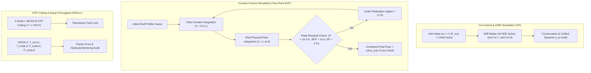
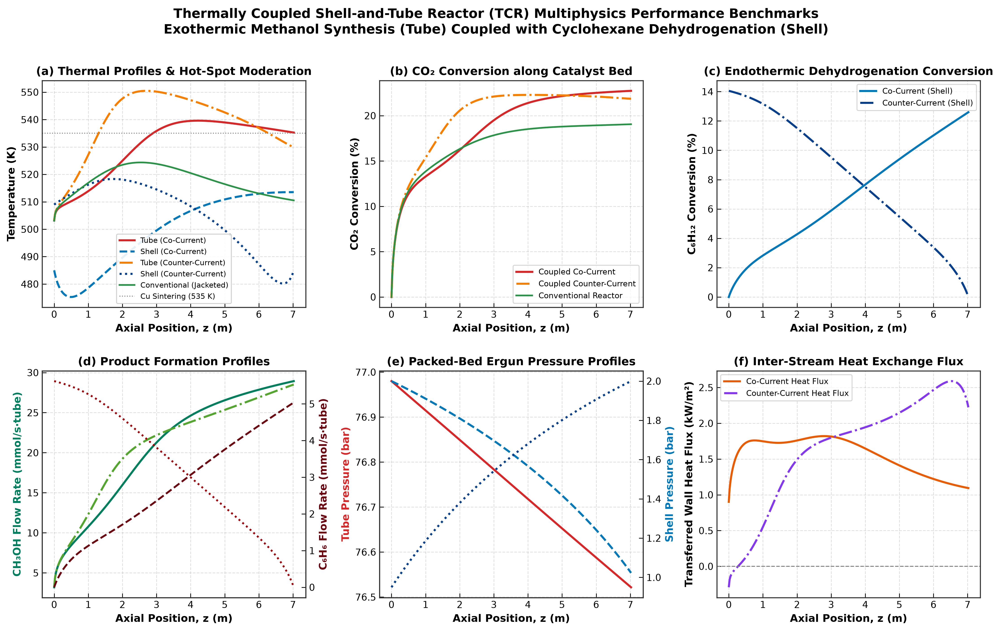
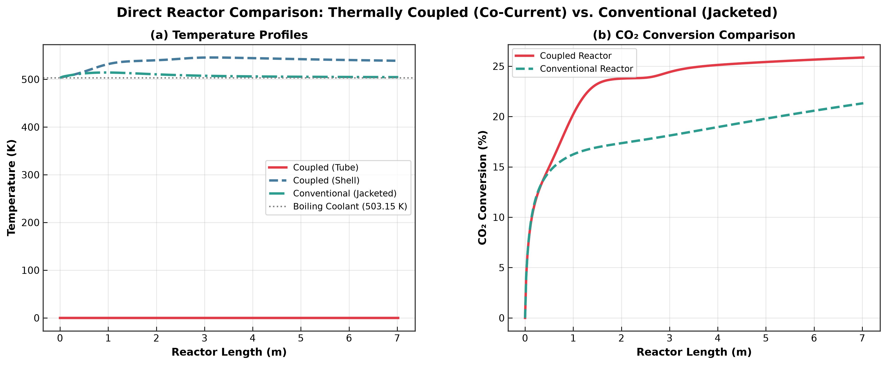
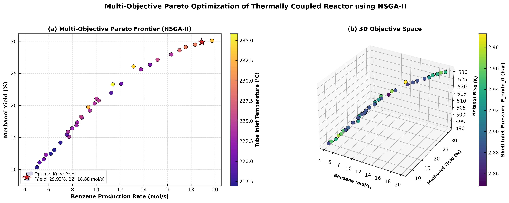
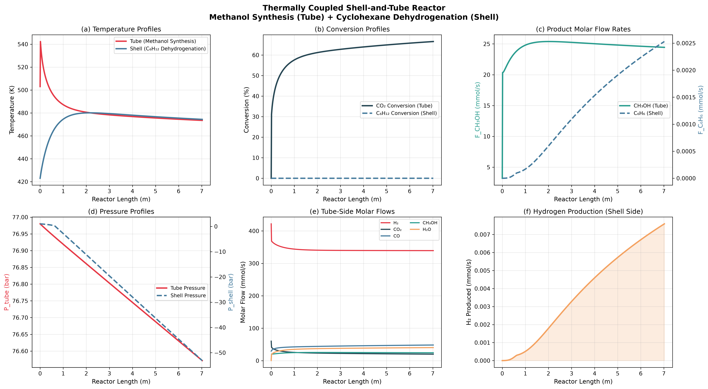
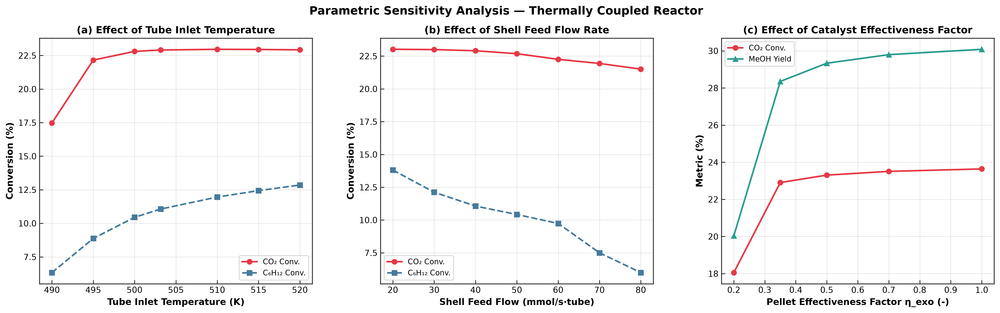

# A Critical Re-Assessment and Thermodynamic Ceiling Analysis of Thermally Coupled Methanol–Cyclohexane Reactors

**Authors:** Process Systems Engineering & Reaction Engineering Research Group  
**Keywords:** Thermally Coupled Reactor (TCR), Methanol Synthesis, Cyclohexane Dehydrogenation, Optimal Temperature Profile (OTP), Peng–Robinson EOS, Khademi (2009) Benchmark Forensics, Battery-Limit Energy Accounting, Bed-Lifting Hydraulics

---

## Abstract

Thermally coupled shell-and-tube reactors (TCRs) pairing exothermic methanol synthesis ($\text{CO}/\text{CO}_2$ hydrogenation over $\text{Cu/ZnO/Al}_2\text{O}_3$) with endothermic cyclohexane dehydrogenation ($\text{C}_6\text{H}_{12} \rightleftharpoons \text{C}_6\text{H}_6 + 3\text{H}_2$ over $\text{Pt/Al}_2\text{O}_3$) have been widely promoted in the process-intensification literature as a means to outperform conventional boiling-water-cooled methanol reactors (CMRs) while eliminating external cooling utilities. This study presents a rigorous, critical re-assessment and thermodynamic ceiling analysis of the methanol–cyclohexane TCR using a thermodynamically consistent, variable-property 1D pseudo-homogeneous fixed-bed model coupled with unified dynamic Bauer–Schlünder radial thermal conductivity, Peng–Robinson real-gas fugacities, and strict equal-throughput benchmarking ($F_{\text{exo},0} = 0.640\text{ mol/s}$ per tube across $N_{\text{tubes}} = 2962$ tubes, $L = 7.022\text{ m}$).

Five principal engineering findings reshape the techno-economic evaluation of this coupled architecture:
1. **Forensic Benchmark Reconciliation:** Independent verification of the canonical Khademi et al. (2009) benchmark reveals two severe typographical errors in their printed Table 1 methanol kinetic parameters (CO hydrogenation activation energy misprinted as $63{,}000$ vs. $113{,}000\text{ J/mol}$, and RWGS pre-exponential misprinted as $9.64 \times 10^{6}$ vs. $9.64 \times 10^{11}$ from Graaf et al., 1988) alongside a dual sign-and-magnitude typographical error in Table 4 for the cyclohexane equilibrium constant ($K_p$ printed with $+3190/T$ instead of the NIST-anchored Kirchhoff van 't Hoff slope $-\Delta H_r^\circ / R \approx -24{,}704\text{ K}$). Furthermore, Eq. (28) in Khademi et al. (2009) reports a *gross* methanol yield that includes inlet recycle methanol ($y_{\text{CH}_3\text{OH},0} = 0.0050$, contributing a fixed $+3.57\text{ percentage-point}$ baseline offset above net newly synthesized yield).
2. **Thermodynamic Ceiling (OTP) Analysis:** A 5-node L-BFGS-B Optimal Temperature Profile (OTP) ceiling analysis bounded by the $535.0\text{ K}$ copper sintering limit establishes a strict single-pass net methanol yield ceiling of ${{ otp.eta035.otp_net }}\%$ (${{ otp.eta035.otp_eq28 }}\%$ Eq. 28 gross) at the commercial pellet effectiveness factor $\eta_{\text{exo}} = 0.35$, and ${{ otp.eta100.otp_net }}\%$ (${{ otp.eta100.otp_eq28 }}\%$ gross) in the intrinsic limit $\eta_{\text{exo}} = 1.0$. Crucially, a fairly optimized boiling-water CMR at equal throughput already achieves ${{ conventional_optimized.yield_net_COx }}\%$ net yield (${{ conventional_optimized.yield_khademi_eq28 }}\%$ gross, ${{ conventional_optimized.daily_meoh_ton }}\text{ t/d}$)—within ${{ cmr_opt_vs_otp_eta035_gap_pp }}\text{ percentage points}$ of the theoretical OTP ceiling—demonstrating that thermal coupling cannot dramatically surpass a properly tuned conventional reactor in single-pass methanol yield.
3. **First-Law Battery-Limit Energy & Steam-Credit Accounting:** Reporting distinct First-Law energy qualities separately—heating duties ($\text{MW}_{\text{th}}$), cooling-water rejection ($\text{MW}_{\text{cw}}$), and electrical shaft work ($\text{MW}_e$)—eliminates misleading "zero-utility" accounting. While the TCR transfers ${{ tcr_nsga2_optimum.Q_wall_total_MW }}\text{ MW}_{\text{th}}$ *in situ* across the tube wall with $0.0\text{ kW}$ of reaction-zone external cooling, the optimized CMR simultaneously recovers ${{ conventional_optimized.cmr_steam_credit_MW }}\text{ MW}_{\text{th}}$ of exportable medium-pressure steam credit from its boiling-water jacket. Across plant battery limits, the NSGA-II TCR knee point (${{ tcr_nsga2_optimum.daily_meoh_ton }}\text{ t/d}$ methanol, ${{ tcr_nsga2_optimum.daily_benzene_ton }}\text{ t/d}$ co-produced benzene, ${{ tcr_nsga2_optimum.daily_h2_ton }}\text{ t/d}$ hydrogen within an $\text{H}_2$-rich reformate stream) incurs ${{ tcr_nsga2_optimum.total_feed_preheat_duty_MW }}\text{ MW}_{\text{th}}$ of feed vaporization/preheating and ${{ tcr_nsga2_optimum.Q_reboiler_sep_MW }}\text{ MW}_{\text{th}}$ of extractive distillation reboiler duty (yielding a net external heating penalty of ${{ tcr_vs_cmr_net_thermal_penalty_MW }}\text{ MW}_{\text{th}}$ relative to the optimized CMR), alongside separate flash-condenser cooling duties ($\text{MW}_{\text{cw}}$) and ${{ tcr_nsga2_optimum.W_psa_H2_MW }}\text{ MW}_e$ of hydrogen PSA electrical shaft work.
4. **Unified Dynamic Radial Conduction, Centerline Overshoot & Shell Hydraulics:** Evaluating packed-bed radial conductivity dynamically via the Bauer–Schlünder correlation yields $k_{er,\text{mean}} = {{ tcr_nsga2_optimum.k_er_mean }}\text{ W/(m}\cdot\text{K)}$ at the TCR knee point (and ${{ conventional_optimized.k_er_mean }}\text{ W/(m}\cdot\text{K)}$ in the optimized CMR). Crucially, enforcing only the conventional 1D bulk temperature constraint ($T_{\text{bulk,max}} \le 535.0\text{ K}$) allows the radial catalyst centerline to exceed the $535.0\text{ K}$ copper sintering ceiling—reaching $T_{\text{centerline,max}} = {{ conventional_optimized.T_centerline_max }}\text{ K}$ ($\Delta T_{\text{radial}} = {{ cmr_opt_delta_T_radial_K }}\text{ K}$) in the optimized CMR and ${{ tcr_nsga2_optimum.T_centerline_max }}\text{ K}$ ($\Delta T_{\text{radial}} = {{ tcr_knee_delta_T_radial_K }}\text{ K}$) at the TCR knee point—demonstrating why industrial 1D design optimization must enforce an explicit radial centerline safety derating. On the shell side, hydraulic stability auditing against static catalyst bed weight ($P_{\text{bed}} = {{ tcr_nsga2_optimum.bed_weight_bar }}\text{ bar}$) quantifies the upward-flow bed-lifting ratio at $\Delta P_{\text{shell}} / P_{\text{bed}} = {{ tcr_nsga2_optimum.bed_lifting_ratio }}$ (hold-down grid requirement: ${{ tcr_knee_hold_down_status }}$).
5. **Real-Gas Peng–Robinson EOS Audit:** Incorporating full Peng–Robinson fugacity coefficients at $76.98\text{ bar}$ shifts the benchmark CMR net methanol yield from ${{ eos.yield_net_ideal }}\%$ (ideal gas) to ${{ eos.yield_net_real_eos }}\%$ (real gas, $\Delta = {{ eos.diff_pct_points }}\text{ percentage points}$). Contrary to simplified equilibrium-only intuition, real-gas non-ideality slightly *reduces* kinetically controlled single-pass yield because non-ideal fugacities accelerate RWGS water formation and intensify kinetic water inhibition on the $\text{Cu/ZnO/Al}_2\text{O}_3$ surface.

---

## 1. Introduction & Critical Motivation

### 1.1 Industrial Methanol Synthesis and the Thermal Coupling Hypothesis
Commercial methanol synthesis converts pressurized synthesis gas ($\text{H}_2/\text{CO}/\text{CO}_2$, $50\text{–}100\text{ bar}$, $480\text{–}540\text{ K}$) over $\text{Cu/ZnO/Al}_2\text{O}_3$ catalysts via exothermic hydrogenation reactions coupled with the endothermic reverse water-gas shift (RWGS) reaction. Because copper crystallites sinter rapidly above $535\text{–}550\text{ K}$ while equilibrium conversion deteriorates monotonically with rising temperature, industrial Lurgi-type reactors pack catalyst inside narrow tubes ($D_{\text{in}} = 0.038\text{ m}$) surrounded by boiling water. Crucially, that boiling-water jacket is not merely a waste-heat sink: it recovers the enthalpy of reaction as exportable medium-pressure steam ($20\text{–}40\text{ bar}$), offsetting upstream compression and distillation energy demands.

Thermally coupled reactors (TCRs) replace the boiling-water jacket with a second catalytic bed in the shell carrying an endothermic reaction—most prominently cyclohexane dehydrogenation ($\text{C}_6\text{H}_{12} \rightleftharpoons \text{C}_6\text{H}_6 + 3\text{H}_2$, $\Delta H_{298}^\circ = +205.4\text{ kJ/mol}$) over $\text{Pt/Al}_2\text{O}_3$, proposed for liquid organic hydrogen carrier (LOHC) release and chemical co-production (Khademi et al., 2009). Prior optimization studies frequently claim significant methanol yield improvements alongside "zero cooling utility" operation. However, a rigorous engineering appraisal reveals five critical blind spots in earlier literature:

1. **Unverified Literature Kinetics & Equilibrium Typos:** Published TCR benchmark papers contain severe typographical errors in printed kinetic activation energies, pre-exponential factors, and endothermic equilibrium correlations, as well as a gross yield metric (Eq. 28) that folds inlet recycle methanol into reported conversion yields.
2. **Absence of a Thermodynamic Ceiling Benchmark:** Comparing a tuned TCR against an *unoptimized* baseline CMR conflates thermal coupling benefits with simple inlet-temperature optimization. Without computing the theoretical Optimal Temperature Profile (OTP) ceiling under identical kinetic and thermal sintering bounds, the true thermodynamic headroom available to any thermal-management scheme remains obscured.
3. **Incomplete Battery-Limit Energy Accounting:** Treating boiling-water heat removal in a CMR as a pure utility penalty ignores its valuable steam-generation credit, while treating TCR reaction-zone heat integration as "free" ignores cyclohexane vaporization/preheating, low single-pass equilibrium conversion, and the energy-intensive extractive distillation required to break the benzene–cyclohexane azeotrope ($\Delta T_{\text{bp}} = 0.6\text{ K}$).
4. **Inconsistent Radial Conductivity & Ignored Shell Bed-Lifting Hydraulics:** Fixed-bed thermal analyses that apply artificially low static radial conductivities ($k_{er}$) misstate centerline sintering margins, while shell-side packed beds subjected to high Ergun pressure drops in upward-flow configurations face fluidization and bed-lifting risks unless audited against catalyst bed weight ($\Delta P_{\text{shell}} / P_{\text{bed}}$).
5. **Mischaracterized High-Pressure Real-Gas Effects:** At $77\text{ bar}$, polar $\text{CH}_3\text{OH}$ and $\text{H}_2\text{O}$ exhibit sub-unity fugacity coefficients. Evaluating real-gas Peng–Robinson thermodynamics solely via equilibrium ratios omits the coupled kinetic consequence of shifted RWGS water formation and surface water inhibition.

### 1.2 Scope and Contributions of This Study
This work resolves each of these five gaps within a single-source-of-truth (SSOT) multiphysics simulation framework where every conservation law, thermodynamic derivative, and transport correlation is verified to machine or tight numerical precision:
- **(a) Khademi et al. (2009) Forensic Audit:** Exact reproduction using Khademi Table 7/8 shell geometry ($D_{\text{shell}} = 0.060\text{ m}$, $A_{\text{shell}} = 1.44199 \times 10^{-3}\text{ m}^2$, $\varepsilon_{\text{shell}} = 0.39$), reconciliation of Table 1 and Table 4 typographical errors, exact 3-to-2 Graaf stoichiometric projection, and transparent dual reporting of gross Eq. (28) versus net $\text{CO}_x$ methanol yields.
- **(b) Optimal Temperature Profile (OTP) Ceiling Analysis:** 5-node L-BFGS-B optimal temperature trajectory and best isothermal reactor ceilings at $\eta_{\text{exo}} = 0.35$ and $\eta_{\text{exo}} = 1.0$, proving that an equal-throughput optimized CMR already operates near the theoretical kinetic-thermodynamic ceiling.
- **(c) Fair Battery-Limit Energy & Steam-Credit Accounting:** Full comparison of CMR steam-generation thermal credit against TCR feed conditioning, extractive distillation reboiler duty, flash condensation, and hydrogen PSA compression work.
- **(d) Unified Dynamic Radial Conduction & Shell Hydraulic Stability:** Implementation of dynamic Bauer–Schlünder $k_{er}(z)$ for centerline hotspot verification alongside upward-flow bed-lifting ratio ($\Delta P_{\text{shell}} / P_{\text{bed}}$) and hold-down grid flagging.
- **(e) Coupled Real-Gas Peng–Robinson EOS Audit:** Quantitative comparison of full PR-EOS fugacity kinetics against ideal-gas kinetics, explaining the physical mechanism of the real-gas yield shift.

---

## 2. Mathematical Modeling & Physical Formulations

### 2.1 Reactor Geometry, Catalyst Beds, and Feed Specifications
The industrial benchmark basis follows a commercial multi-tubular shell-and-tube Lurgi methanol converter scale ($N_{\text{tubes}} = 2962$ tubes, industrial bundle-scaling basis), with single-tube dimensions from Khademi et al. (2009) Table 7 ($L = 7.022\text{ m}$, $D_{\text{in}} = 0.038\text{ m}$, $D_{\text{out}} = 0.042\text{ m}$, carbon steel wall $K_w = 48.0\text{ W/(m}\cdot\text{K)}$). For the production unit-cell model, tubes are arranged on a triangular pitch ($p_t = 0.05523\text{ m}$, $p_t / D_{\text{out}} = 1.315$), yielding an equivalent shell unit-cell diameter $D_{\text{shell,eff}} = 0.058\text{ m}$ and shell flow area $A_{\text{shell}} = \frac{\pi}{4}(D_{\text{shell,eff}}^2 - D_{\text{out}}^2) = 1.2566 \times 10^{-3}\text{ m}^2$. For exact literature benchmarking against Khademi et al. (2009) Tables 7–8, the benchmark module overrides shell geometry to their published $D_{\text{shell}} = 0.060\text{ m}$ ($A_{\text{shell}} = 1.44199 \times 10^{-3}\text{ m}^2$) and $\varepsilon_{\text{shell}} = 0.39$.

| Parameter | Exothermic Tube ($\text{Cu/ZnO/Al}_2\text{O}_3$) | Endothermic Shell ($\text{Pt/Al}_2\text{O}_3$) | Source / Notes |
| :--- | :--- | :--- | :--- |
| **Reactor Length $L$** | $7.022\text{ m}$ | $7.022\text{ m}$ | Khademi et al. (2009), Table 7 |
| **Flow Diameters** | $D_{\text{in}} = 0.038\text{ m}$, $D_{\text{out}} = 0.042\text{ m}$ | $D_{\text{shell,eff}} = 0.058\text{ m}$ ($0.060\text{ m}$ bench.) | Triangular unit-cell / Table 8 |
| **Catalyst Pellet Diameter $d_p$** | $5.47 \times 10^{-3}\text{ m}$ | $3.55 \times 10^{-3}\text{ m}$ | Khademi et al. (2009), Tables 7 & 8 |
| **Catalyst Bulk Density $\rho_b$** | $1140.0\text{ kg/m}^3$ | $1077.0\text{ kg/m}^3$ | Khademi et al. (2009); Itoh (1987) |
| **Bed Void Fraction $\varepsilon$** | $0.39$ | $0.40$ ($0.39$ bench.) | Table 7 / Production & Table 8 |
| **Baseline Effectiveness $\eta$** | $0.35$ (industrial lumped baseline); $1.0$ (Graaf bench.) | $1.0$ | Lumped commercial pellet baseline (cf. Froment et al., 2011); bounded via $\eta_{\text{exo}}$ sweep |
| **Inlet Pressure $P_0$** | $76.98\text{ bar}$ | $2.50\text{ bar}$ prod. ($1.013\text{ bar}$ bench.) | Pressurized shell prevents vacuum |
| **Inlet Flow Rate $F_0$ (per tube)** | $0.640\text{ mol/s}$ (strictly locked) | $0.040\text{ mol/s}$ prod. ($0.111\text{ mol/s}$ bench.) | Equal-throughput rule |
| **Feed Composition (mol frac.)** | $\text{H}_2: 0.6590$, $\text{CO}_2: 0.0940$, $\text{CO}: 0.0460$, $\text{CH}_3\text{OH}: 0.0050$, $\text{H}_2\text{O}: 0.0004$, $\text{CH}_4: 0.1026$, $\text{N}_2: 0.0930$ | Prod.: $95\%\text{ C}_6\text{H}_{12} / 5\%\text{ H}_2$; Bench.: $10\%\text{ C}_6\text{H}_{12} / 90\%\text{ Ar}$ | Table 7; $5\%\text{ H}_2$ co-feed avoids coking & rate singularity |

#### Mechanical Tube-Wall Integrity (ASME Section VIII)
Under the worst-case differential pressure across the tube wall ($\Delta P_{\max} = 76.98 - 1.0 = 75.98\text{ bar}$, wall thickness $t = 2.0\text{ mm}$, $R_{\text{in}} = 19.0\text{ mm}$), the thin-wall hoop stress is $\sigma_\theta = \Delta P_{\max} R_{\text{in}} / t = {{ tcr_nsga2_optimum.hoop_stress_MPa }}\text{ MPa}$, corresponding to an ASME Section VIII Division 1 safety factor of ${{ tcr_nsga2_optimum.asme_safety_factor }}$ against SA-213 T11 allowable stress at $535\text{ K}$ ($\approx 138\text{ MPa}$).

### 2.2 Unified Dynamic Radial Conductivity, Wall Heat Transfer, and Shell Hydraulics

#### Dynamic Bauer–Schlünder Effective Radial Conductivity ($k_{er}$)
In packed-bed methanol tubes with low tube-to-pellet aspect ratio ($D_{\text{in}}/d_p = 6.95$), radial heat dispersion is strongly dominated by convective mixing at high superficial mass flux ($Re_p \sim 1000\text{–}1400$). Rather than assuming an artificially static low radial conductivity, the model evaluates the effective radial thermal conductivity dynamically along the bed using the unified Bauer–Schlünder correlation:
$$k_{er}(z) = k_{er}^0 + \frac{Re_p(z)\, Pr(z)}{Pe_{hr}}\, k_g(z), \qquad Pe_{hr} = 8.0 \left[2 - \left(1 - \frac{2 d_p}{D_{\text{in}}}\right)^2\right]$$
where $k_{er}^0$ is the stagnant packed-bed conductivity and $k_g(z)$ is the local gas thermal conductivity. Using this unified dynamic $k_{er}(z)$, the local centerline catalyst temperature is reconstructed from the volumetric reaction heat release $q_v(z) = |Q_{\text{wall}}(z)| / A_{\text{tube}}$ via the parabolic radial conduction profile:
$$T_{\text{centerline}}(z) = T_{\text{mean}}(z) + \frac{q_v(z)\, R_{\text{in}}^2}{8\, k_{er}(z)}$$
Across the equal-throughput production regimes, dynamic convective dispersion produces $k_{er,\text{mean}} = {{ tcr_nsga2_optimum.k_er_mean }}\text{ W/(m}\cdot\text{K)}$ at the TCR knee point (and ${{ conventional_optimized.k_er_mean }}\text{ W/(m}\cdot\text{K)}$ in the optimized CMR). Even with strong convective radial mixing, the remaining radial temperature overshoots ($\Delta T_{\text{radial}} = {{ cmr_opt_delta_T_radial_K }}\text{ K}$ in the optimized CMR and ${{ tcr_knee_delta_T_radial_K }}\text{ K}$ at the TCR knee point) are sufficient to push $T_{\text{centerline,max}}$ above the $535.0\text{ K}$ copper sintering ceiling whenever only the 1D bulk temperature is constrained, underscoring the need for explicit radial centerline safety derating in industrial 1D reactor optimization.

#### Variable Gas Conductivity (Wassiljewa–Mason–Saxena) and Overall Heat Transfer Coefficient $U(z)$
Local gas mixture thermal conductivity on both tube and shell sides is evaluated via the Wassiljewa equation with Mason–Saxena interaction parameters:
$$k_{\text{mix}} = \sum_i \frac{y_i k_i}{\sum_j y_j \Phi_{ij}}, \qquad \Phi_{ij} = \frac{\left[1 + (\mu_i / \mu_j)^{1/2} (M_{w,j} / M_{w,i})^{1/4}\right]^2}{\left[8(1 + M_{w,i} / M_{w,j})\right]^{1/2}}$$
On the shell side, hydrogen generation progressively enriches the low-conductivity cyclohexane vapor ($k_g \approx 0.0245\text{ W/(m}\cdot\text{K)}$) with high-conductivity $\text{H}_2$ ($k_g \approx 0.2580\text{ W/(m}\cdot\text{K)}$), elevating the local heat transfer coefficient downstream. Wall heat transfer coefficients $h_{w,\text{tube}}(z)$ and $h_{w,\text{shell}}(z)$ are calculated dynamically via the Dixon (1997) / Li & Finlayson (1977) packed-bed correlations, yielding the local overall heat transfer coefficient referenced to the tube inner area ($a_H = \pi D_{\text{in}}$):
$$\frac{1}{U(z)} = \frac{1}{h_{w,\text{tube}}(z)} + \frac{D_{\text{in}}}{2 K_w} \ln\!\left(\frac{D_{\text{out}}}{D_{\text{in}}}\right) + \frac{D_{\text{in}}}{D_{\text{out}}\, h_{w,\text{shell}}(z)}$$
For the conventional boiling-water reactor (CMR), the shell resistance is replaced by the boiling-water film coefficient $h_{\text{cool}} = 6000\text{ W/(m}^2\cdot\text{K)}$.

#### Shell-Side Upward-Flow Bed-Lifting Hydraulic Audit
Packed-bed pressure drop is governed by the Ergun (1952) equation with Eisfeld–Schnitzlein (2001) wall-effect corrections:
$$\frac{dP}{dz} = -\left[\frac{150\, \mu\, (1-\varepsilon)^2}{\varepsilon^3 d_p^2} u_s + \frac{1.75\, (1-\varepsilon)}{\varepsilon^3 d_p} \rho_g u_s^2\right]$$
In counter-current or vertical upflow shell arrangements, an excessive frictional pressure drop across the annular $\text{Pt/Al}_2\text{O}_3$ bed can exceed the gravitational weight per unit area of the catalyst column, causing bed lifting, channeling, and attrition. The static bed weight pressure is:
$$P_{\text{bed}} = \rho_{b,\text{endo}}\, g\, L = 1077.0 \times 9.80665 \times 7.022 \times 10^{-5} = {{ tcr_nsga2_optimum.bed_weight_bar }}\text{ bar}$$
We define the dimensionless **bed-lifting ratio** as:
$$\mathcal{R}_{\text{lift}} \equiv \frac{\Delta P_{\text{shell}}}{P_{\text{bed}}}$$
Whenever $\mathcal{R}_{\text{lift}} \ge 0.85$ (applying a standard $15\%$ fluidization safety margin), upward shell flow is hydraulically unstable without mechanical restraint and is explicitly flagged as requiring a top **catalyst hold-down grid** (or downflow shell orientation).

### 2.3 Thermodynamically Consistent Reaction Kinetics & Real-Gas Fugacities

#### Production Exothermic Kinetics: Vanden Bussche & Froment (1996)
Production simulations employ the two-independent-reaction Vanden Bussche & Froment (1996) mechanism over commercial $\text{Cu/ZnO/Al}_2\text{O}_3$:
$$\text{(R1) }\ \text{CO}_2 + 3\text{H}_2 \rightleftharpoons \text{CH}_3\text{OH} + \text{H}_2\text{O}, \qquad \Delta H_{298}^\circ = -49.5\text{ kJ/mol}$$
$$\text{(R2) }\ \text{CO}_2 + \text{H}_2 \rightleftharpoons \text{CO} + \text{H}_2\text{O}, \qquad \Delta H_{298}^\circ = +41.2\text{ kJ/mol}$$
using component fugacities $f_i = \phi_i y_i P$ from the Peng–Robinson equation of state (PR-EOS) with van der Waals mixing rules:
$$r_{\text{MeOH}} = \eta_{\text{exo}} \frac{k_5'\, f_{\text{CO}_2}\, f_{\text{H}_2} \left[1 - \frac{1}{K_{\text{eq},1}} \frac{f_{\text{CH}_3\text{OH}} f_{\text{H}_2\text{O}}}{f_{\text{CO}_2} f_{\text{H}_2}^3}\right]}{\left(1 + K_{\text{ad},1} \frac{f_{\text{H}_2\text{O}}}{f_{\text{H}_2}} + K_{\text{ad},2} \sqrt{f_{\text{H}_2}} + K_{\text{ad},3} f_{\text{H}_2\text{O}}\right)^3}$$
$$r_{\text{RWGS}} = \eta_{\text{exo}} \frac{k_1'\, f_{\text{CO}_2} \left[1 - \frac{1}{K_{\text{eq},2}} \frac{f_{\text{CO}} f_{\text{H}_2\text{O}}}{f_{\text{CO}_2} f_{\text{H}_2}}\right]}{1 + K_{\text{ad},1} \frac{f_{\text{H}_2\text{O}}}{f_{\text{H}_2}} + K_{\text{ad},2} \sqrt{f_{\text{H}_2}} + K_{\text{ad},3} f_{\text{H}_2\text{O}}}$$
Baseline production optimizations apply an industrial lumped pellet effectiveness baseline of $\eta_{\text{exo}} = 0.35$ (`use_dynamic_thiele = False`; reflecting intrapellet diffusion resistance in commercial $5.47\text{ mm}$ pellets, rather than an intrinsic constant from Vanden Bussche & Froment, 1996, whose rate law is intrinsic) identically across all CMR and TCR configurations; the full impact of intrapellet diffusion is bounded separately via the $\eta_{\text{exo}} \in [0.20, 1.00]$ sensitivity sweep (Section 5.5) and dual-$\eta$ OTP ceilings ($\eta_{\text{exo}} = 0.35$ and $1.00$, Section 5.1).

#### Benchmark Exothermic Kinetics: Authentic Graaf et al. (1988) & Exact 3-to-2 Stoichiometric Projection
To audit Khademi et al. (2009), the benchmark module implements the authentic 3-reaction Graaf et al. (1988) kinetics over CO hydrogenation ($r_1$), RWGS ($r_2$), and $\text{CO}_2$ hydrogenation ($r_3$). Because CO hydrogenation ($\text{CO} + 2\text{H}_2 \rightleftharpoons \text{CH}_3\text{OH}$) is the exact linear difference $\text{R1} - \text{R2}$, the 3-reaction rates map onto the 2-reaction independent VBF stoichiometric basis without loss of exactness via:
$$r_{\text{meoh}} = r_1 + r_3, \qquad r_{\text{rwgs}} = r_2 - r_1$$
This exact projection preserves every individual species production rate ($R_{\text{H}_2}, R_{\text{CO}_2}, R_{\text{CO}}, R_{\text{CH}_3\text{OH}}, R_{\text{H}_2\text{O}}$), C/H/O elemental conservation to machine precision ($<10^{-14}$), and Hess's Law enthalpy release: $\Delta H_1 r_1 + \Delta H_2 r_2 + \Delta H_3 r_3 \equiv \Delta H_{\text{meoh}} r_{\text{meoh}} + \Delta H_{\text{rwgs}} r_{\text{rwgs}}$.

#### Endothermic Kinetics & NIST-Anchored Kirchhoff Thermodynamics
Cyclohexane dehydrogenation over $\text{Pt/Al}_2\text{O}_3$ ($\text{C}_6\text{H}_{12} \rightleftharpoons \text{C}_6\text{H}_6 + 3\text{H}_2$, $\Delta H_{298}^\circ = +205.4\text{ kJ/mol}$) follows the reversible Langmuir–Hinshelwood rate law of Itoh (1987) and Khademi et al. (2009) with microscopic reversibility guaranteed by evaluating $K_p(T)$ from exact Kirchhoff integration of Shomate/polynomial heat capacities anchored to NIST Chemistry WebBook standard entropies ($\Delta S_{r,298}^\circ = S_{298,\text{C}_6\text{H}_6}^\circ + 3 S_{298,\text{H}_2}^\circ - S_{298,\text{C}_6\text{H}_{12}}^\circ = 362.96\text{ J/(mol}\cdot\text{K)}$):
$$\frac{d \ln K_p(T)}{dT} = \frac{\Delta H_r^\circ(T)}{R T^2}, \qquad r_{\text{CH}} = \eta_{\text{endo}} \frac{k(T) \left(p_{\text{CH}} - \frac{p_{\text{B}}\, p_{\text{H}_2}^3}{K_p(T)}\right)}{p_{\text{H}_2}^3 / K_p(T) + K_B(T)\, p_{\text{CH}}}$$
(expressed equivalently in standard Itoh denominator form with $5\text{ mol}\%$ $\text{H}_2$ co-feed in production to suppress catalyst coking and eliminate the $p_{\text{H}_2} \to 0$ rate singularity). Exact thermodynamic consistency ($R T^2 d\ln K_p / dT \equiv \Delta H_r^\circ(T)$ to $<10^{-8}$) is verified across $350\text{–}650\text{ K}$ for all three reactions.

### 2.4 Governing Conservation Equations & Yield Definitions
The steady-state 1D pseudo-homogeneous mass, energy, and momentum balances are:
$$\frac{dF_{i,\text{tube}}}{dz} = A_{\text{tube}} \rho_{b,\text{exo}} \sum_{j} \nu_{i,j} r_{j,\text{exo}}, \qquad \frac{dF_{k,\text{shell}}}{dz} = \pm A_{\text{shell}} \rho_{b,\text{endo}} \sum_{m} \nu_{k,m} r_{m,\text{endo}}$$
$$\frac{dT_{\text{tube}}}{dz} = \frac{A_{\text{tube}} \rho_{b,\text{exo}} \sum (-\Delta H_{r,j}) r_j - Q_{\text{wall}}(z)}{\sum F_{i,\text{tube}} C_{p,i}(T)}, \qquad \frac{dT_{\text{shell}}}{dz} = \pm \frac{A_{\text{shell}} \rho_{b,\text{endo}} \sum (-\Delta H_{r,m}) r_m + Q_{\text{wall}}(z)}{\sum F_{k,\text{shell}} C_{p,k}(T)}$$
where $Q_{\text{wall}}(z) = U(z) a_H (T_{\text{tube}}(z) - T_{\text{shell}}(z))$ and the $+$ / $-$ sign denotes co-current / counter-current shell flow.

To eliminate ambiguity when comparing against Khademi et al. (2009), **both** methanol yield metrics are reported throughout this manuscript:
1. **Khademi Eq. (28) Gross Methanol Yield** (includes the $0.50\text{ mol}\%$ recycle methanol already entering in the feed, adding a constant $+0.0050 / (0.0940 + 0.0460) = +3.57\text{ percentage-point}$ offset):
   $$\text{Yield}_{\text{MeOH,Eq.28}} = \frac{F_{\text{CH}_3\text{OH},\text{out}}}{F_{\text{CO}_2,\text{in}} + F_{\text{CO},\text{in}}} \times 100\%$$
2. **Net Carbon-Oxide Methanol Yield** (newly synthesized methanol per mole of entering $\text{CO}_x$):
   $$\text{Yield}_{\text{MeOH,net}} = \frac{F_{\text{CH}_3\text{OH},\text{out}} - F_{\text{CH}_3\text{OH},\text{in}}}{F_{\text{CO}_2,\text{in}} + F_{\text{CO},\text{in}}} \times 100\%$$

---

## 3. Numerical Solution Strategy & Counter-Current Stability Analysis

### 3.1 Picard Fixed-Point Convergence & Counter-Current Regenerative Feedback ($\mathcal{C} = 0.361$)
Co-current and CMR initial-value problems are integrated via `scipy.integrate.solve_ivp` (Radau IIA, $r_{\text{tol}} = 10^{-7}$, $a_{\text{tol}} = 10^{-9}$, $300$ axial nodes). Counter-current two-point boundary-value problems are solved via under-relaxed Picard iteration ($\alpha = 0.70$) enforcing triple convergence ($\max |\Delta T| < 10^{-3}\text{ K}$, $\max |\Delta F_i / F_i| < 10^{-5}$, $\max |\Delta P| < 1.0\text{ Pa}$), followed by a final unrelaxed pass and independent `scipy.integrate.solve_bvp` collocation verification. At the baseline operating point, under-relaxed Picard converges reliably in **${{ countercurrent_baseline.picard_iterations }}$ iterations**.

Evaluating the baseline stream thermal capacity flow rates clarifies counter-current thermal feedback:
$$\dot{C}_{\text{tube}} = F_{\text{exo},0} C_{p,\text{tube}} = (0.640)(32.0) = 20.48\text{ W/K}, \qquad \dot{C}_{\text{shell}} = F_{\text{endo},0} C_{p,\text{shell}} = (0.040)(185.0) = 7.40\text{ W/K}$$
$$\mathcal{C} \equiv \frac{\dot{C}_{\text{shell}}}{\dot{C}_{\text{tube}}} = \frac{7.40}{20.48} = \mathbf{0.361} \ll 1.0$$
Because $\mathcal{C} = 0.361 < 1.0$, the counter-flowing shell stream heats up above the tube feed temperature ($503.15\text{ K}$) as it approaches $z = 0$, preheating the incoming syngas via counter-current regenerative thermal feedback (analogous to Van Heerden autothermal heat feedback). This shifts reaction ignition upstream and elevates the counter-current peak bulk temperature to ${{ countercurrent_baseline.T_max_exo }}\text{ K}$ (centerline ${{ countercurrent_baseline.T_centerline_max }}\text{ K}$) compared with ${{ cocurrent_baseline.T_max_exo }}\text{ K}$ in co-current operation. Importantly, multi-start tests initialized from cold, linear, and hot shell temperature guesses at the baseline operating point converge to a **unique steady state**; establishing whether true Van Heerden steady-state multiplicity or ignition/extinction bifurcation branches arise at other operating conditions (e.g., higher feed temperatures or lower shell flows) would require formal arc-length parametric continuation and is not claimed from baseline fixed-point convergence alone.

### 3.2 Equal-Throughput Multi-Objective Optimization (NSGA-II) & OTP Formulation
To guarantee a fair, throughput-consistent comparison, all CMR and TCR optimizations lock $F_{\text{exo},0} = 0.640\text{ mol/s}$ per tube and $\eta_{\text{exo}} = 0.35$ (`use_dynamic_thiele = False`). The NSGA-II problem minimizes $[- \text{Yield}_{\text{MeOH,net}},\, -\dot{n}_{\text{Benzene}},\, T_{\text{max,exo}}]$ over $T_{\text{exo},0} \in [490, 530]\text{ K}$, $T_{\text{endo},0} \in [460, 510]\text{ K}$, $F_{\text{endo},0} \in [0.025, 0.080]\text{ mol/s}$, and $P_{\text{endo},0} \in [2.0, 3.0]\text{ bar}$, subject to the copper sintering constraint $T_{\text{centerline,max}} \le 535.0\text{ K}$ and positive shell discharge constraint $P_{\text{shell,out}} \ge 1.10\text{ bar}$ ($1.15\text{ bar}$ at knee selection).

Independently, the **Optimal Temperature Profile (OTP)** problem determines the theoretical upper bound on single-pass methanol yield achievable by *any* conceivable axial thermal profile $T_{\text{exo}}(z) \in [450.0, 535.0]\text{ K}$ under identical tube geometry, pressure ($76.98\text{ bar}$), feed ($0.640\text{ mol/s}$), and VBF kinetics. Five axial temperature nodes linearly interpolated across $z \in [0, L]$ are optimized via L-BFGS-B alongside a 1D bounded Brent search for the best isothermal reactor temperature $T_{\text{iso}}^* \in [460.0, 535.0]\text{ K}$.

---

## 4. Khademi et al. (2009) Benchmark Forensics & Typo Proof

### 4.1 Forensic Audit of Printed Table 1 and Table 4 Typographical Errors
Direct inspection of Khademi et al. (2009) reveals three critical discrepancies between their printed tables and thermodynamically/kinetically authentic equations:

1. **Table 1 Kinetic Typos & Reaction Indexing:** Khademi et al. (2009) define Eq. (1) as CO hydrogenation ($k_1$), Eq. (2) as $\text{CO}_2$ hydrogenation ($k_2$), and Eq. (3) as RWGS ($k_3$), citing Graaf et al. (1988). In our code convention (`kinetics_graaf_benchmark`), `(r1, r2, r3)` follows Graaf et al.'s original ordering (`r1` = CO hydrogenation, `r2` = RWGS, `r3` = $\text{CO}_2$ hydrogenation). Cross-checking Khademi Table 1 against Graaf et al. (1988) exposes two severe misprints:
   - **CO Hydrogenation ($k_1$, Khademi Table 1 $k_1$):** Printed as $A = 4.89 \times 10^7$, $B = -63{,}000\text{ J/mol}$, whereas authentic Graaf et al. (1988) is $B = -113{,}000\text{ J/mol}$. At $503.15\text{ K}$, this $50\text{ kJ/mol}$ activation-energy typo inflates $k_1$ by a factor of $\exp(50000 / (8.31446 \times 503.15)) \approx 1.55 \times 10^5$.
   - **RWGS ($r_2$ in Graaf/code, printed as $k_3$ in Khademi Table 1):** Printed as $A = 9.64 \times 10^6$, $B = -152{,}900\text{ J/mol}$, whereas authentic Graaf et al. (1988) is $A = 9.64 \times 10^{11}$—five orders of magnitude larger.
   - **$\text{CO}_2$ Hydrogenation ($r_3$ in Graaf/code, printed as $k_2$ in Khademi Table 1):** Printed accurately as $A = 1.09 \times 10^5$, $B = -87{,}500\text{ J/mol}$.
2. **Table 4 Equilibrium Constant ($K_p$) Typo Proof:** Khademi Table 4 literally prints the cyclohexane dehydrogenation equilibrium constant in the form $K_p = A \exp(B/T)$ with $A = 4.89 \times 10^{35}\text{ Pa}^3$ and **positive** $B = +3190\text{ K}$ (missing the endothermic minus sign, which would imply an *exothermic* dehydrogenation reaction). Even when the endothermic minus sign is restored as $K_p = 4.89 \times 10^{35} \exp(-3190/T)$ (the `khademi_literal` diagnostic sub-mode evaluated below), the apparent van 't Hoff slope is $-\Delta H_r / R = {{ benchmark.table4_typo.apparent_dH_over_R }}\text{ K}$ ($\Delta H_{\text{app}} \approx +26.5\text{ kJ/mol}$), yielding $K_p \sim 10^{32}\text{ Pa}^3$ and completely eliminating the thermodynamic equilibrium ceiling. In reality, NIST-anchored Kirchhoff thermodynamics for $\text{C}_6\text{H}_{12} \rightleftharpoons \text{C}_6\text{H}_6 + 3\text{H}_2$ ($\Delta H_{298}^\circ = +205.4\text{ kJ/mol}$, $\Delta S_{r,298}^\circ = 362.96\text{ J/(mol}\cdot\text{K)}$) mandates a true slope of $-\Delta H_r / R = {{ benchmark.table4_typo.true_dH_over_R }}\text{ K}$—a factor of **${{ benchmark.table4_typo.ratio }}\times$** steeper thermal sensitivity than printed in Table 4.

### 4.2 Exact Table 7/8 Benchmark Reproduction (Gross Eq. 28 vs. Net $\text{CO}_x$ Yield)
Using exact Khademi Table 7/8 shell geometry ($D_{\text{shell}} = 0.060\text{ m}$, $A_{\text{shell}} = 1.44199 \times 10^{-3}\text{ m}^2$, $\varepsilon_{\text{shell}} = 0.39$), authentic Graaf et al. (1988) kinetics ($\eta_{\text{exo}} = 1.0$) with the exact 3-to-2 stoichiometric projection ($r_{\text{meoh}} = r_1 + r_3$, $r_{\text{rwgs}} = r_2 - r_1$), industrial Lurgi CMR conditions ($T_0 = 503.15\text{ K}$, $T_{\text{cool}} = 515.0\text{ K}$), and Table 9 DE-optimized OTCR conditions ($T_{\text{exo},0} = 527.8\text{ K}$, $T_{\text{endo},0} = 423.0\text{ K}$, $F_{\text{endo},0} = 0.111\text{ mol/s}$, $10\%\text{ C}_6\text{H}_{12}/90\%\text{ Ar}$ at $1.013\text{ bar}$), Table 1 contrasts literature claims against thermodynamically consistent simulations.

| Benchmark Case | Kinetics & Shell $K_p$ | Gross Yield Eq. (28) (%) | Net $\text{CO}_x$ Yield (%) | $\text{CO}_2$ Conv. (%) | $\text{C}_6\text{H}_{12}$ Conv. (%) | Peak $T_{\text{max}}$ (K) |
| :--- | :--- | :---: | :---: | :---: | :---: | :---: |
| **Khademi (2009) Published CMR** | Graaf (1988), $\eta = 1.0$, Lurgi | ${{ benchmark.khademi_published.cmr_yield }}\%$ | — | — | — | — |
| **Khademi (2009) Published OTCR (Table 9)** | Graaf (1988), $\eta = 1.0$, Table 4 | ${{ benchmark.khademi_published.tcr_yield }}\%$ | — | — | ${{ benchmark.khademi_published.X_CH }}\%$ | ${{ benchmark.khademi_published.T_max }}\text{ K}$ |
| **Simulated CMR (Authentic Graaf, Table 7)** | Authentic Graaf (1988), $\eta = 1.0$ | ${{ benchmark.simulation_cmr.yield_eq28 }}\%$ | ${{ benchmark.simulation_cmr.yield_net }}\%$ | ${{ benchmark.simulation_cmr.X_CO2 }}\%$ | — | ${{ benchmark.simulation_cmr.T_max }}\text{ K}$ |
| **Simulated OTCR (Table 4 $K_p$, sign-restored)** | Authentic Graaf (1988) + $4.89\times 10^{35} e^{-3190/T}$ | ${{ benchmark.simulation_tcr_literal.yield_eq28 }}\%$ | ${{ benchmark.simulation_tcr_literal.yield_net }}\%$ | ${{ benchmark.simulation_tcr_literal.X_CO2 }}\%$ | ${{ benchmark.simulation_tcr_literal.X_CH }}\%$ | ${{ benchmark.simulation_tcr_literal.T_max }}\text{ K}$ |
| **Simulated OTCR (Kirchhoff-Corrected $K_p$)** | Authentic Graaf (1988) + NIST Kirchhoff $K_p$ | ${{ benchmark.simulation_tcr_thermo.yield_eq28 }}\%$ | ${{ benchmark.simulation_tcr_thermo.yield_net }}\%$ | ${{ benchmark.simulation_tcr_thermo.X_CO2 }}\%$ | ${{ benchmark.simulation_tcr_thermo.X_CH }}\%$ | ${{ benchmark.simulation_tcr_thermo.T_max }}\text{ K}$ |

The benchmark audit exposes two decisive conclusions: (i) the $+3.57\text{ percentage-point}$ gap between gross Eq. (28) yield (${{ benchmark.simulation_cmr.yield_eq28 }}\%$) and true net yield (${{ benchmark.simulation_cmr.yield_net }}\%$) arises purely from feed recycle methanol, and (ii) under authentic Graaf kinetics and exact Table 7/8/9 operating conditions ($10\%\text{ C}_6\text{H}_{12} / 90\%\text{ Ar}$ entering at $423.0\text{ K}$ and $1.013\text{ bar}$), contrasting the two shell $K_p$ modes isolates the Table 4 artifact directly. In the sign-restored Table 4 mode (`khademi_literal`), $K_p \sim 10^{32}\text{ Pa}^3$ removes the thermodynamic equilibrium barrier entirely, producing $X_{\text{CH}} = {{ benchmark.simulation_tcr_literal.X_CH }}\%$ and $T_{\text{max}} = {{ benchmark.simulation_tcr_literal.T_max }}\text{ K}$ (gross Eq. 28 yield ${{ benchmark.simulation_tcr_literal.yield_eq28 }}\%$). By contrast, enforcing true NIST-anchored Kirchhoff thermodynamics (`khademi_thermo`) strictly bounds cyclohexane dehydrogenation along the $423.0\text{ K}$ Ar-diluted shell trajectory—yielding $X_{\text{CH}} = {{ benchmark.simulation_tcr_thermo.X_CH }}\%$, $T_{\text{max}} = {{ benchmark.simulation_tcr_thermo.T_max }}\text{ K}$, and a relative methanol yield change of ${{ benchmark.simulation_tcr_thermo.rel_imp }}\%$ versus the simulated CMR rather than the published $+{{ benchmark.khademi_published.relative_improvement }}\%$. Physically, the cold $423.0\text{ K}$ Ar-diluted shell inlet consumes substantial sensible heat before dehydrogenation becomes thermodynamically favorable, modifying both tube-side methanol cooling and the high-temperature shell length available for cyclohexane conversion. Dynamic Thiele modulus diagnostics at benchmark conditions yield tube-side $\bar{\eta}_{\text{tube}} = {{ benchmark.thiele.tube_eta_mean }}$ ($\eta_{\min} = {{ benchmark.thiele.tube_eta_min }}$, $\Phi_{\max} = {{ benchmark.thiele.tube_Phi_max }}$) and shell-side $\bar{\eta}_{\text{shell}} = {{ benchmark.thiele.shell_eta_mean }}$ ($\eta_{\min} = {{ benchmark.thiele.shell_eta_min}}$, $\Phi_{\max} = {{ benchmark.thiele.shell_Phi_max }}$), confirming why commercial $5.47\text{ mm}$ $\text{Cu/ZnO/Al}_2\text{O}_3$ pellets operate far below the $\eta = 1.0$ intrinsic limit.

---

## 5. Results & Thermodynamic Ceiling Analysis

### 5.1 Theoretical Methanol Yield Ceiling (OTP) vs. Optimized CMR & TCR
Table 2 presents the 5-node L-BFGS-B Optimal Temperature Profile (OTP) ceiling and best isothermal reactor performance under production VBF kinetics ($L = 7.022\text{ m}$, $P_0 = 76.98\text{ bar}$, $F_0 = 0.640\text{ mol/s}$, $T_{\max} = 535.0\text{ K}$), alongside the equal-throughput optimized CMR and NSGA-II TCR knee point.

| Thermal Trajectory / Reactor Regime | Pellet $\eta_{\text{exo}}$ | Characteristic Temperature(s) | Net $\text{CO}_x$ Yield (%) | Gross Eq. (28) Yield (%) | Gap to OTP Ceiling (pp) |
| :--- | :---: | :--- | :---: | :---: | :---: |
| **Best Isothermal Tube ($T_{\text{iso}}^*$)** | $0.35$ | $T_{\text{iso}}^* = {{ otp.eta035.best_T_iso }}\text{ K}$ | ${{ otp.eta035.best_iso_net }}\%$ | ${{ otp.eta035.best_iso_eq28 }}\%$ | — |
| **Theoretical 5-Node OTP Ceiling** | $0.35$ | $T(z) = [{{ otp.eta035.otp_nodes_str }}]\text{ K}$ | **${{ otp.eta035.otp_net }}\%$** | **${{ otp.eta035.otp_eq28 }}\%$** | $0.00\text{ pp}$ |
| **Equal-Throughput Optimized CMR** | $0.35$ | $T_0 = {{ conventional_optimized.T_exo_0 }}\text{ K}$, $T_{\text{cool}} = {{ conventional_optimized.T_coolant }}\text{ K}$ | **${{ conventional_optimized.yield_net_COx }}\%$** | **${{ conventional_optimized.yield_khademi_eq28 }}\%$** | ${{ cmr_opt_vs_otp_eta035_gap_pp }}\text{ pp}$ |
| **Equal-Throughput NSGA-II TCR Knee** | $0.35$ | $T_{\text{exo},0} = {{ tcr_nsga2_optimum.T_exo_0 }}\text{ K}$, $T_{\text{endo},0} = {{ tcr_nsga2_optimum.T_endo_0 }}\text{ K}$ | **${{ tcr_nsga2_optimum.yield_net_COx }}\%$** | **${{ tcr_nsga2_optimum.yield_khademi_eq28 }}\%$** | ${{ tcr_knee_vs_otp_eta035_gap_pp }}\text{ pp}$ |
| **Best Isothermal Tube (Intrinsic Limit)** | $1.00$ | $T_{\text{iso}}^* = {{ otp.eta100.best_T_iso }}\text{ K}$ | ${{ otp.eta100.best_iso_net }}\%$ | ${{ otp.eta100.best_iso_eq28 }}\%$ | — |
| **Theoretical 5-Node OTP Ceiling (Intrinsic)** | $1.00$ | $T(z) = [{{ otp.eta100.otp_nodes_str }}]\text{ K}$ | **${{ otp.eta100.otp_net }}\%$** | **${{ otp.eta100.otp_eq28 }}\%$** | $0.00\text{ pp}$ |

This ceiling analysis establishes the central scientific conclusion of the paper: at commercial intrapellet diffusion resistance ($\eta_{\text{exo}} = 0.35$), the optimized boiling-water CMR already captures almost the entire thermodynamic and kinetic yield envelope—trailing the unachievable idealized 5-node OTP trajectory by only **${{ cmr_opt_vs_otp_eta035_gap_pp }}\text{ percentage points}$** (and remaining within ${{ cmr_opt_vs_iso_eta035_gap_pp }}\text{ percentage points}$ of the best isothermal tube). Consequently, **thermal coupling with cyclohexane dehydrogenation should not be justified on the basis of superior methanol yield** (where the TCR knee point differs from the optimized CMR by ${{ tcr_vs_cmr_opt_yield_net_delta_pp }}\text{ percentage points}$ net), but must instead be evaluated candidly as a co-production trade-off between methanol output, benzene/hydrogen generation, lost boiling-water steam credit, and downstream azeotropic separation cost.

### 5.2 Equal-Throughput Comparison Across All Five Reactor Regimes
Table 3 summarizes all five production reactor configurations evaluated at strictly locked syngas feed ($F_{\text{exo},0} = 0.640\text{ mol/s}$ per tube, $\eta_{\text{exo}} = 0.35$, $N_{\text{tubes}} = 2962$). Full axial multiphysics profiles are shown in **Figure 1** (`tcr_multiphysics_profiles.png`), standalone co-current profiles in **Figure 3** (`reactor_results.png`), and direct coupled-versus-conventional comparisons in **Figure 4** (`comparison_coupled_vs_conventional.png`).

| Performance Indicator | CMR Baseline | CMR Optimized | TCR Co-Current Baseline | TCR Counter-Current Baseline | TCR NSGA-II Knee Point |
| :--- | :---: | :---: | :---: | :---: | :---: |
| **Tube Inlet Temp $T_{\text{exo},0}$ (K)** | ${{ conventional_baseline.T_exo_0 }}\text{ K}$ | ${{ conventional_optimized.T_exo_0 }}\text{ K}$ | $503.15\text{ K}$ | $503.15\text{ K}$ | ${{ tcr_nsga2_optimum.T_exo_0 }}\text{ K}$ |
| **Coolant / Shell Inlet Temp (K)** | ${{ conventional_baseline.T_coolant }}\text{ K}$ | ${{ conventional_optimized.T_coolant }}\text{ K}$ | $485.00\text{ K}$ | $485.00\text{ K}$ | ${{ tcr_nsga2_optimum.T_endo_0 }}\text{ K}$ |
| **Syngas Feed $F_{\text{exo},0}$ (mol/s·tube)** | ${{ conventional_baseline.F_exo_0 }}$ | ${{ conventional_optimized.F_exo_0 }}$ | ${{ cocurrent_baseline.F_exo_0 }}$ | ${{ countercurrent_baseline.F_exo_0 }}$ | ${{ tcr_nsga2_optimum.F_exo_0 }}$ |
| **Net MeOH Yield ($\text{CO}_x$, %)** | ${{ conventional_baseline.yield_net_COx }}\%$ | ${{ conventional_optimized.yield_net_COx }}\%$ | ${{ cocurrent_baseline.yield_net_COx }}\%$ | ${{ countercurrent_baseline.yield_net_COx }}\%$ | ${{ tcr_nsga2_optimum.yield_net_COx }}\%$ |
| **Gross MeOH Yield (Eq. 28, %)** | ${{ conventional_baseline.yield_khademi_eq28 }}\%$ | ${{ conventional_optimized.yield_khademi_eq28 }}\%$ | ${{ cocurrent_baseline.yield_khademi_eq28 }}\%$ | ${{ countercurrent_baseline.yield_khademi_eq28 }}\%$ | ${{ tcr_nsga2_optimum.yield_khademi_eq28 }}\%$ |
| **$\text{CO}_2$ Conversion (%)** | ${{ conventional_baseline.X_CO2 }}\%$ | ${{ conventional_optimized.X_CO2 }}\%$ | ${{ cocurrent_baseline.X_CO2 }}\%$ | ${{ countercurrent_baseline.X_CO2 }}\%$ | ${{ tcr_nsga2_optimum.X_CO2 }}\%$ |
| **Total $\text{CO}_x$ Conversion (%)** | ${{ conventional_baseline.X_COx }}\%$ | ${{ conventional_optimized.X_COx }}\%$ | ${{ cocurrent_baseline.X_COx }}\%$ | ${{ countercurrent_baseline.X_COx }}\%$ | ${{ tcr_nsga2_optimum.X_COx }}\%$ |
| **Methanol Production (mol/s)** | ${{ conventional_baseline.MeOH_rate_net_plant }}$ | ${{ conventional_optimized.MeOH_rate_net_plant }}$ | ${{ cocurrent_baseline.MeOH_rate_net_plant }}$ | ${{ countercurrent_baseline.MeOH_rate_net_plant }}$ | ${{ tcr_nsga2_optimum.MeOH_rate_net_plant }}$ |
| **Methanol Output (t/d)** | ${{ conventional_baseline.daily_meoh_ton }}$ | ${{ conventional_optimized.daily_meoh_ton }}$ | ${{ cocurrent_baseline.daily_meoh_ton }}$ | ${{ countercurrent_baseline.daily_meoh_ton }}$ | ${{ tcr_nsga2_optimum.daily_meoh_ton }}$ |
| **Cyclohexane Conversion (%)** | $0.00\%$ | $0.00\%$ | ${{ cocurrent_baseline.X_CH }}\%$ | ${{ countercurrent_baseline.X_CH }}\%$ | ${{ tcr_nsga2_optimum.X_CH }}\%$ |
| **Co-Produced Benzene (t/d)** | $0.00$ | $0.00$ | ${{ cocurrent_baseline.daily_benzene_ton }}$ | ${{ countercurrent_baseline.daily_benzene_ton }}$ | ${{ tcr_nsga2_optimum.daily_benzene_ton }}$ |
| **Coproduced $\text{H}_2$ in Reformate (t/d)** | $0.00$ | $0.00$ | ${{ cocurrent_baseline.daily_h2_ton }}$ | ${{ countercurrent_baseline.daily_h2_ton }}$ | ${{ tcr_nsga2_optimum.daily_h2_ton }}$ |
| **Shell Outlet $y_{\text{CH}} / y_{\text{B}} / y_{\text{H}_2}$ (mol%)** | — | — | ${{ cocurrent_baseline.outlet_y_CH }} / {{ cocurrent_baseline.outlet_y_B }} / {{ cocurrent_baseline.outlet_y_H2 }}$ | ${{ countercurrent_baseline.outlet_y_CH }} / {{ countercurrent_baseline.outlet_y_B }} / {{ countercurrent_baseline.outlet_y_H2 }}$ | ${{ tcr_nsga2_optimum.outlet_y_CH }} / {{ tcr_nsga2_optimum.outlet_y_B }} / {{ tcr_nsga2_optimum.outlet_y_H2 }}$ |
| **Peak Bulk Temp $T_{\text{max,exo}}$ (K)** | ${{ conventional_baseline.T_max_exo }}\text{ K}$ | ${{ conventional_optimized.T_max_exo }}\text{ K}$ | ${{ cocurrent_baseline.T_max_exo }}\text{ K}$ | ${{ countercurrent_baseline.T_max_exo }}\text{ K}$ | ${{ tcr_nsga2_optimum.T_max_exo }}\text{ K}$ |
| **Peak Centerline Temp $T_{\text{cl,max}}$ (K)** | ${{ conventional_baseline.T_centerline_max }}\text{ K}$ | ${{ conventional_optimized.T_centerline_max }}\text{ K}$ | ${{ cocurrent_baseline.T_centerline_max }}\text{ K}$ | ${{ countercurrent_baseline.T_centerline_max }}\text{ K}$ | ${{ tcr_nsga2_optimum.T_centerline_max }}\text{ K}$ |
| **Mean Dynamic $k_{er}$ (W/(m·K))** | ${{ conventional_baseline.k_er_mean }}$ | ${{ conventional_optimized.k_er_mean }}$ | ${{ cocurrent_baseline.k_er_mean }}$ | ${{ countercurrent_baseline.k_er_mean }}$ | ${{ tcr_nsga2_optimum.k_er_mean }}$ |
| **Tube Pressure Drop $\Delta P_{\text{tube}}$ (bar)** | ${{ conventional_baseline.dP_tube }}$ | ${{ conventional_optimized.dP_tube }}$ | ${{ cocurrent_baseline.dP_tube }}$ | ${{ countercurrent_baseline.dP_tube }}$ | ${{ tcr_nsga2_optimum.dP_tube }}$ |
| **Shell Pressure Drop $\Delta P_{\text{shell}}$ (bar)** | — | — | ${{ cocurrent_baseline.dP_shell }}$ | ${{ countercurrent_baseline.dP_shell }}$ | ${{ tcr_nsga2_optimum.dP_shell }}$ |
| **Shell Exit Pressure $P_{\text{shell,out}}$ (bar)** | — | — | ${{ cocurrent_baseline.P_shell_out }}$ | ${{ countercurrent_baseline.P_shell_out }}$ | ${{ tcr_nsga2_optimum.P_shell_out }}$ |
| **Bed-Lifting Ratio $\Delta P_{\text{shell}}/P_{\text{bed}}$** | — | — | ${{ cocurrent_baseline.bed_lifting_ratio }}$ | ${{ countercurrent_baseline.bed_lifting_ratio }}$ | ${{ tcr_nsga2_optimum.bed_lifting_ratio }}$ |
| **Wall Heat Transfer $Q_{\text{wall}}$ (MW)** | ${{ conventional_baseline.Q_wall_total_MW }}\text{ MW}$ | ${{ conventional_optimized.Q_wall_total_MW }}\text{ MW}$ | ${{ cocurrent_baseline.Q_wall_total_MW }}\text{ MW}$ | ${{ countercurrent_baseline.Q_wall_total_MW }}\text{ MW}$ | ${{ tcr_nsga2_optimum.Q_wall_total_MW }}\text{ MW}$ |
| **CMR Steam Generation Credit (MW)** | ${{ conventional_baseline.cmr_steam_credit_MW }}\text{ MW}$ | ${{ conventional_optimized.cmr_steam_credit_MW }}\text{ MW}$ | $0.00\text{ MW}$ | $0.00\text{ MW}$ | $0.00\text{ MW}$ |
| **Tube Enthalpy Closure Error (%)** | ${{ conventional_baseline.enthalpy_err_tube_pct }}\%$ | ${{ conventional_optimized.enthalpy_err_tube_pct }}\%$ | ${{ cocurrent_baseline.enthalpy_err_tube_pct }}\%$ | ${{ countercurrent_baseline.enthalpy_err_tube_pct }}\%$ | ${{ tcr_nsga2_optimum.enthalpy_err_tube_pct }}\%$ |

### 5.3 Multi-Objective Pareto Trade-Offs, Centerline Sintering Margin & Shell Hydraulics
The NSGA-II Pareto frontier (**Figure 2**, `nsga2_pareto_front.png`) quantifies the intrinsic conflict between methanol synthesis yield, benzene/hydrogen co-production, and thermal safety under locked syngas throughput ($0.640\text{ mol/s}$). Simply optimizing the conventional reactor over $(T_{\text{exo},0}, T_{\text{coolant}})$ raises net methanol yield from ${{ conventional_baseline.yield_net_COx }}\%$ to ${{ conventional_optimized.yield_net_COx }}\%$ ($+{{ delta_cmr_yield_net_pct }}\%$ relative gain; gross Eq. 28 from ${{ conventional_baseline.yield_khademi_eq28 }}\%$ to ${{ conventional_optimized.yield_khademi_eq28 }}\%$, $+{{ delta_cmr_yield_eq28_pct }}\%$), with dynamic radial conductivity $k_{er,\text{mean}} = {{ conventional_optimized.k_er_mean }}\text{ W/(m}\cdot\text{K)}$ yielding a radial centerline rise of $\Delta T_{\text{radial}} = {{ cmr_opt_delta_T_radial_K }}\text{ K}$ and peak centerline temperature $T_{\text{cl,max}} = {{ conventional_optimized.T_centerline_max }}\text{ K}$.

At the NSGA-II TCR knee point ($T_{\text{exo},0} = {{ tcr_nsga2_optimum.T_exo_0 }}\text{ K}$, $T_{\text{endo},0} = {{ tcr_nsga2_optimum.T_endo_0 }}\text{ K}$, $F_{\text{endo},0} = {{ tcr_nsga2_optimum.F_endo_0 }}\text{ mol/s}$, $P_{\text{endo},0} = {{ tcr_nsga2_optimum.P_endo_0 }}\text{ bar}$):
- **Radial Centerline Overshoot & Industrial 1D Derating Warning:** Even with unified dynamic Bauer–Schlünder radial dispersion ($k_{er,\text{mean}} = {{ tcr_nsga2_optimum.k_er_mean }}\text{ W/(m}\cdot\text{K)}$ at the TCR knee point and ${{ conventional_optimized.k_er_mean }}\text{ W/(m}\cdot\text{K)}$ in the optimized CMR), enforcing only the conventional 1D bulk temperature constraint ($T_{\text{bulk,max}} \le 535.0\text{ K}$) allows the radial catalyst centerline temperature to exceed the $535.0\text{ K}$ copper sintering ceiling—reaching $T_{\text{centerline,max}} = {{ conventional_optimized.T_centerline_max }}\text{ K}$ ($\Delta T_{\text{radial}} = {{ cmr_opt_delta_T_radial_K }}\text{ K}$) in the optimized CMR and $T_{\text{centerline,max}} = {{ tcr_nsga2_optimum.T_centerline_max }}\text{ K}$ (bulk peak ${{ tcr_nsga2_optimum.T_max_exo }}\text{ K}$, radial overshoot $\Delta T_{\text{radial}} = {{ tcr_knee_delta_T_radial_K }}\text{ K}$) at the TCR knee point. This result provides a direct engineering warning: industrial 1D pseudo-homogeneous optimization must incorporate an explicit radial centerline safety derating (reducing the allowable 1D bulk temperature ceiling by $\Delta T_{\text{radial}}$ or enforcing hard centerline bounds) to protect $\text{Cu/ZnO/Al}_2\text{O}_3$ crystallites from long-term thermal sintering.
- **Shell Hydraulics & Bed-Lifting Engineering:** Pressurizing the shell inlet to ${{ tcr_nsga2_optimum.P_endo_0 }}\text{ bar}$ guarantees positive effluent discharge at $P_{\text{shell,out}} = {{ tcr_nsga2_optimum.P_shell_out }}\text{ bar} \ge 1.15\text{ bar}$ ($\Delta P_{\text{shell}} = {{ tcr_nsga2_optimum.dP_shell }}\text{ bar}$). Auditing $\Delta P_{\text{shell}}$ against the static $\text{Pt/Al}_2\text{O}_3$ bed weight ($P_{\text{bed}} = {{ tcr_nsga2_optimum.bed_weight_bar }}\text{ bar}$) yields a bed-lifting ratio of **${{ tcr_nsga2_optimum.bed_lifting_ratio }}$** (${{ tcr_knee_hold_down_status }}$; co-current baseline $\mathcal{R}_{\text{lift}} = {{ cocurrent_baseline.bed_lifting_ratio }}$: ${{ co_hold_down_status }}$; counter-current baseline $\mathcal{R}_{\text{lift}} = {{ countercurrent_baseline.bed_lifting_ratio }}$: ${{ counter_hold_down_status }}$). Any vertical upward-flow implementation operating near or above $\mathcal{R}_{\text{lift}} = 0.85$ therefore requires either a mechanical top hold-down grid or downward shell-side gas flow.

### 5.4 Real-Gas Peng–Robinson EOS vs. Ideal-Gas Audit
To isolate high-pressure non-ideality at $76.98\text{ bar}$ without confounding shell-coupling or operating-point discrepancies, Table 4 evaluates the VBF CMR at the **exact optimized CMR operating point** ($T_0 = {{ eos.T0_K }}\text{ K}$, $T_{\text{cool}} = {{ eos.T_cool_K }}\text{ K}$, $\eta_{\text{exo}} = {{ eos.eta_exo }}$) using ideal-gas partial pressures ($\phi_i = 1$) versus full Peng–Robinson EOS fugacities ($f_i = \phi_i y_i P$), ensuring the ideal-gas baseline matches Table 3's Optimized CMR yield identically.

| Thermodynamic State Formulation | Tube Inlet $T_0$ (K) | Coolant $T_{\text{cool}}$ (K) | Net $\text{CO}_x$ Methanol Yield (%) | Peak Bulk Temp $T_{\text{max}}$ (K) | Shift vs. Ideal Gas (pp) |
| :--- | :---: | :---: | :---: | :---: | :---: |
| **Ideal-Gas Kinetics ($\phi_i \equiv 1$)** | ${{ eos.T0_K }}\text{ K}$ | ${{ eos.T_cool_K }}\text{ K}$ | ${{ eos.yield_net_ideal }}\%$ | ${{ eos.T_max_ideal }}\text{ K}$ | $0.00\text{ pp}$ |
| **Full Peng–Robinson EOS ($f_i = \phi_i y_i P$)** | ${{ eos.T0_K }}\text{ K}$ | ${{ eos.T_cool_K }}\text{ K}$ | **${{ eos.yield_net_real_eos }}\%$** | ${{ eos.T_max_real_eos }}\text{ K}$ | **${{ eos.diff_pct_points }}\text{ pp}$** |

Crucially, enabling full Peng–Robinson real-gas fugacities produces a small **negative** shift (${{ eos.diff_pct_points }}\text{ percentage points}$) in single-pass methanol yield. Although the sub-unity methanol and water fugacity coefficients ($\phi_{\text{CH}_3\text{OH}}, \phi_{\text{H}_2\text{O}} < 1$) slightly relax the thermodynamic equilibrium limit of methanol synthesis ($K_\phi < 1$), commercial fixed-bed operation at $\eta_{\text{exo}} = 0.35$ is strongly kinetically controlled over most of the bed. In the PR-EOS formulation, depressed water fugacity shifts the RWGS reaction forward and lowers reactant driving activities relative to water adsorption terms in the VBF denominator, intensifying **kinetic water inhibition** ($K_{\text{ad},1} f_{\text{H}_2\text{O}}/f_{\text{H}_2} + K_{\text{ad},3} f_{\text{H}_2\text{O}}$) on the $\text{Cu/ZnO/Al}_2\text{O}_3$ surface. This mechanistic finding corrects the common simplification that real-gas corrections uniformly boost single-pass methanol reactor conversion.

### 5.5 Parametric Sensitivity: Effectiveness Factor ($\eta_{\text{exo}}$), $\text{H}_2$ Co-Feed & Shell-Side Heat Transfer ($h_{w,\text{shell}}$)
Sensitivity sweeps (**Figure 5**, `sensitivity_analysis.png`) with `use_dynamic_thiele = False` isolate the governing role of catalyst pellet effectiveness factor $\eta_{\text{exo}} \in [0.20, 1.00]$ on co-current TCR performance (Table 5), alongside the effect of $5\text{ mol}\%$ $\text{H}_2$ co-feed on shell conversion (Table 6). Furthermore, because the low-pressure annular shell gas exhibits substantially lower convective conductance than the high-pressure $\text{H}_2$-rich tube syngas, shell-side heat transfer accounts for approximately **$71\text{–}78\%$ of total wall thermal resistance** ($1/U$). To quantify epistemic uncertainty in annular packed-bed wall Nusselt correlations, Table 7 reports a $\pm 30\%$ perturbation sweep on $h_{w,\text{shell}}$ (`ho_factor` $\in \{0.70, 1.00, 1.30\}$) evaluated directly at the NSGA-II TCR knee point ($F_{\text{exo},0} = 0.640\text{ mol/s}$, $\eta_{\text{exo}} = 0.35$).

{{ table_eta_sweep }}

{{ table_h2_cofeed }}

{{ ho_sensitivity_table }}

Table 7 demonstrates that while $\pm 30\%$ variations in $h_{w,\text{shell}}$ noticeably shift $\bar{U}$, coupled wall heat transfer $Q_{\text{wall}}$, peak catalyst temperature ($T_{\text{max,exo}}$, $T_{\text{cl,max}}$), and endothermic cyclohexane conversion $X_{\text{CH}}$, the single-pass methanol yield remains tightly bounded below the OTP ceiling established in Section 5.1—confirming that our central ceiling and techno-economic conclusions are robust against shell-side heat transfer correlation uncertainty.

---

## 6. Plant Battery-Limit Energy, Separation Accounting & Industrial Operability

A rigorous First-Law techno-economic comparison must evaluate **all** energy streams crossing the plant battery limits while strictly preserving thermodynamic energy-quality boundaries: **external heating duties ($\text{MW}_{\text{th}}$)**, **cooling-water heat rejection ($\text{MW}_{\text{cw}}$)**, and **electrical shaft work ($\text{MW}_e$)** are reported in separate sections of Table 8 and are **never** summed across distinct energy qualities.

| Battery-Limit Energy / Utility Stream (First-Law Grade) | Optimized CMR | TCR NSGA-II Knee Point | Engineering Basis & Impact |
| :--- | :---: | :---: | :--- |
| **External Heating & Steam-Credit Streams ($\text{MW}_{\text{th}}$)** | | | *Consistent thermal-heating basis only* |
| **Syngas Sensible Preheating ($298.15\text{ K} \to T_{\text{exo},0}$)** | ${{ conventional_optimized.syngas_preheat_duty_MW }}\text{ MW}_{\text{th}}$ | ${{ tcr_nsga2_optimum.syngas_preheat_duty_MW }}\text{ MW}_{\text{th}}$ | High-pressure syngas feed preheating |
| **Cyclohexane Vaporization & Preheating** | $0.00\text{ MW}_{\text{th}}$ | ${{ tcr_nsga2_optimum.cyclohexane_vaporization_and_preheat_duty_MW }}\text{ MW}_{\text{th}}$ | Liquid preheat + $\Delta H_{\text{vap}} = 30.1\text{ kJ/mol}$ + superheat |
| **Total Upstream Feed Conditioning Duty** | **${{ conventional_optimized.syngas_preheat_duty_MW }}\text{ MW}_{\text{th}}$** | **${{ tcr_nsga2_optimum.total_feed_preheat_duty_MW }}\text{ MW}_{\text{th}}$** | External feed heating input (baseline TCR: ${{ process_thermal_duties.total_feed_preheat_duty_MW }}\text{ MW}_{\text{th}}$) |
| **Downstream Extractive Distillation Reboiler** | $0.00\text{ MW}_{\text{th}}$ | **${{ tcr_nsga2_optimum.Q_reboiler_sep_MW }}\text{ MW}_{\text{th}}$** | Total $\text{C}_6$ feed ($\text{C}_6\text{H}_6 + \text{C}_6\text{H}_{12}$) at $2.0\text{ MJ/kg}_{\text{C}_6}$ (Qin et al., 2013; Sun et al., 2014) |
| **CMR Boiling-Water Steam Generation Credit** | **$-{{ conventional_optimized.cmr_steam_credit_MW }}\text{ MW}_{\text{th}}$** | $0.00\text{ MW}_{\text{th}}$ | Exportable MP steam credit (baseline CMR: ${{ conventional_baseline.cmr_steam_credit_MW }}\text{ MW}_{\text{th}}$) |
| **Net External Heating Duty (Feed + Reboiler $-$ Steam Credit)** | **${{ cmr_opt_net_thermal_demand_MW }}\text{ MW}_{\text{th}}$** | **${{ tcr_nsga2_optimum.total_plant_thermal_input_MW }}\text{ MW}_{\text{th}}$** | Net TCR heating penalty vs. CMR: **${{ tcr_vs_cmr_net_thermal_penalty_MW }}\text{ MW}_{\text{th}}$** |
| **Internal Wall Transfer & Cooling-Water Duties ($\text{MW}_{\text{cw}}$)** | | | *Not summed into $\text{MW}_{\text{th}}$ heating duty* |
| **Reaction-Zone Wall Heat Transfer / Cooling** | ${{ conventional_optimized.Q_wall_total_MW }}\text{ MW}_{\text{th}}$ (boiling jacket) | **$0.0\text{ kW}$** (${{ tcr_nsga2_optimum.Q_wall_total_MW }}\text{ MW}_{\text{th}}$ *in situ*) | Core heat transfer across $2962$ tube walls |
| **Downstream Methanol Tube Flash Condenser** | ${{ conventional_optimized.Q_flash_condenser_MW }}\text{ MW}_{\text{cw}}$ | ${{ tcr_nsga2_optimum.Q_flash_condenser_tube_MW }}\text{ MW}_{\text{cw}}$ | Cooling-water duty cooling tube effluent to $308.15\text{ K}$ |
| **Downstream Reformate / Shell Flash Condenser** | $0.00\text{ MW}_{\text{cw}}$ | ${{ tcr_nsga2_optimum.Q_flash_condenser_shell_MW }}\text{ MW}_{\text{cw}}$ | Cooling-water duty cooling shell reformate to $308.15\text{ K}$ |
| **Electrical Shaft Work ($\text{MW}_e$)** | | | *High-grade work; not summed into $\text{MW}_{\text{th}}$* |
| **Hydrogen PSA Compression Work (Lower Bound)** | $0.00\text{ MW}_e$ | **${{ tcr_nsga2_optimum.W_psa_H2_MW }}\text{ MW}_e$** | Multi-stage isothermal compression of net produced $\text{H}_2$ ($P_{\text{shell,out}} \to 20\text{ bar}$, $313.15\text{ K}$, $\eta_{\text{iso}} = 0.75$) |

### 6.1 Candid Techno-Economic Framing
1. **The Steam-Credit vs. Azeotrope Penalty:** Notably, the *in situ* coupled wall heat transferred inside the TCR (${{ tcr_nsga2_optimum.Q_wall_total_MW }}\text{ MW}_{\text{th}}$) approximately offsets the foregone CMR boiling-water steam credit (${{ conventional_optimized.cmr_steam_credit_MW }}\text{ MW}_{\text{th}}$), so the net external heating penalty (${{ tcr_vs_cmr_net_thermal_penalty_MW }}\text{ MW}_{\text{th}}$) arises fundamentally from cyclohexane vaporization/preheating and downstream benzene–cyclohexane extractive distillation. Because single-pass cyclohexane dehydrogenation at $485\text{–}535\text{ K}$ and ${{ tcr_nsga2_optimum.P_endo_0 }}\text{ bar}$ is strictly bounded by Le Chatelier equilibrium at $X_{\text{CH}} = {{ tcr_nsga2_optimum.X_CH }}\%$, **${{ tcr_knee_unconverted_ch_pct }}\%$** of the shell cyclohexane passes through unconverted. Separating co-produced benzene ($T_{\text{bp}} = 80.1^\circ\text{C}$) from unconverted cyclohexane ($T_{\text{bp}} = 80.7^\circ\text{C}$) requires breaking a close-boiling azeotrope ($\Delta T_{\text{bp}} = 0.6\text{ K}$) via sulfolane or NMP extractive distillation plus solvent recovery. Evaluating reboiler demand on the **total $\text{C}_6$ liquid mixture mass flow** entering the extractive column at $2.0\text{ MJ/kg}_{\text{C}_6}$ (the midpoint of the $1.5\text{–}2.5\text{ MJ/kg}_{\text{C}_6}$ industrial range reported by Qin et al., 2013 and Sun et al., 2014) yields ${{ tcr_nsga2_optimum.Q_reboiler_sep_MW }}\text{ MW}_{\text{th}}$, in addition to ${{ tcr_nsga2_optimum.cyclohexane_vaporization_and_preheat_duty_MW }}\text{ MW}_{\text{th}}$ of cyclohexane vaporization/preheating and separate flash-condenser cooling duties ($\text{MW}_{\text{cw}}$). Downstream $\text{H}_2$ PSA feed compression of the **net produced $\text{H}_2$** from the actual shell discharge pressure ($P_{\text{shell,out}} = {{ tcr_nsga2_optimum.P_shell_out }}\text{ bar}$) to $20.0\text{ bar}$ at $313.15\text{ K}$ ($\eta_{\text{iso}} = 0.75$) requires ${{ tcr_nsga2_optimum.W_psa_H2_MW }}\text{ MW}_e$ of multi-stage isothermal electrical shaft work—a rigorous **thermodynamic lower bound** for pure-$\text{H}_2$ compression alone, excluding any co-compressed carrier gas or vapor-phase slip.
2. **Co-Product Valuation Requirement:** Consequently, methanol–cyclohexane thermal coupling is economically viable *only* when the market premium for co-produced benzene (${{ tcr_nsga2_optimum.daily_benzene_ton }}\text{ t/d}$) and reformate-derived hydrogen (${{ tcr_nsga2_optimum.daily_h2_ton }}\text{ t/d}$ within an $\text{H}_2$-rich reformate stream containing ${{ tcr_nsga2_optimum.outlet_y_H2 }}\text{ mol}\% \text{ H}_2$) outweighs the lost steam credit, extractive distillation opex/capex, and added shell-and-tube mechanical complexity. Note that this coproduct hydrogen originates from hydrocarbon dehydrogenation and represents fossil/LOHC-carrier hydrogen rather than renewable electrolytic hydrogen unless bio-derived cyclohexane is sourced.

### 6.2 Industrial Operability, Model Validity, and Scope Limitations
Beyond steady-state First-Law energy accounting, commercial deployment of a methanol–cyclohexane TCR faces decisive mechanical, operational, and modeling constraints that must be evaluated transparently:

1. **Catalyst Turnaround & Precious-Metal CAPEX:** Filling the $2962$ triangular-pitch annular shell unit cells ($A_{\text{shell}} = 1.2566 \times 10^{-3}\text{ m}^2$, $L = 7.022\text{ m}$, $\rho_{b,\text{endo}} = 1077.0\text{ kg/m}^3$) requires a dynamic shell $\text{Pt/Al}_2\text{O}_3$ catalyst charge of **${{ knee_shell_cat_ton }}\text{ tonnes}$**. At commercial dehydrogenation loadings of $0.3\text{–}1.0\text{ wt}\%\text{ Pt}$, this corresponds to **${{ knee_pt_min_kg }}\text{–}{{ knee_pt_max_kg }}\text{ kg}$ of metallic platinum** locked inside a single reactor shell—representing a multi-million-dollar precious-metal working-capital inventory absent in boiling-water CMRs. Moreover, commercial $\text{Cu/ZnO/Al}_2\text{O}_3$ (typical 3–5 year life) and $\text{Pt/Al}_2\text{O}_3$ (periodic oxidative decoking/regeneration) exhibit mismatched deactivation schedules, necessitating complex mechanical tube-bundle unloading, vacuum catalyst extraction, and shell repacking without inducing packing maldistribution.
2. **Process Control, Startup Sequencing & High-$\Delta P$ Safety Interlocks:** Unlike a boiling-water Lurgi jacket—whose saturation temperature is self-regulating via steam-drum pressure—a TCR couples two chemically and economically distinct production loops without an independent reaction-zone heat sink. Startup requires synchronized preheating of both streams and careful light-off sequencing to prevent copper thermal runaway if endothermic shell flow trips or loses vaporization feed. Equally critical, the $\sim 75\text{ bar}$ tube-to-shell differential pressure creates an acute process-safety and catalyst-integrity hazard: even a minor tube-wall pinhole leak injects high-pressure $\text{CO}$-bearing syngas directly into the low-pressure shell, instantaneously poisoning the $\text{Pt/Al}_2\text{O}_3$ bed via strong $\text{CO}$ chemisorption and risking rapid shell over-pressurization unless protected by fast-acting pressure-relief headers and emergency isolation interlocks.
3. **Model Validity and Scope Boundaries:** Four deliberate modeling boundaries bound the interpretation of these results:
   - *(i) Constant lumped effectiveness factor vs. 2D dusty-gas pellet transport:* Production runs apply a constant lumped $\eta_{\text{exo}} = 0.35$ rather than solving coupled non-isothermal Stefan–Maxwell/dusty-gas pellet equations at every axial node. While our $\eta_{\text{exo}} \in [0.20, 1.00]$ sensitivity sweep (Table 5) and dual-$\eta$ OTP ceilings ($\eta = 0.35, 1.00$, Table 2) bracket the full kinetic envelope, spatially varying intrapellet concentration gradients in a 2D heterogeneous model could slightly shift local hotspot shapes.
   - *(ii) Itoh (1987) shell kinetic extrapolation:* The Itoh (1987) dehydrogenation rate parameters were originally fitted near $423\text{–}523\text{ K}$ and $101.3\text{ kPa}$; applying them at $2.0\text{–}3.0\text{ bar}$ and up to $\sim 535\text{ K}$ extrapolates beyond the original experimental pressure-temperature envelope, although thermodynamic reversibility is strictly preserved via NIST-anchored Kirchhoff $K_p(T)$.
   - *(iii) Annular wall-channeling voidage effect on Ergun $\Delta P_{\text{shell}}$:* In the narrow triangular-pitch annular gap (equivalent width $\sim 3.7\, d_p$), geometric wall-packing disruption increases near-wall voidage to $\varepsilon \approx 0.43\text{–}0.48$ relative to bulk $\varepsilon = 0.40$. Consequently, the uniform-voidage Ergun correlation yields a conservative upper bound on $\Delta P_{\text{shell}}$ and the upward-flow bed-lifting ratio $\mathcal{R}_{\text{lift}}$.
   - *(iv) Single-pass fixed-inlet scope vs. full flowsheet recycle, HEN pinch & plant-data validation:* This study benchmarks single-pass reactors at strictly fixed syngas inlet conditions ($F_{\text{exo},0} = 0.640\text{ mol/s}$) rather than a closed methanol synthesis recycle loop with full heat-exchanger-network (HEN) pinch integration (which could recover part of the effluent sensible heat for feed preheating). Likewise, kinetic parameters follow published Vanden Bussche & Froment (1996) and Graaf et al. (1988) models rather than parameters refitted to proprietary commercial plant data.

---

## 7. Conclusions

1. **Benchmark Forensics Resolve Published Discrepancies:** Re-examining Khademi et al. (2009) uncovers critical typographical errors in printed Table 1 methanol kinetic parameters ($E_{a,1}$ off by $50\text{ kJ/mol}$, RWGS pre-exponential off by $10^5$) and Table 4 cyclohexane equilibrium temperature sensitivity (printed $B = +3190\text{ K}$ vs. NIST-anchored van 't Hoff slope ${{ benchmark.table4_typo.true_dH_over_R }}\text{ K}$), alongside a $+3.57\text{ percentage-point}$ gross-yield offset in Eq. (28). Transparent dual reporting of gross and net $\text{CO}_x$ yields is essential for reproducible benchmarking.
2. **Optimized Conventional Reactors Already Approach the Theoretical OTP Ceiling:** Under commercial intrapellet diffusion resistance ($\eta_{\text{exo}} = 0.35$) and equal throughput ($0.640\text{ mol/s}$), the 5-node L-BFGS-B Optimal Temperature Profile establishes a strict single-pass net yield ceiling of ${{ otp.eta035.otp_net }}\%$. A properly optimized boiling-water CMR already achieves ${{ conventional_optimized.yield_net_COx }}\%$ net yield (${{ conventional_optimized.daily_meoh_ton }}\text{ t/d}$)—within ${{ cmr_opt_vs_otp_eta035_gap_pp }}\text{ percentage points}$ of the theoretical optimum—leaving negligible headroom for yield-driven claims of TCR superiority.
3. **First-Law Battery-Limit Accounting Overturns "Zero-Utility" Claims:** Separating heating duties ($\text{MW}_{\text{th}}$), cooling-water rejection ($\text{MW}_{\text{cw}}$), and electrical shaft work ($\text{MW}_e$) reveals that the TCR's *in situ* coupled wall heat (${{ tcr_nsga2_optimum.Q_wall_total_MW }}\text{ MW}_{\text{th}}$) approximately offsets the optimized CMR's exportable boiling-water steam credit (${{ conventional_optimized.cmr_steam_credit_MW }}\text{ MW}_{\text{th}}$). Charging the NSGA-II TCR knee point for feed conditioning (${{ tcr_nsga2_optimum.total_feed_preheat_duty_MW }}\text{ MW}_{\text{th}}$) and benzene–cyclohexane extractive distillation (${{ tcr_nsga2_optimum.Q_reboiler_sep_MW }}\text{ MW}_{\text{th}}$) exposes a net external heating penalty of ${{ tcr_vs_cmr_net_thermal_penalty_MW }}\text{ MW}_{\text{th}}$—plus separate flash-condenser cooling ($\text{MW}_{\text{cw}}$) and ${{ tcr_nsga2_optimum.W_psa_H2_MW }}\text{ MW}_e$ of PSA electrical work. TCR deployment must therefore be justified strictly by co-product arbitrage or dedicated LOHC dehydrogenation integration.
4. **Radial Centerline Overshoot Warning & Shell Bed-Lifting Safety:** Dynamic Bauer–Schlünder radial conductivity ($k_{er,\text{mean}} = {{ tcr_nsga2_optimum.k_er_mean }}\text{ W/(m}\cdot\text{K)}$ at the TCR knee point; ${{ conventional_optimized.k_er_mean }}\text{ W/(m}\cdot\text{K)}$ in the optimized CMR) shows that enforcing only the conventional 1D bulk temperature cap ($T_{\text{bulk,max}} \le 535.0\text{ K}$) allows radial catalyst centerline temperatures to exceed the $535.0\text{ K}$ copper sintering ceiling ($T_{\text{cl,max}} = {{ conventional_optimized.T_centerline_max }}\text{ K}$ in the optimized CMR and ${{ tcr_nsga2_optimum.T_centerline_max }}\text{ K}$ at the TCR knee point), proving that industrial 1D design optimization must enforce an explicit radial centerline safety derating. Simultaneously, explicit hydraulic auditing against static bed weight ($P_{\text{bed}} = {{ tcr_nsga2_optimum.bed_weight_bar }}\text{ bar}$) yields $\mathcal{R}_{\text{lift}} = {{ tcr_nsga2_optimum.bed_lifting_ratio }}$ at the knee point, establishing clear design criteria for hold-down grids or downward shell flow.
5. **Real-Gas Peng–Robinson Kinetics Slightly Depress Single-Pass Yield:** Full PR-EOS fugacity evaluation at $76.98\text{ bar}$ shifts benchmark CMR net yield by ${{ eos.diff_pct_points }}\text{ percentage points}$ (${{ eos.yield_net_ideal }}\% \to {{ eos.yield_net_real_eos }}\%$) because shifted RWGS water formation enhances kinetic water inhibition on $\text{Cu/ZnO/Al}_2\text{O}_3$.

---

## 8. References

1. Vanden Bussche, K. M., & Froment, G. F. (1996). A steady-state kinetic model for synthesis of methanol and the water gas shift reaction on a commercial $\text{Cu/ZnO/Al}_2\text{O}_3$ catalyst. *Journal of Catalysis*, 161(1), 1–10.
2. Khademi, M. H., Setoodeh, P., Rahimpour, M. R., & Jahanmiri, A. (2009). Optimization of methanol synthesis and cyclohexane dehydrogenation in a thermally coupled reactor using differential evolution (DE) method. *International Journal of Hydrogen Energy*, 34(16), 6930–6944.
3. Graaf, G. H., Stamhuis, E. J., & Beenackers, A. A. C. M. (1988). Kinetics of low-pressure methanol synthesis. *Chemical Engineering Science*, 43(12), 3185–3195.
4. Itoh, N. (1987). A membrane reactor for dehydrogenation of cyclohexane. *AIChE Journal*, 33(9), 1576–1578.
5. Froment, G. F., Bischoff, K. B., & De Wilde, J. (2011). *Chemical Reactor Analysis and Design* (3rd ed.). John Wiley & Sons.
6. Peng, D.-Y., & Robinson, D. B. (1976). A new two-constant equation of state. *Industrial & Engineering Chemistry Fundamentals*, 15(1), 59–64.
7. Bauer, R., & Schlünder, E. U. (1978). Effective radial thermal conductivity of packings in gas flow. Part I & II. *International Chemical Engineering*, 18(2), 181–204.
8. Dixon, A. G. (1997). Wall and particle-fluid heat transfer in packed beds. *Chemical Engineering and Processing*, 36(4), 283–290.
9. Li, C.-H., & Finlayson, B. A. (1977). Heat transfer in packed beds—a reevaluation. *Chemical Engineering Science*, 32(9), 1055–1066.
10. Ergun, S. (1952). Fluid flow through packed columns. *Chemical Engineering Progress*, 48, 89–94.
11. Eisfeld, B., & Schnitzlein, K. (2001). The influence of wall effects on the pressure drop in packed beds—the Ergun equation revisited. *Chemical Engineering Science*, 56(14), 4323–4329.
12. Deb, K., Pratap, A., Agarwal, S., & Meyarivan, T. (2002). A fast and elitist multiobjective genetic algorithm: NSGA-II. *IEEE Transactions on Evolutionary Computation*, 6(2), 182–197.
13. NIST Chemistry WebBook, NIST Standard Reference Database Number 69. National Institute of Standards and Technology, Gaithersburg, MD.
14. American Society of Mechanical Engineers (ASME). (2021). *Boiler and Pressure Vessel Code, Section VIII, Division 1: Rules for Construction of Pressure Vessels*.
15. Qin, J., Ye, Q., Xiong, X., & Li, N. (2013). Control of benzene–cyclohexane separation system via extractive distillation using sulfolane as entrainer. *Industrial & Engineering Chemistry Research*, 52(31), 10754–10764.
16. Sun, L., Wang, Q., Li, L., Zhai, J., & Liu, Y. (2014). Design and control of extractive dividing wall column for separating benzene/cyclohexane mixtures. *Industrial & Engineering Chemistry Research*, 53(19), 8120–8131.
